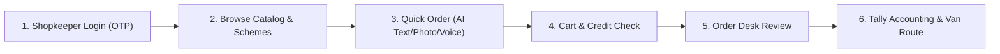

# The Plain-English Non-Technical Guide to IsoLabs

> **Who is this guide for?**  
> Anyone! Whether you are a business owner, an evaluator, an investor, a kirana shopkeeper, or someone without any engineering background, this document explains **what IsoLabs does, why it exists, and how each piece works in plain, everyday language.**

---

## 1. The Story Behind the Problem: The ₹52.5 Lakh Wholesale Headache

Imagine you run **Company A**, a major wholesale distributor in Jabalpur, Madhya Pradesh. Every morning, you deliver packaged groceries, biscuits, soaps, tea, and cooking oils to roughly **600 neighborhood kirana stores** across the city.
- Your business does **₹90 Crore in sales every year** (about ₹30 Lakhs every single day).
- But every day, orders arrive in total chaos: handwritten paper slips, fuzzy WhatsApp voice notes, and messy text messages like:
  > *"bhaiya 5 peti pila wala aur 2 dabba tel kal subah bhej dena urgently"*

Because human clerks have to read or listen to hundreds of these messages every day, three big problems bleed **₹52.5 Lakhs in preventable losses every year**:

```
        THE 3 WAYS MONEY IS LOST EVERY YEAR:
        =====================================
  [1] Wrong Deliveries (5% of orders get messed up)
      9,000 wrong deliveries x ₹350 driver & return cost   = ₹31.5 Lakhs lost
  
  [2] Human Re-Typing Staff (6 office clerks)
      6 clerks x ₹2.6 Lakhs annual salary                 = ₹15.6 Lakhs cost
  
  [3] Post-Booking Stockouts (finding out too late)
      Warehouse out-of-stock after order is already booked  = ₹5.4 Lakhs lost
  ---------------------------------------------------------------------------
  TOTAL LOSS BLEEDING OUT EVERY YEAR:                      = ₹52.5 LAKHS / YEAR
```

**IsoLabs was built to fix this entire mess within 6 weeks on a ₹7 Lakh budget.**

---

## 2. The 9 Everyday Modules Explained in Plain Words

Here is how the entire system works from the moment a shopkeeper wakes up to the moment goods are loaded into the delivery van.



---

### Module 1: Logging In Without Passwords (Phone OTP)
* **How it works:** Kirana shopkeepers do not remember complex email passwords. They simply type their 10-digit mobile number, receive a 6-digit SMS code, and log in with one tap.
* **Why it matters:** It takes less than 5 seconds. If a shopkeeper has slow 3G internet, it still loads in under 3 seconds.
* **Safety feature:** If someone tries to guess the code 3 times, the code self-destructs to prevent unauthorized access.

---

### Module 2: The Digital Price Book & Live Stock (Catalogue)
* **How it works:** Shopkeepers browse everything the distributor sells (Parle-G, Good Day, Ghadi detergent, Wagh Bakri tea, Fortune oil).
* **Clear Pricing:** In India, GST rules can be confusing. The catalog shows both prices clearly:
  - The wholesale price before GST (what the distributor charges).
  - The final price including GST (what the shopkeeper actually pays).
  - The single-pack rate (so the shopkeeper knows their profit margin when selling to neighborhood families).
* **No False Promises:** If an item is out of stock in the warehouse, the button turns red and cannot be ordered. This stops drivers from showing up empty-handed!

---

### Module 3: Trade Schemes & Discounts (The Math Engine)
* **What is a "Scheme"?** In Indian FMCG wholesale, manufacturers offer special deals like *"Buy 10 cases, get 1 free"* or *"Buy 5 or more cases, get 3% off"*.
* **The Problem:** In manual systems, clerks forget to apply schemes or apply the wrong discounts, causing angry arguments between shopkeepers and salesmen.
* **How IsoLabs fixes it:** The system calculates the discount and free goods automatically in real time. If you order 10 cases of Parle-G, a free case is added to your delivery slip with ₹0 price tag automatically.

---

### Module 4: The Kirana Credit Card (Ledger Headroom)
* **The Reality:** Kirana stores don't pay cash on the spot. They buy on credit and pay every 7 to 14 days.
* **The Risk:** If a shopkeeper already owes ₹40,000 on a ₹50,000 credit limit, and orders ₹15,000 worth of oil, they exceed their credit limit.
* **How IsoLabs handles this:**
  - If the order is within credit limit $\to$ it is booked immediately.
  - If the order exceeds the credit limit $\to$ the system does **not** crash or reject the customer rudely. Instead, it places the order on **"Credit Hold"** and sends an alert to the distributor's office desk to approve or request partial payment.

---

### Module 5: Quick Order AI (Text, Voice, and Paper Slips)
* **The Reality:** Busy shopkeepers don't want to tap 50 buttons in a catalog. They want to dictate a voice note or copy-paste their WhatsApp message.
* **What the Engine understands:**
  - **Devanagari Hindi:** `५ पेटी पारले बिस्कुट छोटा` $\to$ understands 5 cases of Parle-G 75g.
  - **Hinglish & Local Words:** `do peti chai`, `chaar peti sabun`, `derh peti good day`.
  - **Regional Nicknames:**
    - *"pila wala"* (the yellow pack) $\to$ Parle-G 75g.
    - *"shakti chai"* $\to$ Tata Tea Gold.
    - *"surajmukhi tel"* $\to$ Fortune Sunflower Refined Oil.
    - *"kapde dhone wala ghadi"* $\to$ Ghadi Detergent Powder.
    - *"bartan bar"* $\to$ Ghadi Detergent Cake.
  - **Local Weights:** `aadha` (0.5), `sawa` (1.25), `derh` (1.5), `dhai` (2.5), `darjan` (12 units).

---

## 3. The "Dabba" Dilemma: Why the System Asks Instead of Guessing

One of the most important rules in IsoLabs is **Invariant [A16]: "Ask, Never Guess"**.

### What does "Dabba" mean?
In Jabalpur and across Madhya Pradesh, the word **"dabba"** (or *dibba*) has three completely different meanings depending on what you are talking about:
1. In cooking oil: 1 *dabba* means a **15-Liter large metal tin**.
2. In biscuits or soaps: 1 *dabba* often means an **inner counter display box** (12 or 24 packets).
3. In wholesale talk: 1 *dabba* can mean a **giant master corrugated carton (case of 96 packs)**.

### The Disaster If You Guess Wrong
If Ramesh Sharma types *"2 dabba parle g pila wala"* and a computer system automatically assumes he meant 2 full master cartons (192 packs), but Ramesh only wanted 2 counter boxes (48 packs):
- The delivery van arrives at his store with 4 times more stock than he ordered.
- Ramesh refuses the delivery at his doorstep.
- The van driver has to bring it all back to the warehouse.
- **The distributor loses ₹350 on wasted fuel, driver turnaround, and restocking costs.**

### The IsoLabs Solution
Instead of guessing, the engine flags `"dabba"` as an **Ambiguous Unit** and shows an instant 1-tap card to the shopkeeper or desk clerk:
> *"Customer wrote 2 dabba. In Jabalpur wholesale, this could mean wholesale master cases (peti) or loose inner boxes. Did you mean 2 Master Cases or 2 Boxes?"*

One tap resolves the ambiguity cleanly, with **zero guesswork and zero wrong deliveries**.

---

## 4. Broken Cases: What Happens When Someone Wants "Loose Packs"?

Wholesale distributors sell sealed cases (e.g., a case of 20 packs of detergent). But sometimes a small village shop only has enough money to buy 15 packs:
> *"detergent powder case of 20 mai se 15 packet dedo"*

If the distributor tears open a sealed case, the loose packets can get crushed or torn inside the delivery truck.

**How IsoLabs handles this (Rule [A36]):**
The engine detects that 15 packets is fewer than a full case of 20. It gives the shopkeeper two crystal-clear choices:
1. **Keep 15 Loose Packs:** Pay the slightly higher single-pack price (₹101.50 per pack).
2. **Upgrade to 1 Full Case (20 packs):** Pay the discounted wholesale case rate and save money per pack.

Both the shopkeeper and the distributor win!

---

## 5. The Office & Logistics Side: What Happens After Booking?

Once an order is confirmed, the magic moves to the distributor's office:

```
  ========================================================================
  STEP 1: ORDER DESK TRIAGE
  The office clerk sees all orders on a live screen. If two clerks open
  the same order at the same second, the system prevents them from
  overwriting each other's work (Optimistic Concurrency Control).
  ========================================================================
                                 |
                                 v
  ========================================================================
  STEP 2: ONE-CLICK TALLY ERP EXPORT
  In legacy offices, 6 clerks sit all day manually re-typing paper bills
  into Tally. With IsoLabs, the clerk clicks "Download Tally XML" and
  imports 100 orders into Tally Prime in 3 seconds flat.
  ========================================================================
                                 |
                                 v
  ========================================================================
  STEP 3: WAREHOUSE PICKING & VAN LOADING MANIFEST
  Warehouse loaders receive a neat printable sheet organized by delivery
  route (e.g., "Van 4 - Napier Town Route"). It lists total cases needed
  and total truck weight in kilograms so vans are never overloaded.
  ========================================================================
                                 |
                                 v
  ========================================================================
  STEP 4: 14-DAY DORMANT KIRANA NUDGES
  If a neighborhood kirana hasn't ordered anything for 14 days, the
  system flags them in yellow or red. The owner can tap one button to
  send a friendly, pre-filled Hindi WhatsApp message to wake them up!
  ========================================================================
```

---

## 6. Why the Engine is in its Own Dedicated Folder (`engine/`)

You might wonder why we separated the engine (`@isolabs/order-engine`) into its own standalone package outside the main website app.

Think of it like building a car:
- The **website app** (`distributor-app`) is the car's body, the steering wheel, the seats, and the dashboard that drivers touch.
- The **order engine** (`engine/`) is the high-performance engine under the hood.

By keeping the engine independent:
1. **Safety:** We can upgrade the artificial intelligence, add Hindi dialect libraries, or change math formulas without risking breaking the login screen or database.
2. **Speed:** The engine runs pure, lightning-fast calculations in under 10 milliseconds without dragging down phone batteries.
3. **Portability:** If the company ever wants to build a dedicated Android native app or a WhatsApp Chatbot in the future, the exact same engine can be plugged in directly with zero rewriting!

---

## 7. Summary Cheat-Sheet: Everyday Terms vs Technical Terms

| What Kirana Owners & Salesmen Say | What Technical Engineers Call It | What It Actually Does |
| :--- | :--- | :--- |
| **"Peti"** | `CASE` unit | A wholesale master box containing 20 to 96 items. |
| **"Pila wala"** | Tier 0 Alias Match | Translates the common slang for yellow Parle-G into `SKU-BS-075`. |
| **"Dabba"** | `AMBIGUOUS_UNIT` | Triggers a question card so we don't accidentally send a giant carton instead of an oil tin or display box. |
| **"Cut pack / mai se dedo"** | Broken Case Guardrail (`[A36]`) | Lets the merchant pick between loose retail packs or rounding up to a full sealed wholesale box. |
| **"Credit Hold"** | Ledger Headroom Guard (`[A14]`) | Stops an order from shipping if the shopkeeper has reached their credit limit. |
| **"Tally Slip"** | Tally Prime XML Sales Voucher | A digital file that feeds orders straight into the accounting software in 1 second. |
| **"Van Sheet"** | Delivery Route Loading Manifest | The printed warehouse list showing exactly how many boxes go into each delivery truck. |

---

*This document is maintained as part of the IsoLabs Build Documentation suite.*
