 # Company A Jabalpur — Distributor Ordering System: Build Blueprint

> **Working document for implementation.** Read, understand, and code directly from this blueprint.  
> Every assumption is labeled with an ID (**A1, A2...**). Cost, savings, and business impact figures are deliberately excluded.

---

## Gaps and Contradictions Found in Draft Spec

Before coding, note the following mismatches between the draft spec (`PS4_Distributor_Complete_Flow_And_Architecture.md`) and the client brief:

1. **Screen Count Inflation:** The draft specified 15 screens. The brief explicitly asks for a **core build of 6 to 8 screens**. Screens like salesman beat routes, out-of-scope ticket desks, van loading sheets, and dormancy dashboards belong to **LATER** modules and must not distract from shipping the core.
2. **Tech Stack Drift:** The draft mentioned Fastify, Vite, and Dexie. The fixed project stack is **Next.js (App Router) + TypeScript + Tailwind CSS + Neon Postgres + Drizzle ORM + `jose` session cookies + Zod + Vitest**.
3. **Database Bloat:** The draft introduced 37 tables with star-schema analytics views. The core build requires only **8 lean tables** (`users`, `retailers`, `skus`, `schemes`, `orders`, `order_lines`, `captures`, `aliases`).
4. **AI Pipeline Inversion:** The draft relied on LLM-first matching. The client brief mandates **rules-first, LLM-second (Gemini), and graceful rules fallback third** behind a single adapter file.
5. **Out-of-Scope Feature Creep:** The draft built a customer support ticketing desk for delivery and payment queries. The core requires capturing orders; non-order text should simply be flagged as unmapped lines, not turned into an internal helpdesk.

---

## 1. What We Are Building

### The Problem in Plain Words
Kirana store owners in Jabalpur order daily from Company A using informal WhatsApp messages: Hindi text, photos of paper lists, or voice notes. Salesmen at the counter do not know live stock or current brand promotional schemes. Office clerks spend hours every morning manually interpreting these messages and typing them into Tally. Stock-outs are discovered after ordering, lines get cut, and wrong items get delivered.

### The Core Solution
An **installable Progressive Web App (PWA)** running on low-end phones over slow 3G. Retailers log in with a **legit mobile SMS OTP**, see live stock status, their exact dealer prices, and active schemes, and can place an order in under 60 seconds. Alternatively, they capture orders via **WhatsApp text, photo of a handwritten list, or a Hindi voice note**; a rules-first AI pipeline maps it to SKUs with confidence chips and unit questions. Nothing is placed until confirmed. The office order desk checks incoming orders side by side with the raw message/audio/photo, manages credit holds, corrects lines (which automatically trains aliases for that retailer), exports clean batches to Tally XML, generates van loading manifests, and tracks retailers with no order in 14 days.

### Strict Constraints & Non-Functional Requirements
- **Low-end phones on slow 3G:** First load under 3 seconds. Critical JS bundle $<90$ KB gzipped. Inline SVGs only, system fonts, aggressive Service Worker caching.
- **Large tap targets:** All touch buttons, steppers, and inputs are $\ge 48\text{ px} \times 48\text{ px}$ with ample spacing for quick one-handed counter use between customers.
- **Bilingual Hindi & English:** Complete interface available in Hindi and English with an instant header toggle (`EN | HI`). Numbers formatted using Indian numbering (`₹12,34,567`).
- **GST Transparency:** Prices state clearly whether GST is included or excluded (e.g. `"₹777.60 / case (₹8.10 / pack) + 18% GST"`). Cart and receipts show an itemized breakdown of taxable value and CGST/SGST.
- **Strict Privacy & Scoping:** A retailer's prices, credit limit, balance, and order history are visible **only to them, their salesman, and the office desk**. Zero cross-shop data leaks.

### Core Architecture: 8 Master Screens (All Must-Have Requirements Covered)

| Screen | Route | Target Role | Primary Capabilities & Brief Requirements Covered |
|---|---|---|---|
| **Screen 1: Login & Install** | `/login` | All | **Legit SMS OTP login** (real SMS gateway, 6-digit cryptographic code, 5-min expiry, rate limiting) + **PWA install prompt** ("Add to Home Screen"). |
| **Screen 2: Retailer Catalogue** | `/catalogue` | Retailer | Fast 3G browsing, live stock chips, retailer tier prices with "+18% GST", scheme banners, 48px steppers, English/Hindi toggle. |
| **Screen 3: Cart & Checkout** | `/cart` | Retailer | Line items, **Scheme Engine live math** (repeating free goods, slab discounts), GST breakdown, credit headroom check, atomic stock reservation. |
| **Screen 4: Multi-Modal AI Capture** | `/capture` | Retailer / Desk | **3-in-1 AI Ingestion**: (1) Paste WhatsApp text, (2) Upload photo of paper list (on-device resize $\le 1000$px + OCR), (3) Record Hindi voice note (Web Audio API). |
| **Screen 5: Capture Review** | `/capture/[id]` | Retailer / Desk | Side-by-side verification: original snippet/transcript, confidence tags (`HIGH`/`MED`/`LOW`), 2 alternative SKUs, **ambiguous unit prompt** ("Case or Pack?"), human confirm. |
| **Screen 6: My Orders & Repeat** | `/orders` | Retailer | Placed order tracking, delivery status, bill receipt download, **1-tap repeat order** with automated price drift detection. |
| **Screen 7: Order Desk Operations** | `/desk` | Order Desk | Central triage: (1) Order queue filters, (2) **Credit hold clearance**, (3) **Tally XML export**, (4) **Van loading list manifests**, (5) **14-day dormant retailers dashboard**. |
| **Screen 8: Desk Verification & Edit** | `/desk/orders/[id]` | Order Desk | Split-view: raw text/photo/voice player on left, editable lines on right. Clerk edits **auto-learn aliases** for that retailer. Optimistic concurrency locking. |

---

## 2. Core Flow, End to End

We follow one retailer through the entire system using the exact sample data from the brief.

### Initial Setup & State
- **Retailer:** Ramesh Sharma, *Sharma Kirana Store* (`RET-0001`), Mobile: `9826000001`, Credit Limit: ₹50,000, Current Outstanding: ₹12,000. Price Tier: `A` (**A11**).
- **Catalogue & Seed Stock:**
  - `SKU-BS-075` (Glucose biscuit 75 g, case of 96): Dealer rate ₹8.10/pack = ₹777.60/case (**A1**). Stock: 340 cases. Scheme: Buy 10 cases get 1 free (**A3**).
  - `SKU-DT-1KG` (Detergent powder 1 kg, case of 20): Dealer rate ₹101.50/pack = ₹2,030.00/case (**A1**). Stock: 85 cases. Scheme: 3% off at 5+ cases (**A4**).
  - `SKU-TE-250` (Tea leaf 250 g, case of 40): Dealer rate ₹118.00/pack = ₹4,720.00/case (**A1**). Stock: 0 cases (Out of Stock). Scheme: None.

---

### Step 1: Login
1. Retailer opens the app on a low-end phone. Enters `9826000001`.
2. Taps **Send OTP**. The system generates mock code `123456` and displays it in a green demo banner (**A13**).
3. Retailer enters `123456` and taps **Verify & Login**.
4. Server validates OTP, sets a signed `jose` session cookie containing `userId`, `role: "retailer"`, and `retailerId: "RET-0001"`.

---

### Step 2: Alternative A — Ordering via Catalogue Taps
1. Retailer navigates to `/catalogue`.
2. Sees Biscuit (`SKU-BS-075`): `₹777.60 / case (₹8.10 / pack) + 18% GST`. Stock chip shows `● In Stock`. Scheme badge: `Buy 10 cases get 1 free`.
3. Retailer uses the 48px stepper to select **10 cases**. The client scheme engine computes live:  
   `10 Paid Cases × ₹777.60 = ₹7,776.00 gross | Free: 1 Case unlocked | Delivered: 11 Cases`.
4. Retailer adds **5 cases** of Detergent (`SKU-DT-1KG`). The client scheme engine computes:  
   `5 Paid Cases × ₹2,030.00 = ₹10,150.00 gross | 3% Slab Discount: -₹304.50 | Net: ₹9,845.50`.
5. Tea (`SKU-TE-250`) displays `✕ Out of Stock`. Stepper is disabled.
6. Retailer taps **View Cart (2 Items)**.

---

### Step 3: Alternative B — Ordering via WhatsApp Text Message
1. Instead of browsing, retailer opens `/capture` and pastes the sample WhatsApp message:  
   `"bhaiya 5 peti biscuit chhota, 2 peti washing powder 1 kilo, chai patti 250 wala 1 peti"`
2. Taps **Process Order Message**.
3. Server executes the rules pipeline:
   - Line 1: `"5 peti biscuit chhota"` $\rightarrow$ qty: 5, unit: `CASE` (`peti`), product: "biscuit chhota". Matches `SKU-BS-075`. Confidence: `HIGH`.
   - Line 2: `"2 peti washing powder 1 kilo"` $\rightarrow$ qty: 2, unit: `CASE`, product: "washing powder 1 kilo". Matches `SKU-DT-1KG`. Confidence: `HIGH`.
   - Line 3: `"chai patti 250 wala 1 peti"` $\rightarrow$ qty: 1, unit: `CASE`, product: "chai patti 250 wala". Matches `SKU-TE-250`. Stock: 0. Flagged: `OUT_OF_STOCK`.
4. Screen redirects to `/capture/[id]`.
5. Retailer reviews lines:
   - Biscuit: 5 cases. Scheme nudge displayed: *"Add 5 more cases to get 1 free case"*.
   - Detergent: 2 cases. Scheme nudge: *"Add 3 more cases for 3% discount"*.
   - Tea: Marked red `Out of Stock`. Line has a checkbox to discard or keep. Retailer removes the out-of-stock tea line.
6. Retailer taps **Confirm & Move to Cart**.

---

### Step 4: Checkout & Order Placement
1. On `/cart`, the cart shows the 2 valid lines:
   - 5 cases Biscuit: Gross ₹3,888.00 (3,88,800 paise), Free: 0, Discount: ₹0.
   - 2 cases Detergent: Gross ₹4,060.00 (4,06,000 paise), Free: 0, Discount: ₹0.
   - **Subtotal:** ₹7,948.00 (7,94,800 paise).
   - **GST (18% illustrative, A2):** ₹1,430.64 (1,43,064 paise).
   - **Final Order Total:** ₹9,378.64 (9,37,864 paise).
2. Credit check: Exposure after order = Current Outstanding (₹12,000) + Order Total (₹9,378.64) = ₹21,378.64. Approved limit is ₹50,000. Status: `OK`.
3. Retailer taps **Place Order**. Client generates `idempotencyKey: "idem_abc123"` and POSTs to `/api/orders`.
4. Server starts a Postgres transaction:
   - Locks stock rows: `SELECT * FROM stock WHERE sku_code IN ('SKU-BS-075', 'SKU-DT-1KG') FOR UPDATE`.
   - Re-runs scheme engine authoritatively. Validates stock: 340 $\ge$ 5, 85 $\ge$ 2.
   - Reserves stock: Biscuit `reserved_cases` becomes 5; Detergent `reserved_cases` becomes 2.
   - Inserts order record with status `PLACED`, snapshotting price, GST, and scheme text.
   - Commits transaction. Returns `orderNo: "ORD-10482"`.
5. Retailer sees `/orders` with status badge `PLACED (Pending Office Confirmation)`.

---

### Step 5: Order Desk Verification & Alias Learning
1. Clerk logs into `/desk`. Sees Order `#ORD-10482` at the top with badge `AI Text`.
2. Clerk clicks **Verify** $\rightarrow$ opens `/desk/orders/ORD-10482`.
3. Split-screen displays:
   - Left side: Original text `"bhaiya 5 peti biscuit chhota..."`.
   - Right side: Interpreted items (`SKU-BS-075` 5 cases, `SKU-DT-1KG` 2 cases).
4. If clerk edits a line (for example, changes an ambiguous item to a specific SKU), the system writes that correction to `aliases` for `RET-0001`. Next time, the rules engine matches it automatically.
5. Clerk clicks **Confirm Order**. Order status updates to `CONFIRMED`.

---

### Step 6: Tally Export
1. At the end of the shift, the clerk on `/desk` selects all `CONFIRMED` orders.
2. Clicks **Export to Tally XML**.
3. Server generates a validated Tally XML document (`VCHTYPE="Sales Order"`, **A9**), grouping line items, party ledger name `"Sharma Kirana Store"`, stock item names, quantities, and rates.
4. Browser downloads `tally-export-20261102.xml`. Orders transition to `EXPORTED`.

---

## 3. Core Screens (BUILT)

### Design & Performance Specifications
- **Palette:** Off-white background (`#F8FAFC`), near-black text (`#0F172A`), single primary accent (`#047857` deep emerald), danger/warning only for errors (`#DC2626`) and low stock (`#D97706`).
- **Typography:** System font stack (`system-ui, -apple-system, sans-serif`). Base 16px. Prices are the boldest numeral on every card.
- **Tap Targets:** All touch targets $\ge 48\text{ px} \times 48\text{ px}$. Stepper buttons are minimum $48\text{ px}$ with clear text spacing.
- **Sub-3s Load on Slow 3G:** Critical JS bundle $<90\text{ KB}$ gzipped. No bloated icon libraries; inline SVG only. Route-level code splitting so desk screens never bundle with retailer views. Local data cached using Next.js route caching and Service Worker shell precaching.

---

### Screen 1: Login & PWA Install (`/login`)
- **Purpose:** Secure, passwordless mobile authentication via legitimate transactional SMS OTP for kirana merchants, with direct PWA home-screen installation.
- **Target Role:** Retailer and Order Desk.

```text
+-------------------------------------------------------------+
|  Company A, Jabalpur                       [ EN | HI ]      |
|                                                             |
|  [ 📲 Install IsoLabs App / होम स्क्रीन पर जोड़ें (48px)   ]  |
|                                                             |
|  Enter Mobile Number / मोबाइल नंबर डालें                     |
|  +-------------------------------------------------------+  |
|  | [+91]  98260 00001                                    |  |
|  +-------------------------------------------------------+  |
|                                                             |
|  [         SEND OTP / ओटीपी प्राप्त करें (48px)          ]  |
|                                                             |
|  ------------------ [ When OTP Sent ] --------------------  |
|  Real SMS dispatched to +91 98260 00001 via SMS Gateway     |
|  (Dev Sandbox: Fixed code 123456 active if DEMO_MODE=true)  |
|                                                             |
|  Enter 6-Digit Verification Code:                           |
|  [ 1 ] [ 2 ] [ 3 ] [ 4 ] [ 5 ] [ 6 ]                        |
|                                                             |
|  [         VERIFY & LOGIN / सत्यापित करें (48px)         ]  |
|                                                             |
|  Resend SMS in 00:45                                        |
+-------------------------------------------------------------+
```

| UI Element | Type | Action / Interaction |
|---|---|---|
| PWA Install Banner | Action Button (48px) | Listens for `beforeinstallprompt` event; triggers native Android / Chrome app install dialog. |
| Language Toggle | Button (`EN / HI`) | Toggles client locale between English and Hindi. |
| Mobile Input | Number field | 10-digit validation. Whitelist check against `users` and `retailers`. |
| Send OTP Button | Primary button (48px) | Calls `/api/auth/otp/send`. Dispatches real SMS via gateway (Fast2SMS / MSG91 / Twilio). |
| 6-Digit Inputs | Numeric boxes | Auto-focuses next digit; auto-submits on 6th digit. |
| Verify Button | Primary button (48px) | Calls `/api/auth/otp/verify`. Checks cryptographic hash; issues signed `jose` cookie. |

- **Real OTP Architecture (Non-Mock Production Implementation):**
  1. *Generation:* 6-digit secure integer via `crypto.randomInt(100000, 999999)`.
  2. *Transmission:* Real HTTP POST to SMS provider API (Fast2SMS / MSG91 / Twilio) using approved DLT template: *"Your Company A login code is {#var#}. Valid for 5 minutes."*
  3. *Storage:* Stored in `otp_requests` table with SHA-256 hash (`crypto.createHash('sha256').update(code + secret).digest('hex')`).
  4. *Expiry & Lockout:* Hard expiry at 5 minutes (`expires_at`). Rate limit: max 3 requests per 10 minutes per IP/mobile. Maximum 3 incorrect verification attempts before code is invalidated.
  5. *Consumption:* Marked `consumed_at = NOW()` immediately upon verification to stop replay attacks.
  6. *Testing Sandbox:* When `DEMO_MODE=true`, code `123456` is accepted for testing without burning SMS credits.
- **Data:** Reads `users` & `retailers`. Writes `otp_requests` and session cookie.

---

### Screen 2: Catalogue (`/catalogue`)
- **Purpose:** Fast browsing of 4 brand catalogues with retailer-specific prices and schemes.
- **Target Role:** Retailer.

```text
+-------------------------------------------------------------+
| [=] Sharma Kirana (RET-0001)             [Cart (2) ₹11,618] |
| Credit: ₹38,000 Avail                    [Language: EN|HI]  |
+-------------------------------------------------------------+
| [Search product / खोजें...                               ]  |
| [All Brands] [Brand A] [Brand B] [Brand C] [Brand D]        |
+-------------------------------------------------------------+
| +---------------------------------------------------------+ |
| | Glucose biscuit 75 g, case of 96                        | |
| | Brand A | Category: Biscuits                            | |
| | Stock: [● In Stock]                                     | |
| | Rate: ₹777.60 / case  (₹8.10 / pack) + 18% GST          | |
| | SCHEME: [★ Buy 10 cases get 1 free]                     | |
| |                                                         | |
| | Quantity:  [- 48px]  [  10  ]  [+ 48px]  cases          | |
| | Benefit:   [ 1 Free Case Unlocked! ]                    | |
| +---------------------------------------------------------+ |
| +---------------------------------------------------------+ |
| | Detergent powder 1 kg, case of 20                       | |
| | Brand B | Stock: [▲ Low: 15 cases]                      | |
| | Rate: ₹2,030.00 / case  (₹101.50 / pack) + 18% GST      | |
| | SCHEME: [★ 3% off at 5+ cases]                          | |
| | Quantity:  [- 48px]  [  4   ]  [+ 48px]  cases          | |
| | Nudge:     (i) Add 1 more case for 3% discount!         | |
| +---------------------------------------------------------+ |
| +---------------------------------------------------------+ |
| | Tea leaf 250 g, case of 40                              | |
| | Brand C | Stock: [✕ Out of Stock]                       | |
| | Rate: ₹4,720.00 / case  (₹118.00 / pack)                | |
| | [ ITEM UNAVAILABLE / स्टॉक समाप्त ]                      | |
| +---------------------------------------------------------+ |
| [STICKY FOOTER]: 2 Items | Total: ₹17,621 + GST  -> [CART]  |
+-------------------------------------------------------------+
```

| UI Element | Type | Action / Interaction |
|---|---|---|
| Search Bar | Text input | Client-side filter on SKU name, category, pack size. |
| Brand Chips | Filter pills | Switches active brand view. |
| Stock Status Chip | Badge | Green (`In Stock`), Amber (`Low Stock`), Red (`Out of Stock`). |
| Quantity Stepper | Stepper (`-`, input, `+`) | 48px buttons. Direct input allowed. Updates local cart state. |
| Scheme Tag | Visual badge | Plain words: "Buy 10 get 1 free" / "3% off at 5+ cases". |
| Nudge Text | Small callout | Live feedback from scheme engine: "Add X more for benefit". |
| Sticky Footer | Bottom bar (48px) | Summarizes active count and opens `/cart`. |

- **States:**
  - *Loading:* Skeleton cards matching exact SKU card heights (no layout shifts).
  - *Empty:* *"No products found matching your search."*
  - *Error:* Offline/retry banner: *"Could not refresh catalogue. Showing cached prices."*
- **Data:** Reads `skus`, `price_list` (filtered by retailer tier), `stock`, `schemes`. Writes `cart_items` in local state.

---

### Screen 3: Cart & Checkout (`/cart`)
- **Purpose:** Review order lines, verify free goods and discounts, and place order.
- **Target Role:** Retailer.

```text
+-------------------------------------------------------------+
| [< Back]  YOUR CART (2 Items)                  [Clear All]  |
+-------------------------------------------------------------+
| Sharma Kirana Store | Credit Headroom: ₹38,000 Available     |
+-------------------------------------------------------------+
| 1. Glucose biscuit 75 g, case of 96                         |
|    Rate: ₹777.60 / case                                     |
|    Qty Paid: [-] [ 10 ] [+] cases                           |
|    Free Goods: [ +1 Case Free Unlocked ]                    |
|    Line Total: ₹7,776.00                                    |
|                                                             |
| 2. Detergent powder 1 kg, case of 20                        |
|    Rate: ₹2,030.00 / case                                   |
|    Qty Paid: [-] [  5 ] [+] cases                           |
|    Scheme Discount: [ 3% Applied: -₹304.50 ]                |
|    Line Total: ₹9,845.50                                    |
+-------------------------------------------------------------+
| ORDER BILL DETAILS                                          |
| Subtotal (Gross):                        ₹17,926.00         |
| Scheme Discounts:                       - ₹  304.50         |
| Taxable Value:                           ₹17,621.50         |
| GST (18% illustrative, A2):              ₹ 3,171.87         |
| ----------------------------------------------------------- |
| TOTAL TO PAY:                            ₹20,793.37         |
| Free Goods Total:                        1 Case (Delivered: 11 cs)
| Total Savings:                           ₹1,082.10          |
+-------------------------------------------------------------+
| [✓] Credit Approved: ₹20,793 within ₹38,000 credit limit    |
|                                                             |
| [      PLACE ORDER / आर्डर बुक करें (₹20,793.37) (48px)     ] |
+-------------------------------------------------------------+
```

| UI Element | Type | Action / Interaction |
|---|---|---|
| Line Steppers | Controls | Adjusts cases; re-runs scheme engine live. |
| Free Goods Tag | Chip | Shows exact free case count to be delivered. |
| Bill Breakdown | Summary table | Clear lines: Subtotal, Scheme Discount, Taxable, GST, Total. |
| Credit Check Box | Status banner | Green if within limit; amber with hold notice if over limit. |
| Place Order Button | Primary button (48px) | Generates `idempotencyKey` and posts order to `/api/orders`. |

- **States:**
  - *Loading:* Spinner on checkout submission. Button disabled to stop double clicks.
  - *Empty:* *"Your cart is empty. Return to catalogue to add items."*
  - *Error:* Over-stock or concurrency error: *"Stock changed. Only 8 cases available."*
  - *Success:* Transitions to `/orders` with confirmation toast.
- **Data:** Reads `cart_items`, `stock`, `credit_accounts`. Writes `orders`, `order_lines`, reserves `stock`.

---

### Screen 4: Multi-Modal AI Quick Order Capture (`/capture`)
- **Purpose:** Ingest messy WhatsApp order inputs via (1) Text Message paste, (2) Photo of handwritten paper list, or (3) Hindi Voice note recording.
- **Target Role:** Retailer and Order Desk (on behalf of retailer).

```text
+-------------------------------------------------------------+
| [< Back]           QUICK ORDER / मैसेज से आर्डर              |
+-------------------------------------------------------------+
| Choose Order Input Method / आर्डर का तरीका चुनें:           |
| [  [T] PASTE TEXT  ]  [  [P] PHOTO OF LIST  ]  [  [V] VOICE  ]|
+-------------------------------------------------------------+
| [TEXT TAB ACTIVE]:                                          |
| Paste WhatsApp order message or type list here:             |
| +---------------------------------------------------------+ |
| | bhaiya 5 peti biscuit chhota,                           | |
| | 2 peti washing powder 1 kilo,                           | |
| | chai patti 250 wala 1 peti                              | |
| +---------------------------------------------------------+ |
|                                                             |
| [PHOTO TAB PREVIEW]:                                        |
| [ 📷 Take Photo of Parchi / Gallery Upload (Max 1MB)     ]  |
| (On-device resize to <= 1000px for instant 3G upload)       |
|                                                             |
| [VOICE TAB PREVIEW]:                                        |
| [ 🎙 Press & Hold to Record Hindi Note (Max 30s)         ]  |
| "भैया 5 पेटी बिस्कुट छोटा, 2 पेटी वाशिंग पाउडर 1 किलो..."   |
|                                                             |
| [    PROCESS WITH AI & REVIEW DRAFT / आर्डर प्रोसेस करें    ] |
+-------------------------------------------------------------+
```

| UI Element | Type | Action / Interaction |
|---|---|---|
| Input Method Tabs | Segmented Control | Switches between Text Paste, Photo Upload, and Hindi Voice Recording. |
| Message Textarea | Multi-line text box | Accepts raw Hindi/English text. Min height 140px. |
| Photo Upload Button | File picker / Camera | Captures parchi; client-side canvas compresses image to $\le 1000$px; calls Gemini Vision OCR. |
| Voice Record Button | Press-and-hold button (48px) | Uses Web Audio API to record up to 30s of Hindi audio; calls Gemini Audio transcription. |
| Process Button | Primary button (48px) | Extracts text from text/photo/voice, runs rules pipeline, and redirects to `/capture/[id]`. |

- **Multi-Modal Adapter Logic:**
  - *Photo of handwritten list:* Client-side Canvas resizes image to $<1000$px (reducing payload from 5MB to $\sim 150$KB for 3G upload). Server sends image to Gemini Vision OCR $\rightarrow$ returns extracted Hindi/English text.
  - *Hindi voice note:* Recorded as `.webm` audio in browser $\rightarrow$ server sends audio to Gemini Audio $\rightarrow$ returns transcribed Hindi text.
  - *Shared SKU Pipeline:* Regardless of whether input was text, photo, or voice, the extracted text flows into the exact same SKU mapping and rules disambiguation pipeline!
- **States:**
  - *Loading:* *"Reading items and checking schemes..."* with progress bar.
  - *Empty:* Textarea empty; button disabled.
  - *Error:* Red alert: *"Please enter text, upload a clear photo, or record a voice note."*
- **Data:** Writes `captures` table (`raw_text`, `media_key`, `extracted_text`, status `DRAFT`).

---

### Screen 5: Capture Review & Disambiguation (`/capture/[id]`)
- **Purpose:** Review AI-parsed lines, answer unit questions, pick alternatives, and confirm.
- **Target Role:** Retailer and Order Desk.

```text
+-------------------------------------------------------------+
| [< Edit Message]          REVIEW PARSED ORDER               |
| Raw: "bhaiya 5 peti biscuit chhota, 2 peti washing..."      |
+-------------------------------------------------------------+
| LINE 1: "5 peti biscuit chhota"                             |
| Matched SKU: Glucose biscuit 75 g (SKU-BS-075)              |
| Quantity:    5 Cases (peti)                                 |
| Confidence:  [● HIGH (94%)]                                 |
| Alternatives: (o) Glucose 75g  ( ) Marie 100g  ( ) Crackers |
+-------------------------------------------------------------+
| LINE 2: "2 peti washing powder 1 kilo"                      |
| Matched SKU: Detergent powder 1 kg (SKU-DT-1KG)             |
| Quantity:    2 Cases                                        |
| Confidence:  [● HIGH (98%)]                                 |
+-------------------------------------------------------------+
| LINE 3: "chai patti 250 wala 1 peti"                        |
| Matched SKU: Tea leaf 250 g (SKU-TE-250)                    |
| Status:      [✕ OUT OF STOCK (0 cases available)]           |
| Action:      [✓] Discard line  [ ] Keep as note             |
+-------------------------------------------------------------+
| [?] AMBIGUITY CHECK (If unit had been "packet"):            |
| "Did you mean 1 Case (40 packs) or 1 Single Pack?"          |
| [ Option A: 1 Case ]          [ Option B: 1 Pack ]          |
+-------------------------------------------------------------+
| Estimated Total (Available items): ₹7,948.00 + GST          |
|                                                             |
| [    CONFIRM & PROCEED TO CART / आर्डर आगे बढ़ाएं (48px)    ] |
+-------------------------------------------------------------+
```

| UI Element | Type | Action / Interaction |
|---|---|---|
| Original Words Tag | Highlight label | Shows exact snippet of text for that line. |
| Matched SKU Dropdown | Selector | Pre-selected to top match; allows picking alternative. |
| Confidence Chip | Chip | Green (`HIGH`), Amber (`MEDIUM`), Red (`LOW`). |
| Alternative Radios | Radio buttons | 2 alternatives required by brief. |
| Unit Question Card | Interactive modal/box | Unclear units asked, never guessed (**A6**). |
| Out of Stock Alert | Red warning | Tea shown clearly as 0 stock; not silently dropped. |
| Confirm Button | Primary button (48px) | Disabled until all ambiguous lines are resolved. |

- **States:**
  - *Loading:* Initial fetch of `/api/captures/[id]`.
  - *Unresolved Questions:* Confirm button locked with count: *"1 question pending"*.
  - *All Clear:* Confirm button unlocked.
- **Data:** Reads `captures`, `capture_lines`. Writes resolved lines to `cart_items` or `orders`.

---

### Screen 6: My Orders & Repeat Order (`/orders`)
- **Purpose:** History of placed orders, live status tracking, and 1-tap reordering.
- **Target Role:** Retailer.

```text
+-------------------------------------------------------------+
| [=] MY ORDERS                                     [Filter]  |
+-------------------------------------------------------------+
| +---------------------------------------------------------+ |
| | Order #ORD-10482  -  Today, 11:30 AM                    | |
| | Source: [AI Message]     Status: [● PLACED]             | |
| | Items: 10 cs Glucose Biscuit, 5 cs Detergent            | |
| | Total: ₹20,793.37 (Includes 1 Free Case Biscuit)        | |
| | Delivery: Expected Tomorrow                             | |
| |                                                         | |
| | [ View Receipt / पर्ची ]      [ REPEAT ORDER / दोबारा ]  | |
| +---------------------------------------------------------+ |
|                                                             |
| [REPEAT ORDER CONFIRMATION MODAL (If prices changed)]:      |
| +---------------------------------------------------------+ |
| | Price Notice: Detergent rate changed:                   | |
| | Old: ₹100.00/pack -> New: ₹101.50/pack (+₹150.00 total)  | |
| | [ CANCEL ]              [ ACCEPT & ADD TO CART ]        | |
| +---------------------------------------------------------+ |
+-------------------------------------------------------------+
```

| UI Element | Type | Action / Interaction |
|---|---|---|
| Order Cards | Card list | Order number, timestamp, source badge (`App` / `AI Message`). |
| Status Chip | Badge | `PLACED` (blue), `HELD_CREDIT` (amber), `CONFIRMED` (green). |
| Repeat Order Button | Button (48px) | Checks current catalogue prices and loads items into cart. |
| Price Diff Modal | Modal | Shows price diff before confirming repeat order. |

- **States:**
  - *Loading:* List skeletons.
  - *Empty:* *"No past orders found."*
- **Data:** Reads `orders`, `order_lines`. Writes re-priced lines to `cart_items`.

---

### Screen 7: Order Desk Central Operations (`/desk`)
- **Purpose:** Central high-speed operations dashboard for office clerks to triage orders, release/reject credit holds, export batches to Tally XML, generate van loading route manifests, and track 14-day dormant kirana stores.
- **Target Role:** Order Desk and Owner.

```text
+-------------------------------------------------------------------------------------------------------------+
| COMPANY A, JABALPUR — ORDER DESK OPERATIONS                                 [User: Sunil Clerk | Role: Desk]|
+-------------------------------------------------------------------------------------------------------------+
| TABS: [ (1) Orders Queue (412) ] [ (2) Credit Holds (4) ] [ (3) Van Loading Lists ] [ (4) Dormant (14 Days) ]|
+-------------------------------------------------------------------------------------------------------------+
| [TAB 1: ORDERS QUEUE & FILTERS ACTIVE]                                                                      |
| Filters: [All (412)] [Needs Review (14)] [Credit Hold (4)] [Confirmed (392)] [Exported (0)]                 |
| Order ID  | Retailer / Shop Name | Area        | Source   | Lines | Total (₹)  | Status       | Action      |
|-----------|----------------------|-------------|----------|-------|------------|--------------|-------------|
| ORD-10482 | Sharma Kirana        | Napier Town | AI Text  | 2     |  20,793.37 | PLACED       | [VERIFY]    |
| ORD-10483 | Gupta General Store  | Wright Town | App      | 4     |  32,450.00 | HELD_CREDIT  | [RELEASE]   |
| ORD-10484 | City Provision Mart  | Madan Mahal | AI Voice | 3     |  14,200.00 | CONFIRMED    | [VIEW]      |
|                                                                                                             |
| BATCH ACTION: [ EXPORT CONFIRMED ORDERS TO TALLY XML (392) ]                                                |
+-------------------------------------------------------------------------------------------------------------+
| [TAB 2: CREDIT HOLD CLEARANCE QUEUE]                                                                        |
| Retailer: Gupta General Store (RET-0002) | Limit: ₹30,000 | Outstanding: ₹29,000 | Order: ₹4,500 | Over: ₹3,500|
| Justification: [ Customer promised cash payment on van delivery ▼ ]  Authorized By: [ Owner / Ramesh ▼ ]    |
| Action: [ RELEASE HOLD (Allow Order) ]   [ REJECT ORDER (Send Over-Limit Notice) ]                          |
+-------------------------------------------------------------------------------------------------------------+
| [TAB 3: VAN LOADING MANIFESTS (Warehouse Route Dispatch)]                                                   |
| Select Route: [ Route 2: Napier Town & Wright Town (114 Orders) ▼ ]                                         |
| WAREHOUSE PICK LIST (Aggregated Cases to Load onto Van):                                                    |
| - Glucose Biscuit 75 g (SKU-BS-075):  240 Paid Cases + 24 Scheme Free Cases = 264 Total Cases               |
| - Detergent Powder 1 kg (SKU-DT-1KG): 110 Paid Cases = 110 Total Cases                                      |
|                                                                                                             |
| VAN DROP-OFF SEQUENCE (Route Order):                                                                        |
| Stop 1: Sharma Kirana Store (RET-0001) - 11 Cases (10 Paid + 1 Free Biscuit)                                |
| Stop 2: Gupta General Store (RET-0002) - 5 Cases Detergent                                                  |
| [ PRINT WAREHOUSE LOADING SHEET (PDF) ]        [ PRINT DRIVER DELIVERY CHALLANS ]                           |
+-------------------------------------------------------------------------------------------------------------+
| [TAB 4: 14-DAY DORMANT RETAILERS RETENTION DASHBOARD]                                                       |
| 84 Kirana Shops with no orders in >= 14 days (Churn Risk):                                                  |
| - Agrawal Provision (Manoj Agrawal, 9826099881, Napier Town) - Inactive: 18 days | Avg Order: ₹14,500       |
|   Action: [ 📞 Call Shopkeeper ]   [ 💬 1-Tap WhatsApp Re-order Nudge with Today's Biscuit Scheme ]         |
| - Mahavir Kirana (Sunil Jain, 9425111223, Wright Town) - Inactive: 21 days | Avg Order: ₹22,000             |
|   Action: [ 📞 Call Shopkeeper ]   [ 💬 1-Tap WhatsApp Re-order Nudge with Today's Detergent Scheme ]       |
+-------------------------------------------------------------------------------------------------------------+
```

| UI Element | Type | Action / Interaction |
|---|---|---|
| Section Tabs | Tab control | Switches between Orders Queue, Credit Holds, Van Loading Lists, and Dormant Retailers. |
| Status Filter Tabs | Buttons | Filters list by `NEEDS_REVIEW`, `HELD_CREDIT`, `CONFIRMED`. |
| Queue Table | Data table | Sortable by timestamp, amount, error flag. Dense desktop layout. |
| Verify Button | Action button | Opens `/desk/orders/[id]` for split-screen verification. |
| Tally Export Button | Primary button | Triggers XML batch download of all `CONFIRMED` orders formatted for TallyPrime. |
| Van Route Selector | Dropdown | Selects van delivery beat; aggregates total cases for warehouse loading. |
| 1-Tap Nudge Button | Action button | Pre-populates WhatsApp chat message to dormant retailer with current brand schemes. |

- **States:**
  - *Loading:* Table row skeletons.
  - *Empty:* *"All clear. No orders waiting for review."*
- **Data:** Reads `orders`, `retailers`, `order_lines`. Writes `orders.status`, `credit_holds`, `tally_exports`.

---

### Screen 8: Desk Verification & Alias Learning (`/desk/orders/[id]`)
- **Purpose:** Side-by-side view of original message vs parsed lines; desk corrections teach aliases.
- **Target Role:** Order Desk.

```text
+-------------------------------------------------------------------------------------------------------------+
| VERIFY ORDER #ORD-10482  —  Sharma Kirana (RET-0001)                                      [Back to Queue]   |
+-------------------------------------------------------------------------------------------------------------+
| ORIGINAL MESSAGE RECEIVED:                   | STRUCTURED ORDER LINES:                                      |
| "bhaiya 5 peti biscuit chhota,               | +----------------------------------------------------------+ |
| 2 peti washing powder 1 kilo,                | | 1. Glucose biscuit 75 g (SKU-BS-075)                      | |
| chai patti 250 wala 1 peti"                  | | Qty: [ 5 ] cases | Free: 0 | Rate: ₹777.60/cs            | |
|                                              | | Confidence: [ HIGH 94% ]                                 | |
|                                              | +----------------------------------------------------------+ |
|                                              | | 2. Detergent powder 1 kg (SKU-DT-1KG)                     | |
| Retailer Credit: ₹38,000 OK                  | | Qty: [ 2 ] cases | Free: 0 | Rate: ₹2,030.00/cs          | |
| Placed At: 11:30 AM via AI Text              | | Confidence: [ HIGH 98% ]                                 | |
|                                              | +----------------------------------------------------------+ |
|                                              | | 3. [✕ REMOVED] Tea leaf 250 g (Out of Stock)              | |
|                                              | +----------------------------------------------------------+ |
+-------------------------------------------------------------------------------------------------------------+
| Desk Correction / Learning Note:                                                                            |
| Changing an item SKU maps this phrase for Sharma Kirana permanently.                                        |
|                                                                                                             |
| [ REJECT ORDER ]          [ RELEASE CREDIT HOLD ]          [ SAVE & CONFIRM ORDER (₹7,948.00 + GST) ]       |
+-------------------------------------------------------------------------------------------------------------+
```

| UI Element | Type | Action / Interaction |
|---|---|---|
| Split-Pane View | Dual panel | Left: raw message text. Right: editable SKU rows. |
| SKU Dropdown | Combobox | Allows changing matched SKU. Updates `aliases` table. |
| Quantity Inputs | Numeric box | Allows correcting misread case counts. |
| Confirm Button | Primary button | Transitions order to `CONFIRMED`. Ready for export. |
| Release Hold Button| Secondary button | Releases credit hold with logged reason. |

- **States:**
  - *Conflict State:* If another clerk edited the order concurrently, optimistic lock warns: *"Order modified by clerk Sunil. Reloading latest."* (**A10**).
- **Data:** Reads `orders`, `order_lines`, `captures`. Writes `order_lines`, `aliases`, `orders.status`.

---

## 4. Scheme Engine (The Hard Part)

### Rules Stated Plainly
The scheme engine is a pure, deterministic function. It takes items, prices, and scheme rules, and outputs money, free goods, and explanatory notes. It has no network, database, or clock dependencies.
- **Rule 1 (Free Goods):** "Buy $X$ cases get $Y$ cases free". Repeating (**A3**): $\text{free} = \lfloor \text{paidCases} / X \rfloor \times Y$. Free cases are delivered at ₹0. Free cases consume physical warehouse stock (**A5**).
- **Rule 2 (Slab Discount):** "3% off at 5+ cases". Applied to all cases of that SKU once paid cases $\ge 5$ (**A4**): $\text{discount} = \text{round}(\text{gross} \times \text{pct} / 100)$.
- **Rule 3 (GST Calculation):** GST is calculated on the **net discounted amount**, not on gross (**A2**).
- **Rule 4 (Integer Paise):** All calculations are executed in integer paise. No floating-point math. $₹1.00 = 100\text{ paise}$.

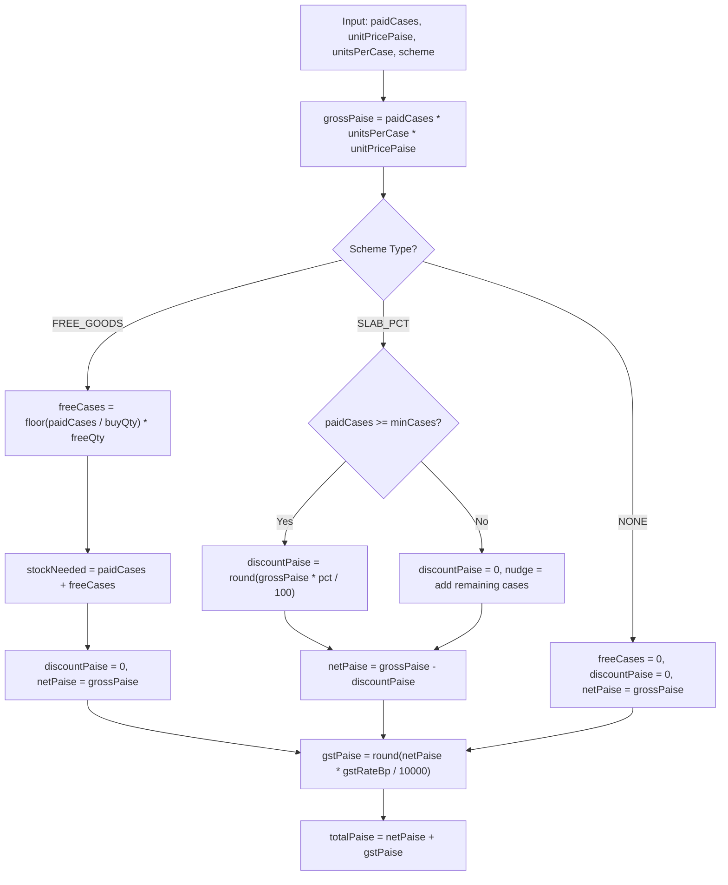

### Function Signature
```typescript
export interface LineInput {
  skuCode: string;
  qtyPaidCases: number;
  unitPricePaise: number;   // Dealer price per pack (excl. GST)
  unitsPerCase: number;
  gstRateBp: number;        // Basis points (1800 = 18%)
  scheme?: 
    | { type: 'FREE_GOODS'; buyQty: number; freeQty: number; repeat: boolean }
    | { type: 'SLAB_PCT'; minCases: number; discountPct: number };
}

export interface LineOutput {
  grossPaise: number;
  freeCases: number;
  totalDeliverCases: number;
  discountPaise: number;
  netPaise: number;
  gstPaise: number;
  totalPaise: number;
  explanation: string;
  nudge?: string;
}
```

### Verified Test Matrix (Vitest Reference)

| SKU Code | Pack Rate | Units/Cs | Case Rate | Paid Cases | Scheme Rule | Gross (₹) | Free Cs | Discount (₹) | Net (₹) | GST 18% (₹) | Total Line (₹) |
|---|---|---|---|---|---|---|---|---|---|---|---|
| `SKU-BS-075` | ₹8.10 | 96 | ₹777.60 | 10 | Buy 10 get 1 | ₹7,776.00 | **1** | ₹0.00 | ₹7,776.00 | ₹1,399.68 | **₹9,175.68** |
| `SKU-BS-075` | ₹8.10 | 96 | ₹777.60 | 9 | Buy 10 get 1 | ₹7,002.00 | **0** | ₹0.00 | ₹7,002.00 | ₹1,260.36 | **₹8,262.36** |
| `SKU-BS-075` | ₹8.10 | 96 | ₹777.60 | 25 | Buy 10 get 1 | ₹19,440.00| **2** | ₹0.00 | ₹19,440.00| ₹3,499.20 | **₹22,939.20**|
| `SKU-DT-1KG` | ₹101.50 | 20 | ₹2,030.00| 5 | 3% off at 5+ | ₹10,150.00| **0** | ₹304.50 | ₹9,845.50 | ₹1,772.19 | **₹11,617.69**|
| `SKU-DT-1KG` | ₹101.50 | 20 | ₹2,030.00| 4 | 3% off at 5+ | ₹8,120.00 | **0** | ₹0.00 | ₹8,120.00 | ₹1,461.60 | **₹9,581.60** |
| `SKU-TE-250` | ₹118.00 | 40 | ₹4,720.00| 1 | None | ₹4,720.00 | **0** | ₹0.00 | ₹4,720.00 | ₹849.60 | **₹5,569.60** |

*Edge Case: Stock check must verify that `stock.available >= paidCases + freeCases`. For 10 cases of biscuits, warehouse must have $\ge 11$ cases.*

---

## 5. AI Order Capture

The pipeline runs entirely server-side behind a single adapter file (`lib/ai/capture.ts`). Users never touch or enter API keys.

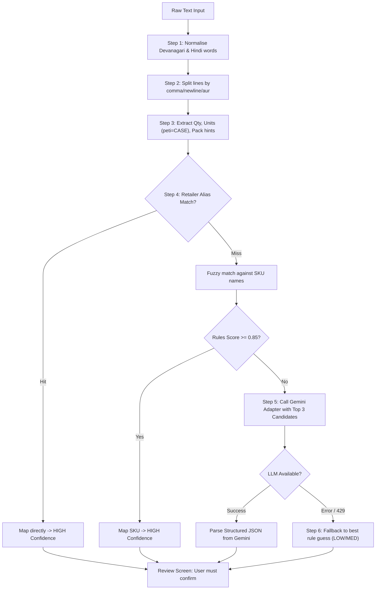

### Step-by-Step Pipeline
1. **Normalisation:** Convert Devanagari digits (१, २, ३) to ASCII. Lowercase. Remove filler words ("*bhaiya*", "*bhai*", "*shri*", "*please*", "*ji*").
2. **Line Splitting:** Split by `\n`, `,`, `aur`, `tatha`, `+`.
3. **Extraction & Unit Detection:**
   - Look for numbers (digits or Hindi words: *ek*, *do*, *teen*, *char*, *paanch*, *dus*).
   - Unit tokens: `peti`, `case`, `carton`, `box` map to `CASE`.
   - Pack tokens: `packet`, `piece`, `pcs` map to `PIECE`.
   - Size hints: `1 kilo`, `1kg`, `250 g`, `250 wala`, `chhota`, `bada`. *Crucial: `250 wala` is a pack hint for `SKU-TE-250`, not a quantity.*
4. **Candidate Retrieval & Alias Match:**
   - Check `aliases` table for `(retailer_id, phrase)` first, then global aliases. An alias hit produces `HIGH` confidence.
   - Boost SKUs the retailer has ordered in the past.
5. **Gemini LLM Call (Conditional):**
   - If rules confidence $< 0.85$, send line to Gemini (`gemini-1.5-flash` via env var).
   - Prompt contains **only** the single line text and a list of 5 candidate SKU codes/names. Returns strict JSON: `{ skuCode, qty, unit, confidence }`.
6. **Graceful Fallback:**
   - If `GEMINI_API_KEY` is missing, times out, or returns HTTP 429, the pipeline skips the LLM and outputs the top rule-based match with a `Rules Fallback` flag. The app never crashes.
7. **Ambiguous Units (The Guardrail):**
   - If unit is `PIECE` or missing ("*bhaiya 5 biscuit chhota*"), the line is flagged `question_type: "UNIT"`.
   - The UI blocks order confirmation and displays: *"Did you mean 5 Cases (480 packs) or 5 Single Packs?"*.
8. **Desk Alias Learning:**
   - When an order desk clerk changes a line from SKU $X$ to SKU $Y$, the system automatically writes an alias: `aliases(retailer_id, phrase, sku_code = Y)`. Next time that retailer uses that phrase, it resolves to $Y$ with `HIGH` confidence.

---

## 6. Data Model: Categorized into Schema A and Schema B

The data architecture is strictly divided into two distinct halves:
- **Schema A (Input & Transaction Data):** What users enter into the system — the messy raw texts, photos of slips, Hindi voice notes, AI draft interpretations, carts, placed orders, and snapshots.
- **Schema B (Distributor & Master Data):** What the distributor/owner maintains — the SKU catalogue, brand/pack masters, dealer price lists per tier, promotional scheme rules, stock levels, retailer accounts, and credit limits.

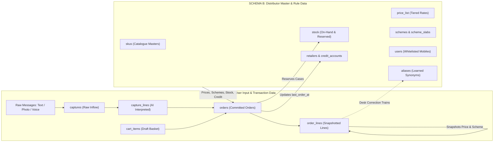

---

### 6.1 Schema A: User Input & Transaction Data (User-Generated)

Holds everything that originates from the retailer or desk user. Append-oriented and immutable once confirmed.

#### Table A1: `captures` (Raw User Inflow)
Stores the raw input exactly as received before any processing.
- `id` (uuid, PK): Internal capture ID (`CAP-2031`).
- `retailer_id` (uuid, FK $\rightarrow$ `retailers`): Who sent the message.
- `channel` (enum: `TEXT`, `PHOTO`, `VOICE`): Input channel.
- `raw_text` (text): Exact text pasted or typed. Never modified.
- `media_key` (text, nullable): S3/storage path for uploaded photo or voice audio file.
- `extracted_text` (text, nullable): OCR transcription from photo or speech-to-text from voice.
- `status` (enum: `DRAFT`, `CONFIRMED`, `DISCARDED`): Capture lifecycle.
- `created_at` (timestamptz): Timestamp received.

#### Table A2: `capture_lines` (AI Interpreted Lines)
The structured breakdown produced by the rules/LLM pipeline before human confirmation.
- `id` (uuid, PK): Line ID.
- `capture_id` (uuid, FK $\rightarrow$ `captures`): Parent capture.
- `line_no` (integer): Order of the line in the message.
- `original_words` (text): Exact phrase snippet (e.g. `"5 peti biscuit chhota"`).
- `qty` (integer): Detected quantity (e.g. `5`).
- `unit_detected` (enum: `CASE`, `PIECE`, `UNKNOWN`): Detected packaging unit.
- `unit_resolved` (enum: `CASE`, `PIECE`): User-confirmed unit after ambiguity check.
- `sku_code` (text, FK $\rightarrow$ `skus`, nullable): Best-matched SKU.
- `confidence_level` (enum: `HIGH`, `MEDIUM`, `LOW`): Measured confidence tag.
- `alt_sku_1` (text, FK $\rightarrow$ `skus`, nullable): First alternative SKU suggestion.
- `alt_sku_2` (text, FK $\rightarrow$ `skus`, nullable): Second alternative SKU suggestion.
- `question_type` (enum: `UNIT`, `PRODUCT`, null): What must be resolved before placing.
- `out_of_stock` (boolean): Flagged if available stock is 0.

#### Table A3: `cart_items` (User Draft Basket)
Ephemeral basket saved per retailer across browser sessions.
- `retailer_id` (uuid, FK $\rightarrow$ `retailers`): Basket owner.
- `sku_code` (text, FK $\rightarrow$ `skus`): Product code.
- `qty_cases` (integer): Cases selected via stepper.
- `updated_at` (timestamptz): Last touch timestamp.
- *Primary Key:* `(retailer_id, sku_code)`.

#### Table A4: `orders` (Committed Placed Orders)
The authoritative commercial transaction.
- `id` (uuid, PK): Internal UUID.
- `order_no` (text, unique): Human-readable identifier (e.g. `ORD-10482`).
- `retailer_id` (uuid, FK $\rightarrow$ `retailers`): Ordering shop.
- `source` (enum: `APP`, `AI_TEXT`, `AI_PHOTO`, `AI_VOICE`, `DESK`, `REPEAT`): Attribution.
- `capture_id` (uuid, FK $\rightarrow$ `captures`, nullable): Link to raw message for 100% traceability.
- `status` (enum: `PLACED`, `HELD_CREDIT`, `CONFIRMED`, `EXPORTED`, `CANCELLED`): State machine.
- `subtotal_paise` (bigint): Gross order amount before discounts.
- `discount_paise` (bigint): Total scheme discounts applied.
- `taxable_paise` (bigint): Net taxable value.
- `gst_paise` (bigint): GST amount (18% illustrative).
- `total_paise` (bigint): Final payable invoice total.
- `free_cases_total` (integer): Sum of all free promotional cases to deliver.
- `credit_limit_snapshot` (bigint): Retailer credit limit at time of placement.
- `outstanding_snapshot` (bigint): Retailer balance at time of placement.
- `hold_reason` (text, nullable): Explanation if placed on credit hold.
- `idempotency_key` (text, unique): Client-generated UUID preventing duplicate submits.
- `version` (integer, default 1): Optimistic locking concurrency counter for desk edits.
- `placed_at` (timestamptz): Timestamp submitted.
- `confirmed_at` (timestamptz, nullable): Timestamp approved by desk.
- `export_batch_id` (text, nullable): Link to Tally XML export batch.

#### Table A5: `order_lines` (Order Line Snapshots)
Write-once snapshot of every item. Old orders never mutate when master prices or schemes change.
- `id` (uuid, PK): Line UUID.
- `order_id` (uuid, FK $\rightarrow$ `orders`): Parent order.
- `line_no` (integer): Sequential line item index.
- `sku_code` (text, FK $\rightarrow$ `skus`): Product code.
- `sku_name_snapshot` (text): SKU name frozen at time of order.
- `units_per_case_snapshot` (integer): Case pack size frozen at time of order.
- `tally_item_name_snapshot` (text): Exact Tally stock item name.
- `qty_paid_cases` (integer): Invoiced cases.
- `qty_free_cases` (integer): Free bonus cases under scheme.
- `unit_price_paise` (bigint): Dealer pack price applied (in paise).
- `gross_paise` (bigint): Paid cases $\times$ units/case $\times$ pack price.
- `discount_paise` (bigint): Scheme discount amount in paise.
- `net_paise` (bigint): Gross minus discount.
- `gst_paise` (bigint): GST on net amount.
- `total_paise` (bigint): Net plus GST.
- `scheme_snapshot` (text): Plain-text rule applied (e.g. `"Buy 10 get 1 free"`).
- `original_text` (text, nullable): Original customer wording copied from AI capture.
- `ai_confidence` (text, nullable): Confidence rating at capture time.
- `edited_by_desk` (boolean, default false): Flagged if office clerk manually changed SKU/qty.

---

### 6.2 Schema B: Distributor & Master Data (Distributor-Maintained)

Maintained by Company A's management via seed scripts or daily CSV uploads. Governs business logic.

#### Table B1: `retailers` & `credit_accounts` (Customer Master)
- `id` (uuid, PK): Retailer UUID.
- `retailer_code` (text, unique): Readable code (`RET-0001`).
- `shop_name` (text): Registered business name (e.g. *Sharma Kirana Store*).
- `owner_name` (text): Proprietor name (e.g. *Ramesh Sharma*).
- `mobile` (text, unique): Whitelisted phone number allowed to request OTP.
- `area` (text): Geographic beat sector (e.g. *Napier Town*, *Wright Town*, *Madan Mahal*).
- `price_tier` (text, default 'A'): Assigned pricing tier (`A`, `B`, `C`).
- `credit_limit_paise` (bigint): Approved credit limit in paise (e.g. `5000000` = ₹50,000).
- `outstanding_paise` (bigint): Current ledger balance from Tally in paise (e.g. `1200000` = ₹12,000).
- `tally_ledger_name` (text): Exact matching account ledger in Tally.
- `last_order_at` (timestamptz, nullable): Updated by system on every order; drives 14-day dormancy.
- `active` (boolean, default true): Soft-delete flag.

#### Table B2: `users` (Access & Roles)
- `id` (uuid, PK): User UUID.
- `mobile` (text, unique): Login mobile number.
- `name` (text): Individual user name.
- `role` (enum: `retailer`, `desk`): RBAC role gating.
- `retailer_id` (uuid, FK $\rightarrow$ `retailers`, nullable): Linked shop (NULL for office desk staff).
- `active` (boolean, default true): Account status.

#### Table B3: `skus` (Product Catalogue Master)
- `code` (text, PK): Stock code (e.g. `SKU-BS-075`).
- `name` (text): Full name (e.g. *"Glucose biscuit 75 g, case of 96"*).
- `brand` (text): Brand name (e.g. *Brand A*).
- `category` (text): Product category (e.g. *Biscuits*, *Detergent*, *Tea*).
- `pack_label` (text): Pack size descriptor (e.g. `'75 g'`, `'1 kg'`, `'250 g'`).
- `units_per_case` (integer): Multiplier per case (`96`, `20`, `40`).
- `dealer_price_paise` (bigint): Wholesale rate per pack in paise excluding GST (e.g. `810` = ₹8.10).
- `gst_rate_bp` (integer): GST in basis points (e.g. `1800` = 18%).
- `stock_cases` (integer): Total physical cases on hand in warehouse.
- `reserved_cases` (integer, default 0): Cases committed to placed/confirmed orders.
- `low_threshold_cases` (integer, default 20): Level triggering `"Low Stock"` amber chip.
- `tally_item_name` (text): Exact stock item string expected by Tally XML import.
- `active` (boolean, default true): Visibility flag.
- *Computed Field:* `available_cases = stock_cases - reserved_cases`.

#### Table B4: `schemes` (Distributor Trade Promotion Rules)
- `id` (uuid, PK): Scheme UUID.
- `sku_code` (text, FK $\rightarrow$ `skus`): Targeted product.
- `type` (enum: `FREE_GOODS`, `SLAB_PCT`): Promotional mechanism.
- `buy_qty` (integer, nullable): Cases to buy for free goods (e.g. `10`).
- `free_qty` (integer, nullable): Free cases awarded (e.g. `1`).
- `repeat` (boolean, default true): Whether benefit repeats (`20` cases $\rightarrow$ `2` free).
- `min_cases` (integer, nullable): Slab threshold (e.g. `5`).
- `discount_pct` (numeric, nullable): Slab percentage off (e.g. `3.00`).
- `display_text` (text): Plain-language summary (e.g. `"Buy 10 cases get 1 free"`).
- `active` (boolean, default true): Promotion status.

#### Table B5: `aliases` (Machine Learning Knowledge Base)
Synonym dictionary connecting informal Hindi/slang phrases to master SKU codes.
- `id` (uuid, PK): Alias UUID.
- `retailer_id` (uuid, FK $\rightarrow$ `retailers`, nullable): Nullable. NULL = global synonym; populated = specific retailer preference.
- `phrase_normalized` (text): Cleaned search string (e.g. `"biscuit chhota"`, `"chai patti"`).
- `sku_code` (text, FK $\rightarrow$ `skus`): Mapped catalog item.
- `confirmed_count` (integer, default 1): Number of times confirmed by desk/retailer.
- `created_at` (timestamptz): Creation timestamp.

#### Table B6: `tally_exports` (ERP Export Audit Ledger)
- `batch_id` (text, PK): Export batch code (e.g. `EXP-20261102`).
- `voucher_type` (text, default 'Sales Order'): Tally voucher classification.
- `order_count` (integer): Total orders bundled into batch.
- `total_paise` (bigint): Total financial value exported.
- `file_name` (text): Export filename generated.
- `exported_at` (timestamptz): Export execution timestamp.
- `exported_by` (uuid, FK $\rightarrow$ `users`): Clerk who triggered export.

---

### 6.3 How Schema A and Schema B Connect

1. **A reads B at Order Time:** The retailer or desk opens the app; Schema A views read active items, prices, schemes, stock, and credit ceilings from Schema B.
2. **A Snapshots B at Placement:** When an order is submitted, `order_lines` (A) makes an immutable copy of SKU name, units per case, pack price, GST rate, and scheme text from Schema B. Future updates to Schema B (e.g. price rises or scheme expirations) never affect previously placed orders.
3. **A Writes to B in Two Places Only:**
   - **Stock Reservation:** A placed order increments `skus.reserved_cases` (B) atomically.
   - **Dormancy Timestamp:** A placed order updates `retailers.last_order_at = NOW()` (B).
4. **Desk Corrections in A Feed Schema B:** When an order desk clerk changes a line item in an AI draft (A), the system inserts or increments an entry in `aliases` (B). Future orders from that shop automatically match with `HIGH` confidence.

---

### 6.4 Query, Filter, Sort & Backtrack Matrix

This matrix verifies that every operation required by the brief is directly supported by indexes on Schema A and B:

| Operation / Use Case | Schema | Target Tables | Query / Filter Expression | Index Required |
|---|:---:|---|---|---|
| **Catalogue Search & Filter** | B | `skus`, `schemes` | `WHERE brand = :brand AND category = :cat AND active = TRUE` | `idx_skus_brand_cat` |
| **Retailer Price Resolution** | B | `retailers`, `skus` | Scoped by session `retailer_id` $\rightarrow$ resolved to retailer's `price_tier` | Primary Key lookups |
| **Stock Availability Check** | B | `skus` | `WHERE (stock_cases - reserved_cases) >= :needed` | `code` PK |
| **Low-Stock Alert Chip** | B | `skus` | `WHERE (stock_cases - reserved_cases) <= low_threshold_cases` | Computed in query |
| **Credit Headroom Calculation** | A + B | `orders`, `retailers` | `credit_limit_paise - (outstanding_paise + SUM(uninvoiced orders))` | `idx_orders_ret_status` |
| **Idempotency Protection** | A | `orders` | `WHERE idempotency_key = :key` | `UNIQUE(idempotency_key)` |
| **Desk Queue: Needs Review** | A | `orders` | `WHERE source IN ('AI_TEXT','AI_PHOTO','AI_VOICE') AND status = 'PLACED'` | `idx_orders_status_src` |
| **Desk Queue: Credit Holds** | A | `orders` | `WHERE status = 'HELD_CREDIT' ORDER BY placed_at ASC` | `idx_orders_status_date` |
| **Desk Queue: Ready to Export** | A | `orders` | `WHERE status = 'CONFIRMED' AND export_batch_id IS NULL` | `idx_orders_export_ready` |
| **Optimistic Concurrency Edit** | A | `orders` | `WHERE id = :id AND version = :expectedVersion` | `id` PK + `version` check |
| **Alias Auto-Learning Lookup** | B | `aliases` | `WHERE phrase_normalized = :phrase AND (retailer_id = :retId OR retailer_id IS NULL) ORDER BY confirmed_count DESC` | `idx_aliases_phrase_ret` |
| **Desk Line Error Metric** | A | `order_lines` | `SELECT SUM(CASE WHEN edited_by_desk THEN 1 ELSE 0 END)::float / COUNT(*) FROM order_lines` | `idx_orderlines_edited` |
| **14-Day Dormancy Dashboard** | B | `retailers` | `WHERE last_order_at < NOW() - INTERVAL '14 days' AND active = TRUE ORDER BY last_order_at ASC` | `idx_ret_last_order` |
| **1-Tap Repeat Order Lookup** | A + B | `order_lines`, `skus` | Fetches lines from past `order_id`, compares snapshot price to current `skus.dealer_price_paise` | `idx_orderlines_orderid` |

---

### 6.5 The Complete Backtrack Chain (Full Traceability)

Every order number can be audited backward to the raw message or forward to Tally export:

```text
Tally XML Export File (batch_id: "EXP-20261102")
   │
   └─► orders.order_no: "ORD-10482"
         ├─► Source: "AI_TEXT" | Placed By: Retailer Ramesh Sharma | At: 11:30 AM
         ├─► Idempotency Key: "idem_abc123" (Stops double-billing)
         ├─► Version: 2 (Optimistic lock audit)
         │
         ├─► captures (id: "CAP-2031")
         │     ├─► Channel: TEXT
         │     └─► Raw Inflow: "bhaiya 5 peti biscuit chhota, 2 peti washing powder 1 kilo..."
         │
         ├─► capture_lines (Line 1)
         │     ├─► Original Snippet: "5 peti biscuit chhota"
         │     ├─► Detected: qty 5, unit CASE (peti)
         │     ├─► AI Confidence: HIGH (94%)
         │     └─► Alternatives Evaluated: SKU-BS-100 (Marie), SKU-BS-050 (Crackers)
         │
         ├─► order_lines (Line 1)
         │     ├─► Snapshot SKU: SKU-BS-075 (Glucose biscuit 75 g, case of 96)
         │     ├─► Snapshot Price: ₹8.10 / pack (₹777.60 / case)
         │     ├─► Delivered: 5 Paid Cases + 0 Free Cases
         │     ├─► Snapshot Scheme: "Buy 10 cases get 1 free"
         │     └─► Desk Edited Flag: FALSE (Match accepted as-is)
         │
         └─► Credit Snapshot at Placement
               ├─► Limit: ₹50,000.00
               ├─► Balance Before: ₹12,000.00
               └─► Balance After Order: ₹21,378.64 (Within limit -> Status PLACED)
```

---

## 7. Rules and Safeguards

### Order Status State Machine
Valid transitions only:
- `PLACED` $\rightarrow$ `CONFIRMED` $\rightarrow$ `EXPORTED`
- `PLACED` $\rightarrow$ `CANCELLED`
- `PLACED` $\rightarrow$ `HELD_CREDIT` $\rightarrow$ (Desk Release) $\rightarrow$ `CONFIRMED`
- `HELD_CREDIT` $\rightarrow$ (Desk Reject) $\rightarrow$ `CANCELLED`

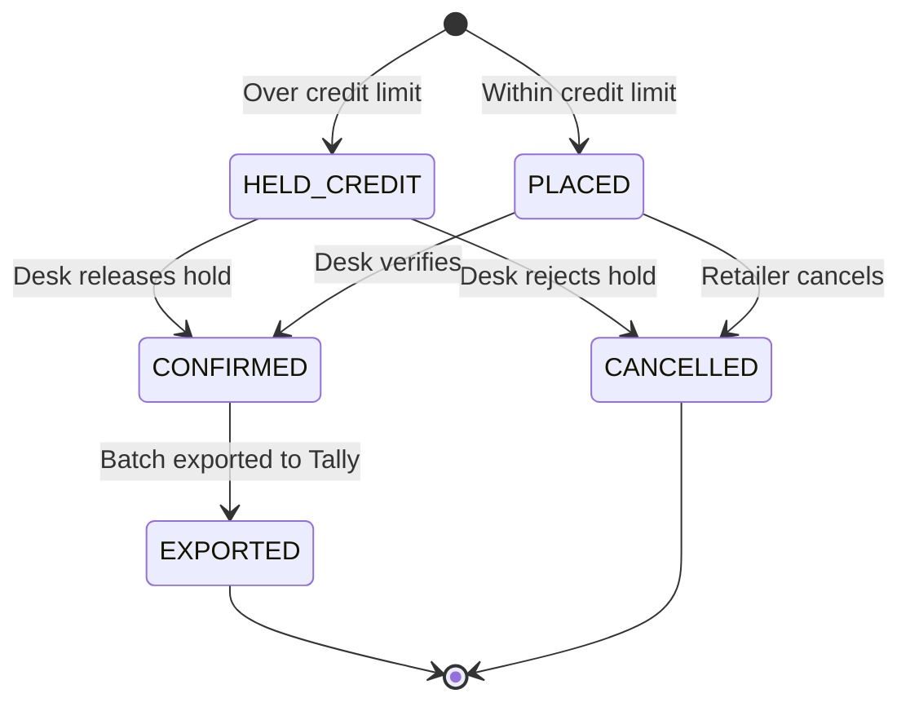

### Stock & Credit Checks
- **Atomic Stock Reservation:** Check occurs in a single PostgreSQL transaction:
  `UPDATE skus SET reserved_cases = reserved_cases + :needed WHERE code = :code AND (stock_cases - reserved_cases) >= :needed`. If 0 rows update, transaction rolls back and returns stockout error.
- **Credit Exposure Formula:** $\text{exposure} = \text{outstanding\_paise} + \text{sum}(\text{uninvoiced placed orders}) + \text{current order total}$. If $\text{exposure} > \text{credit\_limit}$, order status is set to `HELD_CREDIT`. The order is not rejected; it queues for desk approval (**A7**).

### Duplicate Order Protection (Idempotency)
- Checkout requests include an `idempotency_key` (UUID created on screen load).
- If a shopkeeper double-taps on slow 3G, the second request hits the unique database index on `orders.idempotency_key` and returns the existing order safely without charging or reserving twice.

### Scoping & Permissions (Who Sees What)

| Role | Catalogue Rates | Stock Cases | Credit Limit & Balance | Orders Visible | Tally Export |
|---|---|---|---|---|---|
| **Retailer** | Own Tier Price only | Status chip only (In/Low/Out) | Own credit only | Own orders only | No access |
| **Salesman** (Later) | Assigned Shops | Exact case numbers | Assigned Shops only | Assigned Shops | No access |
| **Order Desk** | All tiers | Exact case numbers | All Retailers | All Orders | Full Export |

*Security Rule: `retailerId` is always extracted from the verified session cookie, never trusted from query parameters or request bodies.*

---

## 8. Assumptions List

Every assumption is explicitly cataloged with an ID and reason. Items from the draft not found in the brief are flagged.

| ID | Assumption | Rationale | Flagged from Draft |
|---|---|---|---|
| **A1** | "Dealer Price ₹" in sample data is **per pack (unit)**, not per case. | Biscuit case has 96 packs. ₹8.10/pack $\times 96 = ₹777.60$/case. A per-case price of ₹8.10 would make an average ₹5,000 order mathematically impossible in FMCG distribution. | Baseline Brief Clarification |
| **A2** | Dealer prices are **exclusive of GST**. | Indian FMCG wholesale prices are quoted net. 18% GST (1800 bp) is applied illustratively as an example rate to satisfy "GST shown clearly". | **Illustrative rate not in brief** |
| **A3** | "Buy 10 get 1 free" is **repeating**. | Standard FMCG distribution rule: 20 cases get 2 free. Only paid cases count toward qualifying threshold. | Standard Trade Practice |
| **A4** | 3% off on 5+ cases applies to **all cases** once threshold is met. | Common FMCG slab structure: 5 cases of detergent get 3% off the entire gross ₹10,150. | Configurable Trade Policy |
| **A5** | Free promotional goods **consume physical warehouse stock**. | 10 paid + 1 free biscuit requires 11 cases physically leaving the Jabalpur warehouse. Reserved cases must cover both. | Physical Fulfillment Reality |
| **A6** | Unclear units are **asked, never guessed**. | If retailer writes "5 biscuit", system prompts: "5 Cases or 5 Packs?". A case is 96 units; an automated guess would cause 96x over-shipment. | Mandated in Brief |
| **A7** | Credit exposure includes uninvoiced active orders. | Exposure = current Tally balance + pending placed orders. Prevents multiple concurrent orders exceeding credit ceiling. | Standard Risk Control |
| **A8** | Outside systems (SMS, Tally, payments) are **mocked**. | In demo mode, fixed OTP `123456` logs in. Tally exports a clean downloadable XML file rather than attempting an HTTP post to a live port. | Mandated in Brief |
| **A9** | Tally export voucher type defaults to **`Sales Order`**. | E-invoicing and financial ledger accounting remain in Tally; the app exports sales orders for warehouse dispatch. | Standard ERP Workflow |
| **A10** | Optimistic concurrency locking via `version` column. | Prevents 2 desk clerks verifying the 600-order morning rush from overwriting each other's edits. | Engineering Safeguard |
| **A11** | Retailers have price tiers (A, B, C). | Brief says "sees his price". Seed data sets default tier A. | **Tier construct not in brief** |
| **A12** | All business dates follow Indian Standard Time (IST). | Single-region Jabalpur business operations. | Standard Regional Rule |
| **A13** | Mock OTP banner displayed in UI. | Allows evaluation and testing without actual SMS telecom provider integration. | Developer Experience |
| **A14** | Fictional company branding and area names. | Napier Town, Wright Town, Madan Mahal used for Jabalpur route realism. | **Fictional area names** |

---

## 9. Diagrams

### 1. System Overview
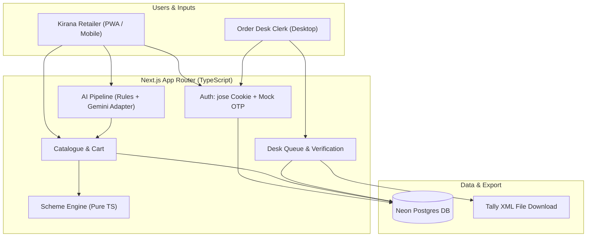

### 2. Screen Map (BUILT vs LATER)
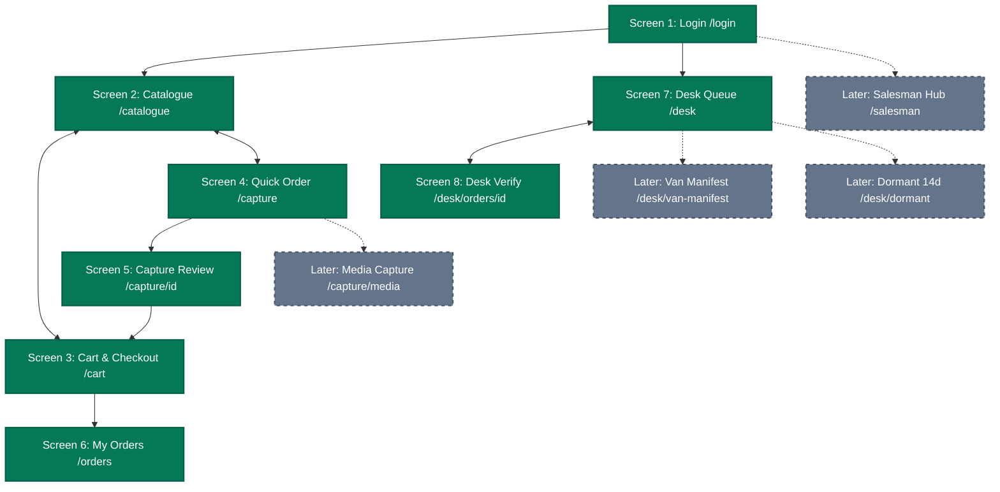

### 3. Sequence Diagrams (Clicks to Transitions & Error Flows)

#### Sequence Diagram 1: Mobile OTP Login & Session Dispatch (`/login`)
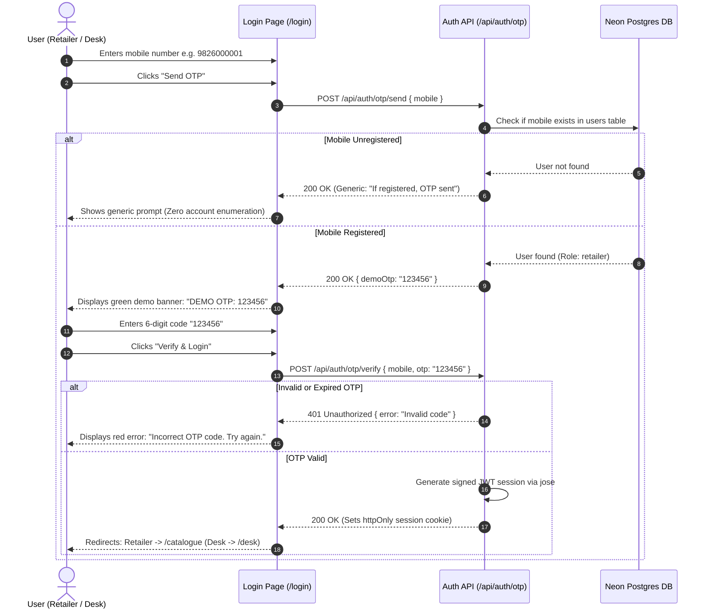

#### Sequence Diagram 2: Catalogue Browsing, Live Scheme Stepper & Cart Sync (`/catalogue`)
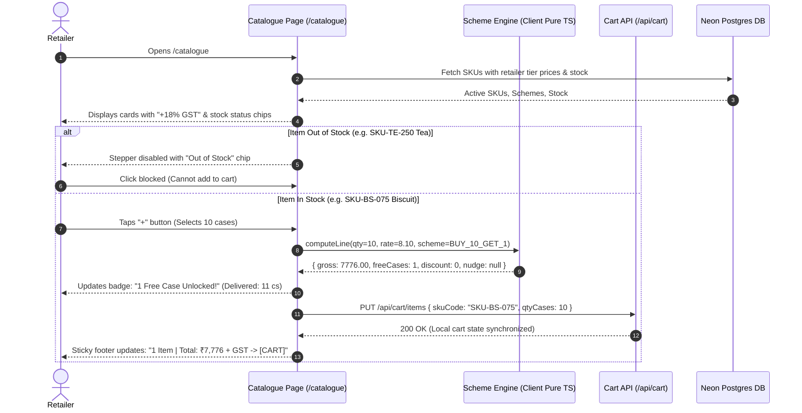

#### Sequence Diagram 3: Order Placement, Atomic Stock Locking, Credit Limit & Idempotency (`/cart`)
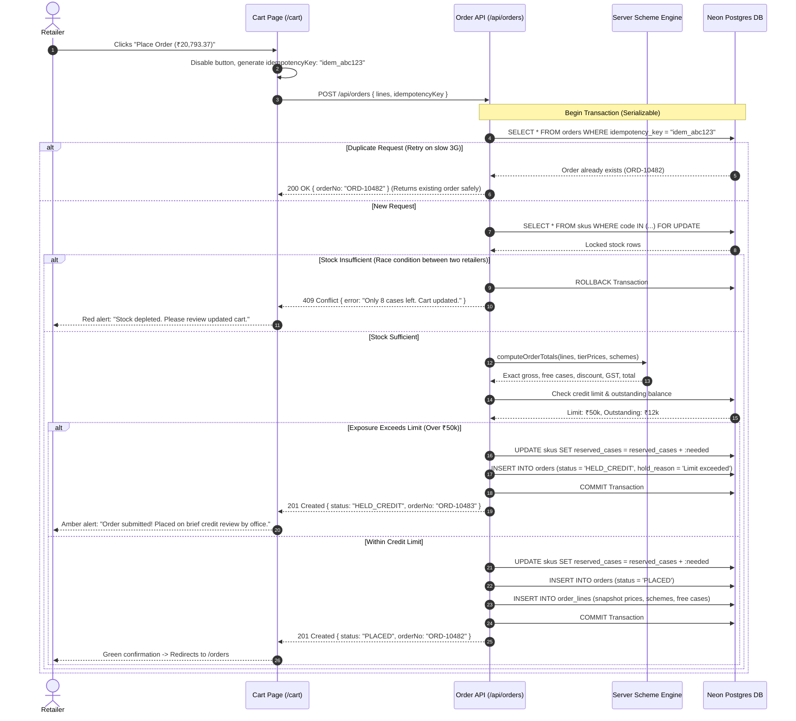

#### Sequence Diagram 4: AI WhatsApp Text Capture, Gemini Adapter, Fallback & Unit Disambiguation (`/capture`)
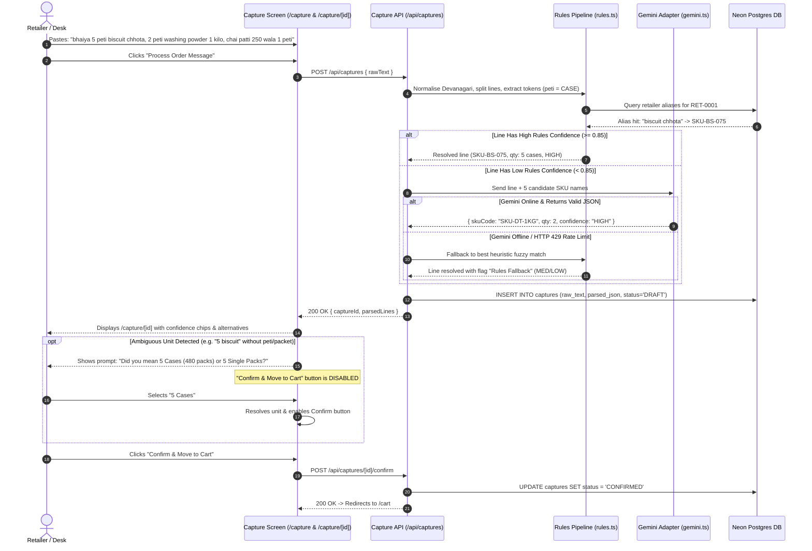

#### Sequence Diagram 5: Order Desk Verification, Line Correction & Auto-Alias Learning (`/desk/orders/[id]`)
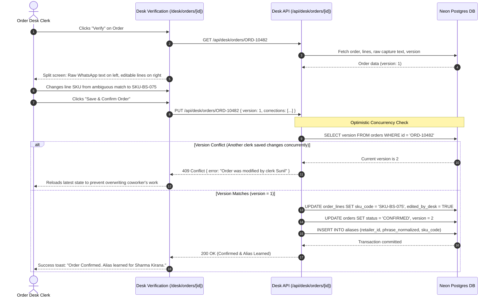

#### Sequence Diagram 6: Tally XML Batch Export (`/desk`)
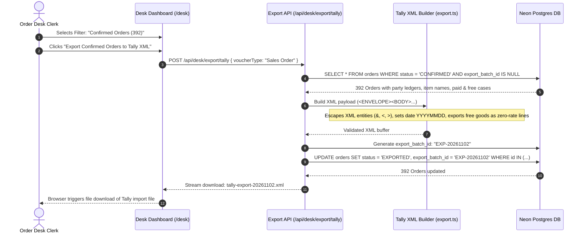

---

## 10. BUILD MODULES

Organized in strict build order. Keep code grouped logically in minimal, readable files.

---

### Module 1: Project Setup, Database Schema & Seed Data
- **Purpose:** Next.js project skeleton, Neon Postgres connection, Drizzle schema, and seed script containing sample data.
- **Files to Create:**
  - `src/lib/db/schema.ts` — Drizzle definitions for 8 core tables (`users`, `retailers`, `skus`, `schemes`, `orders`, `order_lines`, `captures`, `aliases`).
  - `src/lib/db/index.ts` — Neon client pool and Drizzle ORM instance.
  - `src/lib/db/seed.ts` — Standalone script populating sample SKUs (`SKU-BS-075`, `SKU-DT-1KG`, `SKU-TE-250`), schemes, retailer `RET-0001`, and desk user.
  - `drizzle.config.ts` — Drizzle migration configuration.
- **Checklist:**
  - [ ] Tables use integer paise for money (`bigint`).
  - [ ] Seed data exactly matches the client brief rates and stock numbers.
  - [ ] Seed creates test retailer `9826000001` (Ramesh Sharma) and desk user `9826000000`.
- **Done Criteria:** Running `npm run db:seed` executes cleanly and inspects 3 SKUs and 1 retailer in Neon console.

---

### Module 2: Pure Scheme Engine + Vitest Tests
- **Purpose:** Core business calculator for free goods and slab discounts. Pure TypeScript, zero external dependencies.
- **Files to Create:**
  - `src/lib/engine/scheme.ts` — Functions `computeLine()` and `computeOrderTotals()`.
  - `src/lib/engine/scheme.test.ts` — Comprehensive Vitest test suite.
- **Checklist:**
  - [ ] Implements repeating free goods: `floor(paid / buy) * free`.
  - [ ] Implements slab discount on all cases when paid $\ge$ threshold.
  - [ ] Calculates GST on net discounted value in integer paise.
  - [ ] Generates plain English/Hindi benefit nudges.
- **Done Criteria:** Running `npx vitest run src/lib/engine` passes all 6 verified matrix cases with 100% assertion accuracy.

---

### Module 3: Auth, Legit SMS OTP & PWA Installability
- **Purpose:** Production-ready passwordless mobile authentication via a real SMS Gateway (Fast2SMS / MSG91 / Twilio), cryptographic OTP generation, secure hashing, and PWA installability with native "Add to Home Screen" support.
- **Files to Create:**
  - `src/lib/auth/session.ts` — Signed JWT session handling using `jose` (`createSession`, `getSession`, `requireRole`).
  - `src/lib/auth/sms.ts` — Real SMS gateway adapter (Fast2SMS / MSG91 / Twilio) sending DLT-approved transactional SMS.
  - `src/app/api/auth/otp/send/route.ts` — Route handler checking mobile whitelist, generating 6-digit crypto code, storing SHA-256 hash in `otp_requests` with 5-minute expiry and rate-limiting (max 3 per 10 mins).
  - `src/app/api/auth/otp/verify/route.ts` — Route handler verifying OTP hash, consuming token, and issuing secure session cookie.
  - `public/manifest.json` — PWA manifest (`display: "standalone"`, icons 192/512, maskable, `theme_color: "#047857"`).
  - `src/app/login/page.tsx` — Login UI with mobile input, 6-digit OTP fields, and PWA install prompt button.
- **Checklist:**
  - [ ] Real SMS sent via gateway in production; sandbox mock code `123456` enabled only when `DEMO_MODE=true`.
  - [ ] OTPs hashed at rest with SHA-256; expires in 5 minutes; max 3 verification failures.
  - [ ] Web App Manifest validates as installable PWA on Android Chrome.
  - [ ] Session cookie is `httpOnly`, `SameSite=Strict`, `Secure`.
- **Done Criteria:** Entering registered mobile dispatches real SMS OTP; app presents native install banner on Chrome mobile.

---

### Module 4: Catalogue & Cart
- **Purpose:** Fast mobile browsing of catalogue with live scheme steppers, GST transparency, and cart review.
- **Files to Create:**
  - `src/app/api/catalogue/route.ts` — Returns SKUs with retailer-tier prices, live stock status, and active schemes.
  - `src/app/catalogue/page.tsx` — Catalogue UI with brand filters, search, 48px steppers, "+18% GST" labels, and sticky bottom cart bar.
  - `src/app/cart/page.tsx` — Cart UI with line item breakdown, scheme savings, GST summary, and credit check.
- **Checklist:**
  - [ ] Prices match tier rate per case and per pack, explicitly marked "+ 18% GST".
  - [ ] Steppers immediately run client-side scheme preview.
  - [ ] Tea (`SKU-TE-250`) is disabled with `Out of Stock` badge.
  - [ ] Cart shows transparent breakdown: Subtotal, Scheme Discount, Taxable, GST, Total.
- **Done Criteria:** Adding 10 biscuit cases unlocks 1 free case live in cart; adding 5 detergent cases shows 3% discount deducted.

---

### Module 5: Order Placement & Rules
- **Purpose:** Server-side order checkout with atomic stock reservation, credit hold checks, and idempotency protection.
- **Files to Create:**
  - `src/app/api/orders/route.ts` — `POST` handler executing transaction: row-locking stock, computing scheme totals, checking credit limit, inserting order.
  - `src/app/orders/page.tsx` — Order confirmation receipt and past order history list.
  - `src/app/api/orders/[id]/repeat/route.ts` — Loads past order items into cart after checking current catalogue prices.
- **Checklist:**
  - [ ] Stock reserved via `SELECT ... FOR UPDATE` covering paid + free cases.
  - [ ] If exposure exceeds credit limit, status is set to `HELD_CREDIT`. Otherwise `PLACED`.
  - [ ] Snapshots exact prices, GST, and scheme text onto `order_lines`.
  - [ ] Rejects duplicate requests with identical `idempotencyKey`.
- **Done Criteria:** Placing order reserves 10 biscuit cases in DB (`reserved_cases = 10`), returns `ORD-10482`, and shows status `PLACED`.

---

### Module 6: Multi-Modal AI Capture (Text, Photo of List, Hindi Voice)
- **Purpose:** Ingest orders from (1) WhatsApp text paste, (2) Photos of handwritten lists with on-device compression, or (3) Hindi voice notes, mapping to SKUs with confidence chips and unit questions.
- **Files to Create:**
  - `src/lib/ai/rules.ts` — Text normalizer, unit tokenizer (`peti` $\rightarrow$ `CASE`), and SKU matcher with past order weighting.
  - `src/lib/ai/gemini.ts` — Gemini 1.5 Flash adapter for OCR on photo slips, audio transcription on Hindi voice notes, and structured JSON disambiguation.
  - `src/app/api/captures/route.ts` — Accepts text, image file, or audio blob; extracts text; runs rules/Gemini pipeline; creates `captures` record.
  - `src/app/capture/page.tsx` — Multi-modal capture UI with Text, Photo Upload (Canvas compressed $\le 1000$px), and Hindi Voice recording tabs.
  - `src/app/capture/[id]/page.tsx` — Review screen displaying original words/transcript, matched SKUs, confidence tags, and unit questions.
- **Checklist:**
  - [ ] Correctly parses text sample into 5 cs Biscuit, 2 cs Detergent, 1 cs Tea (Out of Stock).
  - [ ] Photo upload resizes on device to $<1000$px before sending to Gemini Vision OCR.
  - [ ] Web Audio API records up to 30s Hindi audio for Gemini transcription.
  - [ ] If unit is missing/packet, presents 48px radio options (*Case vs Pack*); blocks confirmation until answered.
- **Done Criteria:** Submitting text, photo, or Hindi voice note populates review screen with identical structured draft lines.

---

### Module 7: Order Desk Operations (Credit Holds & Alias Auto-Learning)
- **Purpose:** Office queue to review orders, resolve credit holds, and auto-learn aliases from clerk corrections.
- **Files to Create:**
  - `src/app/desk/page.tsx` — Central operations hub with tabs: Orders Queue, Credit Holds, Van Loading Lists, and 14-Day Dormant Retailers.
  - `src/app/desk/orders/[id]/page.tsx` — Split-view verification: raw message/audio on left, editable parsed lines on right.
  - `src/app/api/desk/orders/[id]/route.ts` — Handler to edit lines, release credit holds, or confirm order.
- **Checklist:**
  - [ ] Desk line corrections automatically insert a new learned row into `aliases`.
  - [ ] Releasing a credit hold transitions order from `HELD_CREDIT` to `CONFIRMED` with logged reason.
  - [ ] Optimistic locking check: rejects save if `version` has incremented.
- **Done Criteria:** Changing a matched item on an order saves the edit, transitions order to `CONFIRMED`, and creates a retailer alias.

---

### Module 8: Tally XML Export & Van Loading Route Manifests
- **Purpose:** Generate clean, validated XML batches of confirmed orders for Tally import, and compile aggregated warehouse pick lists by van route.
- **Files to Create:**
  - `src/lib/tally/export.ts` — Generates Tally-compliant `<ENVELOPE>` XML payload with XML-escaped entities and zero-rated free goods.
  - `src/app/api/desk/export/tally/route.ts` — Streams XML download and marks orders as `EXPORTED`.
  - `src/app/api/desk/export/van-manifest/route.ts` — Aggregates total paid and free cases per SKU grouped by delivery route and driver drop sequence.
- **Checklist:**
  - [ ] Sets `<VOUCHER VCHTYPE="Sales Order" ACTION="Create">` with formatted dates `YYYYMMDD`.
  - [ ] Free goods exported as zero-rate quantity lines.
  - [ ] Van loading sheet groups cases by route (e.g. Route 2 Napier Town) with aggregated picking totals and stop order.
- **Done Criteria:** Clicking Export downloads valid Tally XML; clicking Van Manifest displays warehouse picking totals and drop sequence.

---

### Module 9: 14-Day Dormant Retailers Retention Dashboard & Design System
- **Purpose:** Track dormant kirana shops to prevent churn, provide 1-tap WhatsApp scheme reorder nudges, enforce $\ge 48$px tap targets, and ensure sub-3s 3G loads.
- **Files to Create:**
  - `src/app/api/desk/dormant/route.ts` — Queries `retailers` where `last_order_at < NOW() - INTERVAL '14 days'`.
  - `src/components/DormantRetailersTab.tsx` — UI showing shop name, owner, mobile, assigned salesman, days dormant, and 1-tap WhatsApp reorder button.
  - `src/app/globals.css` — Tailwind base styles, typography hierarchy, high-contrast focus rings, 48px touch targets.
  - `src/components/LanguageToggle.tsx` — Header toggle between English and Hindi.
  - `src/lib/i18n.ts` — Key-value dictionary for English and Hindi UI labels.
- **Checklist:**
  - [ ] Dormant dashboard correctly identifies shops inactive for $\ge 14$ days with 1-tap WhatsApp link.
  - [ ] Critical bundle size verified $<90\text{ KB}$ gzipped.
  - [ ] Every touch target verified $\ge 48\text{ px}$.
  - [ ] Hindi labels verified against card layouts with zero text clipping.
- **Done Criteria:** Lighthouse audit confirms first load under 3 seconds on slow 3G; dormant dashboard lists inactive shops.

---

### LATER Modules (Kept Separate)

#### Module 10: LLM Adapter (Gemini) added to AI Pipeline
- **File:** `src/lib/ai/gemini.ts`
- **Purpose:** Plugs into `src/lib/ai/rules.ts` when rules confidence $< 0.85$. Sends normalized line and 5 candidate SKUs; returns structured JSON. Falls back to rules if missing or rate-limited.

#### Module 11: Photo & Hindi Voice Capture
- **File:** `src/app/capture/media/page.tsx`
- **Purpose:** On-device image compression (max 1000px) before upload; client-side audio recording using Web Audio API for Hindi voice notes. Feeds transcribed text directly into the same text capture pipeline.

#### Module 12: Salesman Offline Mode
- **Files:** `src/app/salesman/page.tsx`, `public/sw.js`
- **Purpose:** Service worker + IndexedDB (`idb`) caching assigned shops, stock, and prices. In-shop counter orders queue locally and auto-sync when network connectivity returns.

#### Module 13: Van Loading List & 14-Day Dormant Dashboard
- **Files:** `src/app/desk/van-manifest/page.tsx`, `src/app/desk/dormant/page.tsx`
- **Purpose:** Generates warehouse picking sheets grouped by route and lists retailers with no orders in $\ge 14$ days for salesman follow-up.

---

## 11. Full Project File Tree

A minimal, compact Next.js App Router tree with zero redundant layers:

```text
isobuild/
├── package.json
├── tsconfig.json
├── tailwind.config.js
├── next.config.js
├── drizzle.config.ts
├── .env.example
├── public/
│   └── favicon.ico
└── src/
    ├── app/
    │   ├── layout.tsx
    │   ├── globals.css
    │   ├── page.tsx                    # Redirects to /catalogue or /login
    │   ├── login/
    │   │   └── page.tsx                # Screen 1: Login
    │   ├── catalogue/
    │   │   └── page.tsx                # Screen 2: Catalogue & Schemes
    │   ├── cart/
    │   │   └── page.tsx                # Screen 3: Cart & Checkout
    │   ├── capture/
    │   │   ├── page.tsx                # Screen 4: Quick Order Text Input
    │   │   └── [id]/
    │   │       └── page.tsx            # Screen 5: Capture Review Screen
    │   ├── orders/
    │   │   └── page.tsx                # Screen 6: My Orders & Repeat Order
    │   ├── desk/
    │   │   ├── page.tsx                # Screen 7: Desk Order Queue
    │   │   └── orders/
    │   │       └── [id]/
    │   │           └── page.tsx        # Screen 8: Desk Verification & Edit
    │   └── api/
    │       ├── auth/
    │       │   └── otp/
    │       │       ├── send/route.ts
    │       │       └── verify/route.ts
    │       ├── catalogue/route.ts
    │       ├── captures/
    │       │   ├── route.ts
    │       │   └── [id]/confirm/route.ts
    │       ├── orders/
    │       │   ├── route.ts
    │       │   └── [id]/repeat/route.ts
    │       └── desk/
    │           ├── orders/[id]/route.ts
    │           └── export/tally/route.ts
    ├── components/
    │   ├── Header.tsx
    │   ├── LanguageToggle.tsx
    │   └── Stepper.tsx
    └── lib/
        ├── auth/
        │   └── session.ts              # jose cookie sessions
        ├── db/
        │   ├── index.ts                # Neon client connection
        │   ├── schema.ts               # 8 Drizzle tables
        │   └── seed.ts                 # Sample data seed script
        ├── engine/
        │   ├── scheme.ts               # Pure scheme engine
        │   └── scheme.test.ts          # Vitest suite
        ├── ai/
        │   ├── rules.ts                # Rules pipeline & normalizer
        │   └── gemini.ts               # Gemini LLM adapter (Optional/Later)
        ├── tally/
        │   └── export.ts               # Tally XML builder
        └── i18n.ts                     # Hindi/English strings
```

---

## 12. Environment Variable Names & Deployment Steps

### Environment Variable Names
Place in `.env` locally and in Vercel Project Settings. **Do not commit values to the repository.**

```text
DATABASE_URL=
SESSION_SECRET=
GEMINI_API_KEY=
GEMINI_MODEL=
DEMO_MODE=
```

### Deployment Steps (Vercel + Neon)
1. **Database Setup (Neon):**
   - Create a free project on Neon Postgres named `isobuild-jabalpur`.
   - Copy the pooled connection string into `DATABASE_URL`.
2. **Schema & Seed:**
   - Run `npx drizzle-kit push` locally to generate the 8 tables on Neon.
   - Run `npm run db:seed` to populate the sample SKUs, schemes, and retailer accounts.
3. **Application Deployment (Vercel):**
   - Push code to GitHub repository.
   - Import repository into Vercel (Next.js preset auto-detected).
   - In Vercel Project Settings $\rightarrow$ Environment Variables, add `DATABASE_URL`, `SESSION_SECRET` (generate 32-character string), `GEMINI_API_KEY`, `GEMINI_MODEL` (`gemini-1.5-flash`), and `DEMO_MODE` (`true`).
   - Trigger deployment.
4. **Verification & Testing:**
   - Open production Vercel URL.
   - Log in using mobile `9826000001` with OTP `123456`.
   - Verify catalogue loads in $<3$ seconds on 3G throttling.
   - Paste sample message into `/capture`, confirm order, open `/desk` with mobile `9826000000`, verify lines, and trigger Tally XML export download.
