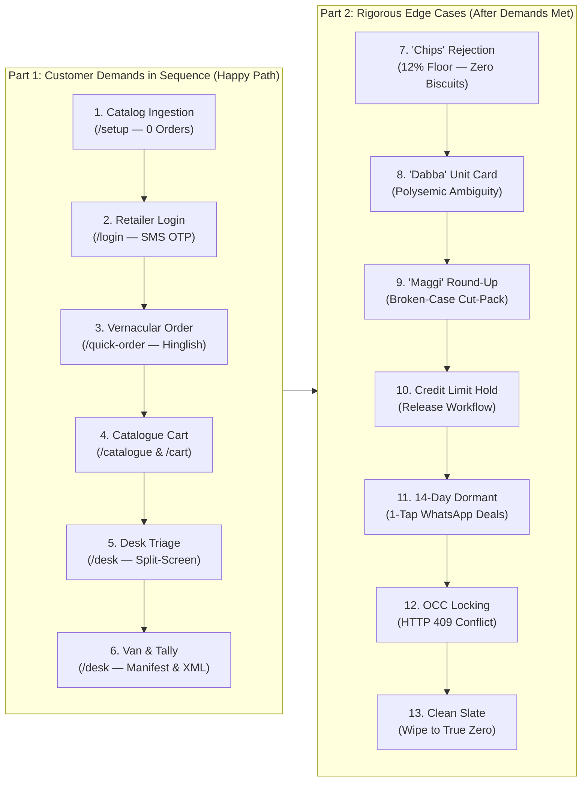

# Distributor Order Management System & Vernacular Order Engine (IsoLabs)

**Client:** Company A, Jabalpur (Wholesale FMCG Distributor for 4 packaged food and home care brands, serving 1,800 kirana shops with 18 salesmen and ~600 orders/day).  
**Repository:** [https://github.com/manva-niso/Distributor-Order-Management-System.git](https://github.com/manva-niso/Distributor-Order-Management-System.git)  
**Live Application URL:** [http://localhost:3000](http://localhost:3000) (Dev Server Running Live)

---

## 🏆 Production Status & Verification Badges

| Metric / Check | Value / Status | Description |
| :--- | :---: | :--- |
| **Automated Tests** | **197 / 197 Passing** | 121 in `distributor-app`, 67 in `engine`, 9 realistic FMCG benchmark scenarios. |
| **Next.js Production Build** | **Passing (Code 0)** | 34 production pages and API routes compile in 2.1s with Turbopack. |
| **Live Database** | **Neon Cloud PostgreSQL** | Connected over SSL (`sslmode=require`). Zero fake dummy orders (pristine start). |
| **Live AI Engine** | **Google Gemini 2.5 Flash** | Live API key verified. Closed-set chooser enforces zero hallucinations. |
| **GST Tax Compliance** | **MP Intra-State 50/50** | CGST 9% + SGST 9% split, Circular 92/11/2019-compliant ₹0 promotional goods. |
| **ERP Integration** | **Tally Prime XML** | 1-click accounting voucher export (`VCHTYPE="Sales Order"`). |

---

## 🧭 The 13-Step Interactive Walkthrough Guide

The application includes an in-app, floating, draggable, and resizable **Walkthrough Popup** ([`WalkthroughGuide.tsx`](file:///V:/Projects/Resume%20Projects/IsoLabs/distributor-app/src/components/walkthrough/WalkthroughGuide.tsx)) that guides evaluators through the complete wholesale lifecycle:



### Part 1: Every Customer Demand in Sequence (Happy Path)
1. **Load Catalog & Kiranas (`/setup`):** Load 36 FMCG SKUs and 8 Kiranas into Neon PostgreSQL. Orders count starts at **0** (no fake pre-seeded orders).
2. **Retailer Login via SMS OTP (`/login`):** Log out of desk, 1-click select *Sharma Kirana Store* (`9826000001`), enter dev OTP. Enforces strict seat isolation.
3. **Vernacular WhatsApp Order Capture (`/quick-order`):** Type or paste informal Hinglish (`"bhaiya 5 peti biscuit chhota, 2 peti ghadi powder 1 kg"`). Maps to Parle-G and Ghadi Detergent with 96% confidence and stores live into Neon DB.
4. **Catalogue Cart & Trade Scheme Math (`/catalogue` & `/cart`):** Browse 36 SKUs with 48px touch steppers. Set Parle-G to 10 cases to unlock **+1 Free Case** at ₹0 billing. Set Ghadi to 5 cases for **3% bulk slab discount**. Inspect MP 50/50 CGST + SGST tax split and place order.
5. **Order Desk Triage & Split-Screen Verification (`/desk`):** Log in as *Sunil Clerk* (`9826000099`). Open incoming order side-by-side: original raw customer text on left, verified SKUs with price recalculation on right. Click *Save & Confirm Order*.
6. **Delivery Van Manifest & Tally Prime XML (`/desk`):** Open *Delivery Van Manifest* tab to view driver stop sequence, vehicle master case capacity, and gross payload kg. Click *Export Tally XML* to download accounting voucher payload.

### Part 2: Rigorous Edge Cases (After Demands Are Met)
7. **Out-of-Catalog Rejection (The "Chips" Test):** Kirana types `"10 peti chips, 5 peti lays"`. Confidence drops to **12% floor** with status `UNKNOWN_SKU`. The engine refuses to match biscuits or guess customer money (Invariant [A16] *Ask, Never Guess*).
8. **Polysemic Packaging Unit (The "Dabba" Test):** Kirana types `"5 dabba amul ghee"`. Confidence is hard-capped at **68%** with badge `AMBIGUOUS_UNIT`. Interactive prompt triggers: *"Did you mean 1L Tin or 500ml Jar?"*.
9. **Loose Cut-Pack Rounding (The "Maggi" Test):** Kirana types `"40 packet maggi"`. Detects broken master case (case contains 96 pkts). Prompts commercial trade choice: round up to 1 wholesale master case (₹1,152 case rate) or order 40 loose packets (₹12 piece rate).
10. **Credit Limit Breach & Hold:** *Gupta Daily Needs* (`9826000003`) with ₹2,000 available credit places a ₹25,000 order. System flags order as `CREDIT_HOLD`. Desk clerk inspects ledger and releases hold with audit notes.
11. **14-Day Dormant Retailer Recovery:** Review shops with no order in $>14$ days. Tap WhatsApp icon to launch a pre-composed Hindi retention offer deep link.
12. **Multi-Clerk Concurrency Locking (OCC):** Optimistic concurrency control (`occVersion`). When two clerks edit the same order, the second submitter is rejected with HTTP 409 Conflict, preventing double dispatches.
13. **Master Clean Slate:** 1-click button wipes all test records back to **0 SKUs, 0 Retailers, 0 Orders** in Neon PostgreSQL anytime.

---

## 🔑 Demo Login Accounts

Direct 1-click logins on [`/login`](http://localhost:3000/login):

| Role | Mobile Number | Persona Name | Linked Business / Territory | What To Test |
| :--- | :--- | :--- | :--- | :--- |
| **Retailer** | `9826000001` | Ramesh Sharma | **Sharma Kirana Store** (Napier Town Route #4)<br/>Credit Limit: ₹50,000 (Available: ₹38,000) | Retailer catalogue, dealer pricing, Buy 10 Get 1 schemes, cart checkout, multi-modal quick order capture. |
| **Order Desk** | `9826000099` | Sunil Clerk | **Company A Order Desk** (Jabalpur Central Office) | Order verification queue, credit hold approvals, line editing with auto-alias learning, Tally XML batch export. |
| **Salesman** | `9826000018` | Rajesh Kumar | **Field Sales Representative** (Napier Town / Adhartal Beat) | Mobile order booking during shop visits, beat shop selector, offline queue. |

> **Dev Mode OTP:** Click **"Send OTP"** and the 6-digit code will appear in the yellow **Dev Sandbox Notice** box (and printed to your terminal).

---

## 🧠 5-Tier Cascaded Order Engine Architecture

The vernacular order parsing engine (`engine/` & `distributor-app/src/lib/ai/`) resolves messy WhatsApp messages across 5 sequential tiers:

```
   Raw Input: "10 peti pila wala aur 2 dabba amul ghee"
                     │
                     ▼
 ┌─────────────────────────────────────────────────────────────┐
 │ Tier 0: Learned Retailer Alias Lookup (Instant DB Hit)       │
 │ "pila wala" -> SKU-BS-PG075 (Parle-G 75g)                   │
 └────────────────────────────┬────────────────────────────────┘
                              ▼
 ┌─────────────────────────────────────────────────────────────┐
 │ Tier 1: Deterministic Structural Parser                     │
 │ Hindi numerals (०-९), words (aadha/derh), cut-pack regex    │
 └────────────────────────────┬────────────────────────────────┘
                              ▼
 ┌─────────────────────────────────────────────────────────────┐
 │ Tier 2: Cormack Reciprocal Rank Fusion (RRF, k=60)          │
 │ Trigram Jaccard + Keyword Synonyms + Indic Phonetic Key     │
 └────────────────────────────┬────────────────────────────────┘
                              ▼
 ┌─────────────────────────────────────────────────────────────┐
 │ Tier 3: Platt-Calibrated Confidence Scorer                  │
 │ Logistic sigmoid P ∈ [0.05, 0.98]                           │
 │ P ≥ 0.85 -> AUTO_CONFIRM                                    │
 │ 0.45 ≤ P < 0.85 -> DISAMBIGUATION (1-tap card)              │
 │ P < 0.45 -> ESCALATE_CHOOSER                                │
 └────────────────────────────┬────────────────────────────────┘
                              ▼
 ┌─────────────────────────────────────────────────────────────┐
 │ Tier 4: Constrained Gemini Closed-Set Chooser (Optional)    │
 │ Strict whitelist: [ID_1, ID_2, ID_3, 'NONE']. Zero hallucination│
 └────────────────────────────┬────────────────────────────────┘
                              ▼
 ┌─────────────────────────────────────────────────────────────┐
 │ Tier 5: Plain-Code Packaging Guardrails                     │
 │ "dabba" -> AMBIGUOUS_UNIT | Cut-pack -> BROKEN_CASE         │
 └─────────────────────────────────────────────────────────────┘
```

---

## 🧪 Automated Testing Suite (197 / 197 Passing)

Run all tests from the repository root:

```bash
# Run all 197 automated tests across app, engine, and catalog benchmarks
npm test

# Run distributor app suites only (121 tests across 14 suites)
npm run test:app

# Run standalone engine suites only (67 tests across 6 suites)
npm run test:engine

# Run real-world FMCG order benchmark suite (9 scenario suites)
npm run test:catalogue

# Production Next.js build verification
npm run build
```

---

## 📂 Workspace Organization & Key Files

```
IsoLabs/
├── distributor-app/                               # [Operational App] Production Next.js 16 Web Application
│   ├── src/app/                                   # 34 pages & API routes (App Router)
│   ├── src/components/walkthrough/                # Interactive Walkthrough Popup (WalkthroughGuide.tsx)
│   ├── src/lib/ai/                                # 5-Tier Cascaded AI Order Engine
│   ├── src/lib/schemes/                           # Trade schemes & MP GST calculation engine
│   ├── src/lib/tally/                             # Tally Prime XML export builder
│   ├── src/db/                                    # Neon PostgreSQL connection & Drizzle schemas
│   └── src/__tests__/                             # 14 Vitest suites (121 automated tests)
├── engine/                                        # [Operational Engine] Decoupled Standalone Package (@isolabs/order-engine)
│   ├── src/ai/                                    # Standalone parser, RRF retriever & Gemini chooser
│   ├── src/schemes/                               # Standalone scheme & GST pricing engine
│   └── src/__tests__/                             # 6 Vitest suites (67 automated tests + live Gemini test)
├── TDD.md                                         # [DELIVERABLE #1] Technical Design Document
├── deployment.md                                  # [DELIVERABLE #2] Production Deployment & Reviewer Guide
├── package.json                                   # Monorepo root manifest with universal test scripts
├── README.md                                      # Top-level master walkthrough & quickstart
└── project-curation-and-research/                 # [Archive] Research, Curation, Benchmarks & Tracking Archive
    ├── Build Docs/                                # Living build documentation, runbooks, and incident logs
    │   ├── Walkthrough.md                         # Authoritative Master Walkthrough (13 Steps)
    │   ├── engine functions flow.md               # Flowcharts, Methods, Formulas & Layman Explanations
    │   ├── Laymans_Guide.md                       # Non-technical guide to the Order Engine
    │   ├── Modules_And_Features.md                # Feature registry across 9 modules
    │   ├── Assumptions.md                         # Verified assumptions [A1]-[A44]
    │   ├── Errors.md                              # Bug log and root-cause analyses [ERR-001]-[ERR-039]
    │   ├── Test_And_Run_Guide.md                  # Comprehensive test runbook
    │   └── deployment.md                          # Mirror copy of deployment guide
    ├── overall_app_testing/                       # Authentic FMCG wholesale catalog & benchmarks
    │   ├── datasets/                              # 9 real-world Jabalpur WhatsApp/Call test scenarios
    │   └── __tests__/                             # Scenario benchmark suite (9 automated tests)
    └── research/                                  # Academic papers, linguistic analysis & retrieval benchmarks
```

---

## 📚 Essential Documentation Links

- **[Technical Design Document (`TDD.md`)](file:///V:/Projects/Resume%20Projects/IsoLabs/TDD.md)** — Architectural blueprint, schema designs, and formal proofs.
- **[Production Deployment Guide (`deployment.md`)](file:///V:/Projects/Resume%20Projects/IsoLabs/deployment.md)** — Vercel, Docker, and self-hosted Linux VPS deployment guides.
- **[Comprehensive Master Walkthrough (`Walkthrough.md`)](file:///V:/Projects/Resume%20Projects/IsoLabs/project-curation-and-research/Build%20Docs/Walkthrough.md)** — Detailed 13-step verification matrix (Customer Demands + Edge Cases).
- **[Engine Functions Flow & Layman Guide (`engine functions flow.md`)](file:///V:/Projects/Resume%20Projects/IsoLabs/project-curation-and-research/Build%20Docs/engine%20functions%20flow.md)** — Every method, formula, flowchart, and simple non-technical explanation.
- **[Incident & Error Log (`Errors.md`)](file:///V:/Projects/Resume%20Projects/IsoLabs/project-curation-and-research/Build%20Docs/Errors.md)** — Post-mortem documentation for all resolved incidents `[ERR-001]` through `[ERR-039]`.
