# Overall System Architecture & Directory Connection Guide

This document explains the role of every directory, subfolder, and file across the repository. It maps every screen and module from the master architecture blueprint ([`PS4_Distributor_Complete_Flow_And_Architecture.md`](file:///V:/Projects/Resume%20Projects/IsoLabs/PS4_Distributor_Complete_Flow_And_Architecture.md)) directly to the physical files and diagrams how data flows between user interactions, client components, API endpoints, authentication guards, domain calculation engines, and the database layer.

---

## 1. Master Screen-to-Code Architecture Mapping

Every screen defined in Section 1 and Section 3 of the Master Blueprint is grouped below with its corresponding frontend UI, backend logic, API route handlers, database entities, automated tests, and end-to-end data flow:

```text
===================================================================================================================
MASTER BLUEPRINT SCREEN            PRIMARY ROUTE     TARGET ROLE       CORE CAPABILITIES
===================================================================================================================
Screen 1: Login & OTP              /login            All Roles         6-Digit Crypto OTP, SMS Gateway, Session JWT
Screen 1B: Self-Registration       /register         Retailer          B2B Onboarding, Beat Routing, ₹25k Credit
Screen 2: Retailer Catalogue       /catalogue        Retailer/Salesman Dual Steppers (Cases + Loose Packs), Live Stock
Screen 3: Cart & Checkout          /cart             Retailer/Salesman Universal Scheme Math, Credit Meter, 1-Tap Empty
Screen 4: Quick Order AI Intake    /quick-order      Retailer/Desk     WhatsApp Text/Voice, NLP Stripping, Cart Sync
Screen 5: Review & Disambiguation  /capture          Retailer/Desk     Confidence Chips, "Case vs Pack?" Guardrail
Screen 6: My Orders & Repeat       /orders           Retailer          Order Tracking, Delivery ETA, 1-Tap Repeat
Screen 7: Order Desk Operations    /desk             Order Desk Clerk  OCC Triage, Credit Holds, Batch Tally Export
Screen 8: Desk Edit & Learn        /desk/orders/[id] Order Desk Clerk  Split-Screen Edit, Alias Learning, Live Math
Screen 9: Master Setup Hub         /setup            Distributor/Admin Dynamic Excel/CSV Ingestion, Industry Presets
Screen 10: Van Loading Manifest    /desk?tab=manifest Order Desk/Godown Route Picking Aggregation, Weight Approximations
Screen 11: 14-Day Dormant Kiranas  /desk?tab=dormant Order Desk/Sales  Churn Risk Tiers, 1-Tap Hindi WhatsApp Nudge
===================================================================================================================
```

---

### Screen 1: Login & Mobile OTP Authentication (`/login`)
- **Master Doc Reference:** Section 3 (Screen 1), Section 10 (Module 1, 3).
- **Target Role:** Kirana Retailer, Salesman, Order Desk Clerk.
- **Frontend Files:**
  - Page: [`distributor-app/src/app/(auth)/login/page.tsx`](file:///V:/Projects/Resume%20Projects/IsoLabs/distributor-app/src/app/(auth)/login/page.tsx)
  - Components: [`distributor-app/src/components/LanguageToggle.tsx`](file:///V:/Projects/Resume%20Projects/IsoLabs/distributor-app/src/components/LanguageToggle.tsx)
- **Backend & Logic Files:**
  - [`distributor-app/src/lib/auth/otp.ts`](file:///V:/Projects/Resume%20Projects/IsoLabs/distributor-app/src/lib/auth/otp.ts) — 6-digit cryptographic generation, 30s rate limits, 5-min expiry, max 3 failed attempt lockouts (`[A6]`).
  - [`distributor-app/src/lib/auth/jwt.ts`](file:///V:/Projects/Resume%20Projects/IsoLabs/distributor-app/src/lib/auth/jwt.ts) — `jose` HS256 signed JWT cookies (`auth_token`) valid for 7 days (`[A7]`).
  - [`distributor-app/src/middleware.ts`](file:///V:/Projects/Resume%20Projects/IsoLabs/distributor-app/src/middleware.ts) — Gatekeeping controller inspecting session cookie and enforcing role boundaries.
- **API Endpoints:**
  - `POST /api/auth/send-otp` ([`route.ts`](file:///V:/Projects/Resume%20Projects/IsoLabs/distributor-app/src/app/api/auth/send-otp/route.ts))
  - `POST /api/auth/verify-otp` ([`route.ts`](file:///V:/Projects/Resume%20Projects/IsoLabs/distributor-app/src/app/api/auth/verify-otp/route.ts))
  - `GET /api/auth/lookup-phone` ([`route.ts`](file:///V:/Projects/Resume%20Projects/IsoLabs/distributor-app/src/app/api/auth/lookup-phone/route.ts))
- **Database Entities:** `users`, `otps`, `retailers` in [`src/db/store.ts`](file:///V:/Projects/Resume%20Projects/IsoLabs/distributor-app/src/db/store.ts).
- **Automated Tests:** [`src/__tests__/auth.test.ts`](file:///V:/Projects/Resume%20Projects/IsoLabs/distributor-app/src/__tests__/auth.test.ts) (13 tests passing).
- **Data Flow:**
  1. Merchant types 10-digit mobile number $\rightarrow$ `lookup-phone` endpoint provides live feedback showing shop trade name and available credit.
  2. Merchant taps **"Send OTP"** $\rightarrow$ `POST /api/auth/send-otp` calls `createAndSendOtp()`, stores SHA-256 hash in `otps` table, logs code in development console (or sends via SMS gateway).
  3. Merchant enters 6 digits $\rightarrow$ `POST /api/auth/verify-otp` validates code in constant-time, consumes token, mints a signed HS256 JWT containing `{ userId, phone, role, retailerId, name }`, and attaches an HTTP-Only cookie.
  4. Response returns redirect URL (`/desk` for clerk, `/catalogue` for retailer).

---

### Screen 1B: B2B Kirana Self-Registration (`/register`)
- **Master Doc Reference:** Section 1 (Screen 1B), Section 8 (`[A5]`, `[A27]`, `[A28]`).
- **Target Role:** Unseeded Kirana Store Owners across Jabalpur.
- **Frontend Files:**
  - Page: [`distributor-app/src/app/(auth)/register/page.tsx`](file:///V:/Projects/Resume%20Projects/IsoLabs/distributor-app/src/app/(auth)/register/page.tsx)
- **Backend & Logic Files:**
  - [`distributor-app/src/lib/auth/jwt.ts`](file:///V:/Projects/Resume%20Projects/IsoLabs/distributor-app/src/lib/auth/jwt.ts)
  - [`distributor-app/src/db/store.ts`](file:///V:/Projects/Resume%20Projects/IsoLabs/distributor-app/src/db/store.ts) (`registerRetailer`)
- **API Endpoints:**
  - `POST /api/auth/register` ([`route.ts`](file:///V:/Projects/Resume%20Projects/IsoLabs/distributor-app/src/app/api/auth/register/route.ts))
- **Database Entities:** `retailers` (allocates sequential `RET-1800+`, provisional ₹25,000 credit limit `[A5]`, beat assignment), `users`.
- **Automated Tests:** [`src/__tests__/auth.test.ts`](file:///V:/Projects/Resume%20Projects/IsoLabs/distributor-app/src/__tests__/auth.test.ts).
- **Data Flow:**
  1. Unregistered merchant enters Shop Name, Owner Full Name, Mobile Number, Delivery Beat (e.g. *Napier Town Route #4*), and Physical Address.
  2. `POST /api/auth/register` asserts phone uniqueness (`[A28]`, rejects duplicates with HTTP 409 Conflict).
  3. Inserts provisional retailer record with ₹25,000 credit limit and creates user with `role: "retailer"`.
  4. Mints signed session cookie and directs merchant immediately into `/catalogue`.

---

### Screen 2: Retailer Catalogue & Dual Steppers (`/catalogue`)
- **Master Doc Reference:** Section 3 (Screen 2), Section 10 (Module 2).
- **Target Role:** Retailer, Salesman on counter visits.
- **Frontend Files:**
  - Page: [`distributor-app/src/app/(portal)/catalogue/page.tsx`](file:///V:/Projects/Resume%20Projects/IsoLabs/distributor-app/src/app/(portal)/catalogue/page.tsx)
  - Navigation: [`distributor-app/src/components/AppHeader.tsx`](file:///V:/Projects/Resume%20Projects/IsoLabs/distributor-app/src/components/AppHeader.tsx), [`distributor-app/src/components/BottomNav.tsx`](file:///V:/Projects/Resume%20Projects/IsoLabs/distributor-app/src/components/BottomNav.tsx)
- **Backend & Logic Files:**
  - [`distributor-app/src/lib/catalogue/cart-store.ts`](file:///V:/Projects/Resume%20Projects/IsoLabs/distributor-app/src/lib/catalogue/cart-store.ts) — In-browser cart store syncing to `localStorage` (`[A25]`), handling dual case/pack selections.
  - [`distributor-app/src/lib/schemes/engine.ts`](file:///V:/Projects/Resume%20Projects/IsoLabs/distributor-app/src/lib/schemes/engine.ts) (`calculateLineItem` for live benefit calculation).
- **API Endpoints:**
  - `GET /api/catalogue` ([`route.ts`](file:///V:/Projects/Resume%20Projects/IsoLabs/distributor-app/src/app/api/catalogue/route.ts))
  - `POST /api/catalogue/notify-restock` ([`route.ts`](file:///V:/Projects/Resume%20Projects/IsoLabs/distributor-app/src/app/api/catalogue/notify-restock/route.ts))
- **Database Entities:** `skus`, `schemes`, `audit_logs` in [`src/db/store.ts`](file:///V:/Projects/Resume%20Projects/IsoLabs/distributor-app/src/db/store.ts).
- **Automated Tests:** [`src/__tests__/catalogue.test.ts`](file:///V:/Projects/Resume%20Projects/IsoLabs/distributor-app/src/__tests__/catalogue.test.ts) (8 tests passing).
- **Data Flow:**
  1. Page fetches live stock and scheme metadata via `GET /api/catalogue`.
  2. UI performs instant multi-field client filtering across product names, categories, and brand filter pills (`Parle`, `Ghadi`, `Wagh Bakri`).
  3. Retailer modifies quantities using **Dual Steppers**:
     - Master Cases: `[- 48px] [ 10 ] [+ 48px] cases`
     - Loose Packs: `[- 48px] [ 12 ] [+ 48px] loose packs` (`[A42]`).
  4. Client invokes `calculateLineItem()`, displaying unlocked promotional rewards (*"1 Free Case Unlocked"*, *"3% Slab Applied"*) or upsell nudges (*"Add 1 more case for 3% discount!"*).
  5. Out-of-stock items (`SKU-TE-250`) disable steppers and provide a 1-tap restock notification button which posts telemetry to `audit_logs` (`[A26]`).
  6. Sticky bottom drawer calculates live composite order total and routes to `/cart`.

---

### Screen 3: Cart, Credit Meter & Checkout (`/cart`)
- **Master Doc Reference:** Section 3 (Screen 3), Section 4 (Universal Scheme Engine), Section 10 (Module 4).
- **Target Role:** Retailer, Salesman.
- **Frontend Files:**
  - Page: [`distributor-app/src/app/(portal)/cart/page.tsx`](file:///V:/Projects/Resume%20Projects/IsoLabs/distributor-app/src/app/(portal)/cart/page.tsx)
- **Backend & Logic Files:**
  - [`distributor-app/src/lib/schemes/engine.ts`](file:///V:/Projects/Resume%20Projects/IsoLabs/distributor-app/src/lib/schemes/engine.ts) (`calculateOrderSummary`: multi-tier progressive slab ladders, cross-SKU free goods gifting, flat cash rebates, 50/50 MP GST, round-off balancing).
  - [`distributor-app/src/lib/catalogue/cart-store.ts`](file:///V:/Projects/Resume%20Projects/IsoLabs/distributor-app/src/lib/catalogue/cart-store.ts) (`clearCart`, `updateCases`, `updatePacks`).
- **API Endpoints:**
  - `POST /api/orders/checkout` ([`route.ts`](file:///V:/Projects/Resume%20Projects/IsoLabs/distributor-app/src/app/api/orders/checkout/route.ts))
- **Database Entities:** `orders`, `order_items`, `skus` (atomic stock reservation `[A15]`, `[A30]`), `retailers` (ledger balance) in [`src/db/store.ts`](file:///V:/Projects/Resume%20Projects/IsoLabs/distributor-app/src/db/store.ts).
- **Automated Tests:** [`src/__tests__/schemes.test.ts`](file:///V:/Projects/Resume%20Projects/IsoLabs/distributor-app/src/__tests__/schemes.test.ts) (13 tests), [`src/__tests__/orders.test.ts`](file:///V:/Projects/Resume%20Projects/IsoLabs/distributor-app/src/__tests__/orders.test.ts) (4 tests).
- **Data Flow:**
  1. Cart retrieves lines from `cartStore`. Runs `calculateOrderSummary()` to produce itemized taxable value, CGST (9.0% or 2.5%), SGST (9.0% or 2.5%), and grand total.
  2. B2B Credit Headroom Meter compares $\text{Current Balance} + \text{Order Total}$ against $\text{Credit Limit}$.
  3. Retailer taps **"Place Order"**.
  4. `POST /api/orders/checkout` validates session, re-calculates invoice authoritatively on server, checks physical warehouse stock for $\text{orderedCases} + \text{freeCases}$ (`[A30]`), decrements inventory, and checks credit headroom:
     - If exposure $\le$ limit $\rightarrow$ status is set to `PLACED`.
     - If exposure $>$ limit $\rightarrow$ status is set to `CREDIT_HOLD` (`[A14]`, `[A29]`).
  5. Clears active cart state and navigates to `/orders`.

---

### Screen 4: Quick Order AI Conversational Intake (`/quick-order`)
- **Master Doc Reference:** Section 3 (Screen 4), Section 5 (AI Pipeline), Section 10 (Module 5).
- **Target Role:** Retailer, Salesman, Order Desk Clerk.
- **Frontend Files:**
  - Page: [`distributor-app/src/app/(portal)/quick-order/page.tsx`](file:///V:/Projects/Resume%20Projects/IsoLabs/distributor-app/src/app/(portal)/quick-order/page.tsx)
- **Backend & Logic Files:**
  - [`distributor-app/src/lib/ai/text-parser.ts`](file:///V:/Projects/Resume%20Projects/IsoLabs/distributor-app/src/lib/ai/text-parser.ts) — Context-aware NLP parser: strips explanatory context clauses (`extractAndStripExplanatoryClause`), normalizes Devanagari numerals (`०-९`), boosts primary category tokens (`+0.55`), extracts quantities & units.
  - [`distributor-app/src/lib/ai/gemini-adapter.ts`](file:///V:/Projects/Resume%20Projects/IsoLabs/distributor-app/src/lib/ai/gemini-adapter.ts) — Multi-modal Gemini adapter for image OCR and voice notes.
  - [`distributor-app/src/lib/ai/types.ts`](file:///V:/Projects/Resume%20Projects/IsoLabs/distributor-app/src/lib/ai/types.ts) — `OrderParserPipeline` contract (`[A33]`).
- **API Endpoints:**
  - `POST /api/capture/parse-text` ([`route.ts`](file:///V:/Projects/Resume%20Projects/IsoLabs/distributor-app/src/app/api/capture/parse-text/route.ts))
- **Database Entities:** `retailer_aliases` (past vocabulary hits) in [`src/db/store.ts`](file:///V:/Projects/Resume%20Projects/IsoLabs/distributor-app/src/db/store.ts).
- **Automated Tests:** [`src/__tests__/text-parser.test.ts`](file:///V:/Projects/Resume%20Projects/IsoLabs/distributor-app/src/__tests__/text-parser.test.ts) (16 tests passing).
- **Data Flow:**
  1. Merchant pastes WhatsApp message or selects sample voice note (*"bhaiya 5 peti biscuit chhota, 2 peti washing powder 1 kilo, 1 pkt tea..."*).
  2. Dispatches to `POST /api/capture/parse-text`.
  3. Pre-processor strips explanatory clauses (e.g. *"where a case contains 24 pkts"*) to avoid secondary number token collision.
  4. Matches SKUs using retailer aliases first, followed by category keyword boosts.
  5. UI renders parsed draft lines with confidence tags (`HIGH`/`MED`/`LOW`), candidate alternatives, and unit question cards.
  6. Merchant can adjust numbers or tap **"Transfer to Cart"**, which pushes lines directly into `cartStore` and opens `/cart`.

---

### Screen 5: Review & Unit Question Guardrail (`/capture`)
- **Master Doc Reference:** Section 3 (Screen 5), Section 5, Section 8 (`[A16]`, `[A36]`).
- **Target Role:** Retailer, Order Desk Clerk.
- **Frontend Files:**
  - Page: [`distributor-app/src/app/(portal)/capture/page.tsx`](file:///V:/Projects/Resume%20Projects/IsoLabs/distributor-app/src/app/(portal)/capture/page.tsx)
- **Backend & Logic Files:**
  - [`distributor-app/src/lib/ai/text-parser.ts`](file:///V:/Projects/Resume%20Projects/IsoLabs/distributor-app/src/lib/ai/text-parser.ts)
- **Data Flow:**
  1. If an order line omits units (*"5 biscuit chhota"*), the system enforces Rule `[A16]` (**Never Guess**).
  2. Presents the **Unit Question Card**: *"Did you mean 5 Cases (480 packs · ₹3,888) or 5 Loose Packs (₹40.50)?"*.
  3. If broken case requested (*"case of 20 mai se 15"*), triggers Rule `[A36]` presenting 1-case roundup or loose-pack choices.
  4. Confirmation is blocked until all unit ambiguities are answered.

---

### Screen 6: My Orders & 1-Tap Repeat Order (`/orders`)
- **Master Doc Reference:** Section 3 (Screen 6), Section 10 (Module 4).
- **Target Role:** Retailer, Salesman.
- **Frontend Files:**
  - Page: [`distributor-app/src/app/(portal)/orders/page.tsx`](file:///V:/Projects/Resume%20Projects/IsoLabs/distributor-app/src/app/(portal)/orders/page.tsx)
- **Backend & Logic Files:**
  - [`distributor-app/src/lib/catalogue/cart-store.ts`](file:///V:/Projects/Resume%20Projects/IsoLabs/distributor-app/src/lib/catalogue/cart-store.ts) (`addItem`)
- **API Endpoints:**
  - `GET /api/orders` ([`route.ts`](file:///V:/Projects/Resume%20Projects/IsoLabs/distributor-app/src/app/api/orders/route.ts))
- **Database Entities:** `orders`, `order_items` in [`src/db/store.ts`](file:///V:/Projects/Resume%20Projects/IsoLabs/distributor-app/src/db/store.ts).
- **Data Flow:**
  1. Page fetches order history scoped to the authenticated retailer via `GET /api/orders`.
  2. Displays real-time status chips (`PLACED`, `CREDIT_HOLD`, `VERIFIED`, `EXPORTED_TALLY`), itemized lines, free goods counts, and 2:00 PM cutoff delivery ETA (`[A1]`).
  3. Retailer taps **"Repeat Order"**:
     - Cart store extracts historical lines, quantities, and loose packs.
     - Adds all items into active `cartStore` and redirects to `/cart` for live price verification.

---

### Screen 7: Order Desk Central Operations Hub (`/desk`)
- **Master Doc Reference:** Section 3 (Screen 7), Section 10 (Modules 6, 7, 8, 9).
- **Target Role:** Order Desk Clerk, Business Owner.
- **Frontend Files:**
  - Page: [`distributor-app/src/app/(portal)/desk/page.tsx`](file:///V:/Projects/Resume%20Projects/IsoLabs/distributor-app/src/app/(portal)/desk/page.tsx)
- **Backend & Logic Files:**
  - [`distributor-app/src/db/store.ts`](file:///V:/Projects/Resume%20Projects/IsoLabs/distributor-app/src/db/store.ts) (`getOrders`, `getDeskStats`, `releaseCreditHold`)
  - [`distributor-app/src/lib/tally/xml-builder.ts`](file:///V:/Projects/Resume%20Projects/IsoLabs/distributor-app/src/lib/tally/xml-builder.ts)
  - [`distributor-app/src/lib/logistics/van-manifest.ts`](file:///V:/Projects/Resume%20Projects/IsoLabs/distributor-app/src/lib/logistics/van-manifest.ts)
  - [`distributor-app/src/lib/retention/dormancy.ts`](file:///V:/Projects/Resume%20Projects/IsoLabs/distributor-app/src/lib/retention/dormancy.ts)
- **API Endpoints:**
  - `GET /api/desk/orders` ([`route.ts`](file:///V:/Projects/Resume%20Projects/IsoLabs/distributor-app/src/app/api/desk/orders/route.ts))
  - `GET /api/desk/stats` ([`route.ts`](file:///V:/Projects/Resume%20Projects/IsoLabs/distributor-app/src/app/api/desk/stats/route.ts))
  - `POST /api/desk/orders/[id]/release-hold` ([`route.ts`](file:///V:/Projects/Resume%20Projects/IsoLabs/distributor-app/src/app/api/desk/orders/[id]/release-hold/route.ts))
  - `GET /api/tally/preview` & `POST /api/tally/export` ([`route.ts`](file:///V:/Projects/Resume%20Projects/IsoLabs/distributor-app/src/app/api/tally/export/route.ts))
  - `GET /api/desk/van-manifest` ([`route.ts`](file:///V:/Projects/Resume%20Projects/IsoLabs/distributor-app/src/app/api/desk/van-manifest/route.ts))
  - `GET /api/desk/dormant` ([`route.ts`](file:///V:/Projects/Resume%20Projects/IsoLabs/distributor-app/src/app/api/desk/dormant/route.ts))
- **Automated Tests:** [`src/__tests__/desk.test.ts`](file:///V:/Projects/Resume%20Projects/IsoLabs/distributor-app/src/__tests__/desk.test.ts) (8 tests), [`src/__tests__/tally.test.ts`](file:///V:/Projects/Resume%20Projects/IsoLabs/distributor-app/src/__tests__/tally.test.ts) (8 tests), [`src/__tests__/manifest.test.ts`](file:///V:/Projects/Resume%20Projects/IsoLabs/distributor-app/src/__tests__/manifest.test.ts) (4 tests), [`src/__tests__/dormant.test.ts`](file:///V:/Projects/Resume%20Projects/IsoLabs/distributor-app/src/__tests__/dormant.test.ts) (4 tests).
- **Data Flow:**
  - **Tab 1: Orders Queue:** Renders high-density table of all Jabalpur orders with live status filtering (`Needs Review`, `Credit Hold`, `Confirmed`, `Exported`).
  - **Tab 2: Credit Holds:** Lists orders flagged under `CREDIT_HOLD`. Clerk reviews customer history, taps "Release Hold", submits required operational justification note $\rightarrow$ transitions order to `VERIFIED` with atomic OCC increment (`[A37]`).
  - **Tab 3: Van Loading Manifest (Screen 10):** Selects delivery beat route $\rightarrow$ calculates aggregated warehouse pick list (`totalCases = paidCases + freeCases`), approximate payload weight, and drop stop sequence (`[A22]`, `[A41]`, `[A42]`).
  - **Tab 4: 14-Day Dormant Dashboard (Screen 11):** Lists kirana stores inactive for $\ge 14$ days. Stratifies churn risk into High Risk (14–20 days) and Critical Churn ($\ge 21$ days). Provides 1-tap WhatsApp deep link pre-filling personalized Devanagari Hindi re-order text (`[A23]`, `[A43]`, `[A44]`).
  - **Batch Export to Tally:** Clerk selects verified orders $\rightarrow$ clicks "Export to Tally XML" $\rightarrow$ streams `tally-export-YYYYMMDD.xml` with native `<ACTUALQTY>` vs `<BILLEDQTY>` and zero-sum double-entry balance, updating order status to `EXPORTED_TALLY` (`[A39]`, `[A40]`).

---

### Screen 8: Desk Verification & Alias Auto-Learning (`/desk/orders/[id]`)
- **Master Doc Reference:** Section 3 (Screen 8), Section 10 (Module 6).
- **Target Role:** Order Desk Clerk.
- **Frontend Files:**
  - Page: [`distributor-app/src/app/(portal)/desk/orders/[id]/page.tsx`](file:///V:/Projects/Resume%20Projects/IsoLabs/distributor-app/src/app/(portal)/desk/orders/[id]/page.tsx)
- **Backend & Logic Files:**
  - [`distributor-app/src/db/store.ts`](file:///V:/Projects/Resume%20Projects/IsoLabs/distributor-app/src/db/store.ts) (`updateOrderLinesWithOcc`, `learnRetailerAlias`)
  - [`distributor-app/src/lib/schemes/engine.ts`](file:///V:/Projects/Resume%20Projects/IsoLabs/distributor-app/src/lib/schemes/engine.ts) (authoritative live recalculation on edit `[A38]`)
- **API Endpoints:**
  - `GET /api/desk/orders/[id]` ([`route.ts`](file:///V:/Projects/Resume%20Projects/IsoLabs/distributor-app/src/app/api/desk/orders/[id]/route.ts))
  - `PATCH /api/desk/orders/[id]` ([`route.ts`](file:///V:/Projects/Resume%20Projects/IsoLabs/distributor-app/src/app/api/desk/orders/[id]/route.ts))
- **Database Entities:** `orders`, `order_items`, `retailer_aliases` in [`src/db/store.ts`](file:///V:/Projects/Resume%20Projects/IsoLabs/distributor-app/src/db/store.ts).
- **Automated Tests:** [`src/__tests__/desk.test.ts`](file:///V:/Projects/Resume%20Projects/IsoLabs/distributor-app/src/__tests__/desk.test.ts).
- **Data Flow:**
  1. Clerk opens order. Split-view workspace displays raw WhatsApp message / audio on left, editable SKU rows on right.
  2. Clerk modifies case count or substitutes SKU.
  3. UI runs live recalculation via pure scheme engine (`[A38]`), updating discounts, free goods, and tax.
  4. Clerk taps **"Save & Confirm Order"**.
  5. `PATCH` asserts `expectedOccVersion` against DB (`[A19]`). If another clerk saved changes concurrently, rejects update with HTTP 409 Conflict.
  6. Upon successful save, system automatically writes the customer's raw phrase and selected SKU to `retailer_aliases` (`[A20]`), permanently auto-learning that merchant's vocabulary.

---

### Screen 9: Master Setup & Dynamic Excel Ingestion Hub (`/setup`)
- **Master Doc Reference:** Section 1 (Screen 9), Section 10 (Master Setup Hub), Section 8 (`[A31]`, `[A32]`).
- **Target Role:** Distributor Owner, Evaluator, System Administrator.
- **Frontend Files:**
  - Page: [`distributor-app/src/app/(portal)/setup/page.tsx`](file:///V:/Projects/Resume%20Projects/IsoLabs/distributor-app/src/app/(portal)/setup/page.tsx)
- **Backend & Logic Files:**
  - [`distributor-app/src/lib/excel/importer.ts`](file:///V:/Projects/Resume%20Projects/IsoLabs/distributor-app/src/lib/excel/importer.ts) — Universal SheetJS parser, column synonym resolver (`[A32]`), multi-tier ladder syntax extractor, downloadable template generator.
  - [`distributor-app/src/db/store.ts`](file:///V:/Projects/Resume%20Projects/IsoLabs/distributor-app/src/db/store.ts) (`replaceCatalogFromExcel`, `replaceRetailersFromExcel`)
- **API Endpoints:**
  - `POST /api/setup/import-excel` ([`route.ts`](file:///V:/Projects/Resume%20Projects/IsoLabs/distributor-app/src/app/api/setup/import-excel/route.ts))
  - `GET /api/setup/template` ([`route.ts`](file:///V:/Projects/Resume%20Projects/IsoLabs/distributor-app/src/app/api/setup/template/route.ts))
  - `GET /api/setup/status` ([`route.ts`](file:///V:/Projects/Resume%20Projects/IsoLabs/distributor-app/src/app/api/setup/status/route.ts))
  - `POST /api/setup/load-preset` ([`route.ts`](file:///V:/Projects/Resume%20Projects/IsoLabs/distributor-app/src/app/api/setup/load-preset/route.ts))
- **Automated Tests:** [`src/__tests__/excel-import.test.ts`](file:///V:/Projects/Resume%20Projects/IsoLabs/distributor-app/src/__tests__/excel-import.test.ts) (4 tests passing).
- **Data Flow:**
  1. User uploads custom `.xlsx`, `.xls`, or `.csv` price list or retailer credit workbook (`[A31]`).
  2. Ingestion engine resolves column synonyms (*"Dealer Price"*, *"Rate"*, *"Units/Case"*) and parses multi-tier slab ladder syntax (e.g. `"5:3%, 10:5%, 20:8%"`).
  3. Updates in-memory and relational catalogs dynamically with zero app restart.
  4. Provides 1-click industry preset switcher (Parle, ITC, Amul, HUL) and live database explorer.

---

## 2. Calculation Engine Communication & Inter-Module Data Pipeline

This section traces exactly **how the calculation engines communicate with each other, how data passes between them, and the underlying mathematical formulas** that drive the system:

```mermaid
flowchart TD
    subgraph Intake["1. User Demand Translation"]
        Raw["Raw WhatsApp Text / Audio / Input"] --> PreProc["text-parser.ts<br>extractAndStripExplanatoryClause()"]
        PreProc --> Norm["Devanagari Normalizer & Tokenizer<br>(peti=CASE, pkt=PACK)"]
        Norm --> Guardrail{"Unit Omitted or Broken Case?"}
        Guardrail -->|Yes| Prompt["Unit Disambiguation Guardrail Card<br>([A16], [A36])"]
        Guardrail -->|No| Demand["Structured Demand Output:<br>{ skuId, quantityCases, quantityPacks }"]
        Prompt --> Demand
    end

    subgraph SchemeEngine["2. Universal Trade Scheme & Tax Pricing"]
        Demand --> CartStore["cart-store.ts (localStorage)"]
        CartStore --> Engine["src/lib/schemes/engine.ts<br>calculateOrderSummary()"]
        Engine --> Gross["Gross Value:<br>(cases * dealerPrice) + (packs * packPrice)"]
        Gross --> SchemeRules{"Scheme Evaluation"}
        SchemeRules -->|Free Goods| FG["floor(cases / buyQty) * getFreeQty<br>(Valued at ₹0.00 Composite Supply)"]
        SchemeRules -->|Multi-Tier Slab| Slab["Evaluate Tiers Descending<br>Select Highest Non-Cumulative Tier ([A45])"]
        SchemeRules -->|Flat Rebate| Rebate["cases * flatPerCase ([A47])"]
        FG --> Taxable["Taxable Amount = max(0, Gross - Discounts)"]
        Slab --> Taxable
        Rebate --> Taxable
        Taxable --> GST["Intra-State MP GST Split:<br>CGST 50% + SGST 50% (Half-up rounding [A2])"]
        GST --> RoundOff["Round-Off Balancing:<br>roundOff = grandTotal - unroundedGrandTotal ([A40])"]
    end

    subgraph CheckoutLedger["3. Checkout Transaction & Warehouse Locks"]
        RoundOff --> CheckoutAPI["POST /api/orders/checkout"]
        CheckoutAPI --> ServerRecalc["Server Authoritative Re-calculation<br>(calculateOrderSummary)"]
        ServerRecalc --> StockCheck{"Physical Stock Available?<br>stockCases >= (paidCases + freeCases)"}
        StockCheck -->|No| RejectStock["Halt Checkout (HTTP 400 Conflict)"]
        StockCheck -->|Yes| Decrement["Atomic Stock Decrement in dbStore:<br>sku.stockCases -= (paidCases + freeCases) ([A30])"]
        Decrement --> CreditCheck{"Credit Headroom Check:<br>currentBalance + grandTotal <= creditLimit"}
        CreditCheck -->|Within Limit| StatusPlaced["Set status = 'PLACED'"]
        CreditCheck -->|Exceeded Limit| StatusHold["Set status = 'CREDIT_HOLD' ([A14], [A29])"]
        StatusPlaced --> LedgerUpdate["retailer.currentBalance += grandTotal"]
        StatusHold --> LedgerUpdate
    end

    subgraph DeskFulfillment["4. Desk Concurrency, Alias Training & ERP Export"]
        StatusHold --> DeskTerminal["Screen 8: /desk/orders/[id]"]
        DeskTerminal --> ClerkEdit["Clerk modifies case count / substitutes SKU"]
        ClerkEdit --> StockDelta["Compute Stock Delta in dbStore:<br>deltaCases = newCases - oldCases<br>(Restores or reserves inventory)"]
        StockDelta --> OCCCheck{"occ_version === expectedOccVersion?"}
        OCCCheck -->|Mismatch| RejectOCC["HTTP 409 Conflict (Concurrency Collision [A19])"]
        OCCCheck -->|Match| SaveVerified["Set status = 'VERIFIED', occ_version++<br>Persist phrase -> SKU to retailer_aliases ([A20])"]
        SaveVerified --> Tally["src/lib/tally/xml-builder.ts<br>Generate Tally Sales Voucher XML<br>(<ACTUALQTY> vs <BILLEDQTY> [A39], Net Zero Balance [A40])"]
        SaveVerified --> Manifest["src/lib/logistics/van-manifest.ts<br>Aggregate cases by beat (paid + free [A41])<br>Calculate cargo payload weight ([A42])"]
    end
```



### Detailed Inter-Module Calculation Specifications

#### Step 1: User Utterance $\rightarrow$ Structured Demand Translation
- **Files Involved:** [`src/lib/ai/text-parser.ts`](file:///V:/Projects/Resume%20Projects/IsoLabs/distributor-app/src/lib/ai/text-parser.ts), [`src/lib/catalogue/cart-store.ts`](file:///V:/Projects/Resume%20Projects/IsoLabs/distributor-app/src/lib/catalogue/cart-store.ts)
- **Calculation & Logic:**
  1. **Context Clause Stripping:** Regex pattern `extractAndStripExplanatoryClause` identifies explanatory clauses like `"where a case contains 24 pkts"`, isolating packaging numbers so they do not contaminate the item order quantity.
  2. **Numeral Normalization (`[A34]`):** Converts Devanagari numerals (`०-९`) $\rightarrow$ Arabic (`0-9`) and transliterates word numerals (*ek*, *do*, *paanch*, *दो*) $\rightarrow$ numeric integers.
  3. **Unit Mapping (`[A16]`):** Wholesale tokens (`peti`, `case`, `carton`, `box`) map to `quantityCases`. Loose tokens (`packet`, `pkt`, `piece`, `pcs`) map to `quantityPacks`.
  4. **Ambiguity Guardrail:** If an item name is specified without a unit (e.g. *"5 biscuit"*), `isAmbiguous` is set to `true`, halting direct ordering until the merchant selects **Cases** or **Loose Packs** on Screen 5.
  5. **Broken Master Case (`[A36]`):** When a user asks for loose quantities under a case capacity (*"case of 20 mai se 15"*), the parser computes `BROKEN_CASE`, offering 1 full case roundup (20 packs) or 15 loose packs.

#### Step 2: Demand $\rightarrow$ Universal Scheme Engine Live Calculations
- **File Involved:** [`src/lib/schemes/engine.ts`](file:///V:/Projects/Resume%20Projects/IsoLabs/distributor-app/src/lib/schemes/engine.ts)
- **Calculation & Logic:**
  1. **Gross Line Amount:**
     $$\text{grossAmount} = (\text{orderedCases} \times \text{dealerPrice}) + (\text{orderedPacks} \times \text{packPrice})$$
     Where $\text{packPrice} = \text{dealerPrice} / \text{unitsPerCase}$ pro-rata.
  2. **Free Goods Scheme Formula (`[A11]`):**
     $$\text{freeCases} = \left\lfloor \frac{\text{orderedCases}}{\text{buyQty}} \right\rfloor \times \text{getFreeQty}$$
     Free goods are delivered at ₹0.00 taxable value (Circular 92/11/2019-GST). If `freeSkuId` is configured, promotional cases are credited under the secondary SKU (`[A46]`).
  3. **Multi-Tier Progressive Slab Ladders (`[A45]`):**
     Configured tiers (e.g., `[{ minCases: 5, discountPct: 3 }, { minCases: 10, discountPct: 5 }, { minCases: 20, discountPct: 8 }]`) are scanned descending. The engine selects the single highest qualifying tier:
     $$\text{discountAmount} = \text{round}\left( \text{grossAmount} \times \frac{\text{selectedTierPct}}{100} \right)$$
  4. **Flat Trade Cash Rebates (`[A47]`):**
     If $\text{orderedCases} \ge \text{minCasesForRebate}$, $\text{discountAmount} = \text{orderedCases} \times \text{flatPerCase}$.
  5. **Taxable Amount:**
     $$\text{taxableAmount} = \max(0, \text{grossAmount} - \text{discountAmount})$$
  6. **Intra-State MP GST Split (`[A2]`):**
     $$\text{CGST} = \text{round}\left( \text{taxableAmount} \times \frac{\text{gstRate} / 2}{100} \right), \quad \text{SGST} = \text{round}\left( \text{taxableAmount} \times \frac{\text{gstRate} / 2}{100} \right)$$
  7. **Double-Entry Round-Off Balancing (`[A40]`):**
     $$\text{unroundedGrandTotal} = \text{taxableAmount} + \text{CGST} + \text{SGST}$$
     $$\text{grandTotal} = \text{round}(\text{unroundedGrandTotal}), \quad \text{roundOff} = \text{grandTotal} - \text{unroundedGrandTotal}$$

#### Step 3: Pricing $\rightarrow$ Checkout Transaction & Inventory Deduction
- **Files Involved:** [`src/app/api/orders/checkout/route.ts`](file:///V:/Projects/Resume%20Projects/IsoLabs/distributor-app/src/app/api/orders/checkout/route.ts), [`src/db/store.ts`](file:///V:/Projects/Resume%20Projects/IsoLabs/distributor-app/src/db/store.ts)
- **Calculation & Logic:**
  1. **Physical Warehouse Stock Lock Assertion (`[A30]`):**
     $$\text{stockNeeded} = \text{orderedCases} + \text{freeCases}$$
     The checkout route asserts `sku.stockCases >= stockNeeded`. If physical stock is insufficient, the transaction aborts with `HTTP 400 Insufficient Inventory`.
  2. **Atomic Inventory Decrement:**
     Inside `dbStore.createOrder()`, stock is deducted atomically:
     ```typescript
     sku.stockCases -= (line.orderedCases + (line.freeCases || 0));
     ```
  3. **Credit Headroom Calculation (`[A14]`):**
     $$\text{Total Exposure} = \text{retailer.currentBalance} + \text{invoice.grandTotal}$$
     - If $\text{Total Exposure} \le \text{retailer.creditLimit} \rightarrow \text{status} = \text{'PLACED'}$.
     - If $\text{Total Exposure} > \text{retailer.creditLimit} \rightarrow \text{status} = \text{'CREDIT_HOLD'}$ (`[A29]`).
  4. **Ledger Update:** The retailer's outstanding receivables balance increases by $\text{invoice.grandTotal}$.

#### Step 4: Desk Line Editing & Warehouse Inventory Delta Balancing
- **Files Involved:** [`src/app/api/desk/orders/[id]/route.ts`](file:///V:/Projects/Resume%20Projects/IsoLabs/distributor-app/src/app/api/desk/orders/[id]/route.ts), [`src/db/store.ts`](file:///V:/Projects/Resume%20Projects/IsoLabs/distributor-app/src/db/store.ts)
- **Calculation & Logic:**
  1. When a clerk modifies lines on Screen 8, `dbStore.updateOrderLinesWithOcc()` calculates the **Inventory Delta**:
     $$\Delta\text{Cases} = \text{newLineCases} - \text{oldLineCases}$$
     - If $\Delta\text{Cases} > 0$: Warehouse stock is decremented by $\Delta\text{Cases}$.
     - If $\Delta\text{Cases} < 0$: Warehouse stock is replenished by $|\Delta\text{Cases}|$.
  2. **Authoritative Scheme Recalculation (`[A38]`):** Re-runs `calculateOrderSummary()` to update promotional free goods, slab discounts, and 50/50 tax lines.
  3. **Optimistic Concurrency Control (`[A19]`):** Asserts `expectedOccVersion === order.occVersion`. If another clerk edited concurrently, rejects with `HTTP 409 Conflict`. On save, `order.occVersion` increments by 1.
  4. **Retailer Alias Auto-Learning (`[A20]`):** If the clerk changed the SKU, the system inserts the customer's raw phrase and the new SKU ID into `retailer_aliases` (`times_used += 1`), permanently training future NLP intake.

#### Step 5: Fulfillment Aggregation & ERP Export
- **Files Involved:** [`src/lib/tally/xml-builder.ts`](file:///V:/Projects/Resume%20Projects/IsoLabs/distributor-app/src/lib/tally/xml-builder.ts), [`src/lib/logistics/van-manifest.ts`](file:///V:/Projects/Resume%20Projects/IsoLabs/distributor-app/src/lib/logistics/van-manifest.ts)
- **Calculation & Logic:**
  1. **Tally Sales Voucher XML (`[A39]`, `[A40]`):**
     - Emits `<ACTUALQTY> 11 case</ACTUALQTY>` and `<BILLEDQTY> 10 case</BILLEDQTY>`.
     - Debits customer party ledger with positive amount (`+₹9,175.68`).
     - Credits sales goods, CGST, SGST, and round-off ledgers with negative amounts (`-₹7,776.00`, `-₹699.84`, `-₹699.84`).
     - Sum of all ledger amounts strictly balances to zero (`0.00`).
  2. **Van Route Manifest (`[A41]`, `[A42]`):**
     - Groups orders by van delivery beat (e.g. *Route 4 - Napier Town*).
     - Sums total master cases: $\sum (\text{paidCases} + \text{freeCases})$ so loaders never miss promotional cartons.
     - Computes approximate cargo payload: $\text{Weight (kg)} = \sum (\text{totalCases} \times \text{kgPerCase})$ to prevent vehicle axle overload.

---

## 3. Top-Level Directory Breakdown

```
IsoLabs/ (Repository Root)
├── Build Docs/                                    # Development tracking, feature logs & error registry
│   ├── Laymans_Guide.md                           # Plain-English non-technical guide for business owners
│   ├── Modules_And_Features.md                    # Core build & module feature registry
│   ├── Overall_connections.md                     # System architecture & file-by-file roles
│   ├── Assumptions.md                             # Canonical assumption registry ([A1] - [A44])
│   └── Errors.md                                  # Incident registry & post-mortems
├── research/                                      # Academic papers, cascade theory & retrieval research
│   └── README.md                                  # Benchmark research, 5-tier cascade, ₹52.5L loss math
├── engine/                                        # Standalone Decoupled Order Engine (@isolabs/order-engine)
│   ├── src/ai/                                    # Deterministic NLP parser, dialect dictionary & types
│   ├── src/data/                                  # Seed catalog & regional aliases
│   ├── src/schemes/                               # Pure scheme & tax calculation math
│   └── src/__tests__/                             # 39 standalone Vitest unit tests (zero Next.js dependencies)
├── distributor-app/                              # Full-Stack Next.js 16 Web Application Codebase
├── Inital Documents/                             # Client brief drafts, raw specs & initial architecture docs
├── UI/                                           # Stitch UI mockups, HTML references & DESIGN.md
├── PS4_Distributor_Complete_Flow_And_Architecture.md # Single Source of Truth / Master Build Blueprint
├── README.md                                     # Project overview, capabilities & quick-start guide
└── .gitignore                                    # Git exclusion rules for secrets, builds & modules
```

| Folder / File | What It Does | Who Uses It | Key Responsibilities |
| :--- | :--- | :--- | :--- |
| **`Build Docs/`** | Engineering log book | Developers, Evaluators | Tracks incremental progress (`Modules_And_Features.md`), records incident post-mortems (`Errors.md`), maps file roles (`Overall_connections.md`), and plain-English explanation (`Laymans_Guide.md`). |
| **`research/`** | Research & architecture benchmarks | Evaluators, Architects | Academic foundations (Flipkart ACL 2023, IndicXlit, Cormack RRF k=60, Cascades arXiv 2502.09054), ₹52.5L loss breakdown, and Vercel serverless compute feasibility. |
| **`engine/`** | Standalone Order Engine (`@isolabs/order-engine`) | Core Intelligence | Completely decoupled standalone package with zero framework dependencies. Contains pure multilingual text parser, Jabalpur vernacular lexicon, trade scheme engine, and 39 Vitest tests. |
| **`distributor-app/`** | The active software application | Retailers, Desk, Salesmen | The working Next.js App Router codebase with UI, backend route handlers, Drizzle ORM schema, and 92 unit tests. |
| **`UI/`** | Visual reference mockups | Designers, Front-End Devs | 11 screen variants generated by Stitch for desktop and mobile viewports, plus the high-contrast Merchant Utility design token specification (`DESIGN.md`). |
| **`Inital Documents/`** | Historical context | Product Team | Archive of initial problem statements, distributor constraints, and earlier drafts before consolidation. |
| **`PS4_Distributor_Complete_Flow_And_Architecture.md`** | Master Blueprint | Entire Team | The comprehensive functional and technical specification: mathematical walkthroughs, sequence diagrams, 8 core screens, and data models. |

---

## 3. End-to-End Request & Data Flow Diagram

```
┌────────────────────────────────────────────────────────────────────────────────────────┐
│                                USER INTERACTION (BROWSER)                              │
│         Retailer enters phone '9826000001' & submits 6-digit OTP on /login             │
└───────────────────────────────────────────┬────────────────────────────────────────────┘
                                            │ HTTP POST /api/auth/verify-otp
                                            ▼
┌────────────────────────────────────────────────────────────────────────────────────────┐
│                              NEXT.JS ROUTE HANDLER LAYER                               │
│              File: distributor-app/src/app/api/auth/verify-otp/route.ts                │
│                                                                                        │
│  1. Validates payload structure using Zod (phone: 10 digits, otp: 6 digits).           │
│  2. Calls auth engine in src/lib/auth/otp.ts -> verifyOtp().                           │
└───────────────────────────────────────────┬────────────────────────────────────────────┘
                                            │
                                            ▼
┌────────────────────────────────────────────────────────────────────────────────────────┐
│                                AUTH & BUSINESS LOGIC LAYER                             │
│                  File: distributor-app/src/lib/auth/otp.ts                             │
│                  File: distributor-app/src/lib/auth/jwt.ts                             │
│                                                                                        │
│  1. Checks OTP expiry (<5 mins) and attempt counter (<3 attempts).                     │
│  2. Performs constant-time timing-safe comparison to prevent side-channel attacks.     │
│  3. Mints a 7-day cryptographic session JWT via jose with payload:                    │
│     { userId, phone, role: 'retailer', retailerId: 'RET-0001', name: 'Ramesh Sharma' } │
└───────────────────────────────────────────┬────────────────────────────────────────────┘
                                            │ Reads & Updates state
                                            ▼
┌────────────────────────────────────────────────────────────────────────────────────────┐
│                               DATA ACCESS & DATABASE LAYER                             │
│                    File: distributor-app/src/db/store.ts                               │
│                    File: distributor-app/src/db/schema.ts                              │
│                    File: distributor-app/src/db/seed-data.ts                           │
│                                                                                        │
│  1. Marks OTP record as verified in otps table.                                        │
│  2. Loads retailer record RET-0001 (creditLimit: ₹50k, balance: ₹12k, route: Van 4).   │
└───────────────────────────────────────────┬────────────────────────────────────────────┘
                                            │
                                            ▼
┌────────────────────────────────────────────────────────────────────────────────────────┐
│                                  RESPONSE & MIDDLEWARE                                 │
│                   File: distributor-app/src/middleware.ts                              │
│                                                                                        │
│  1. Response attaches HTTP-Only Cookie 'auth_token'.                                   │
│  2. Client receives { redirectUrl: '/catalogue' }.                                    │
│  3. Middleware inspects cookie on subsequent routes (/catalogue, /desk) and enforces   │
│     role-based access control.                                                         │
└────────────────────────────────────────────────────────────────────────────────────────┘
```

---

## 4. Deep-Dive: File-by-File Anatomy of `distributor-app/`

Every file in `distributor-app` has a single, well-defined responsibility:

### A. Root Configuration Files
- **`package.json`**: Declares dependencies (`next`, `react`, `jose`, `zod`, `drizzle-orm`, `lucide-react`, `vitest`, `drizzle-kit`) and execution scripts (`npm run dev`, `npm run build`, `npm run test`).
- **`next.config.ts`**: Next.js production configuration with Turbopack CSS loaders and App Router optimization.
- **`tsconfig.json`**: TypeScript compiler rules with path alias mapping `@/*` to `./src/*`.
- **`vitest.config.ts`**: Test runner configuration using Node environment and path resolution aliases.
- **`.env.example` & `.env.local`**: Environment variable templates for database URL, JWT secret key, SMS gateway credentials, and Gemini API keys.

---

### B. Security & Gatekeeping (`src/middleware.ts`)
- **`src/middleware.ts`**: The application's frontline traffic controller.
  - Intercepts all incoming requests before page rendering.
  - Verifies the cryptographic signature of the `auth_token` cookie using `jose`.
  - Redirects unauthenticated visitors from `/catalogue`, `/cart`, `/orders`, and `/desk` to `/login`.
  - **Role-Based Security:** Guarantees that only users with `role: "desk"` can enter `/desk/*`; unauthorized users are routed to `/catalogue`.
  - Redirects already-authenticated users trying to view `/login` directly to their respective home dashboard.

---

### C. Database & Data Model Layer (`src/db/`)
- **`src/db/schema.ts`**: The canonical Drizzle ORM PostgreSQL schema. Defines:
  - **Schema A (Inflow):** `users`, `otps`, `captures`, `capture_lines` (storing incoming raw messages, audio clips, and photo URLs).
  - **Schema B (Distributor Master):** `retailers` (credit lines & routes), `skus` (pricing, stocks & schemes), `retailer_aliases` (auto-learned vocabulary), `orders`, `order_items`, and `audit_logs`.
- **`src/db/seed-data.ts`**: The exact ground-truth seed dataset specified in the client brief:
  - `Sharma Kirana Store` (`RET-0001`, Napier Town Route #4).
  - `Glucose biscuit 75 g` (`SKU-BS-075`, ₹777.60/case, 340 cases, Buy 10 Get 1 Free).
  - `Detergent powder 1 kg` (`SKU-DT-1KG`, ₹2,030.00/case, 85 cases, 3% slab discount at 5+ cases).
  - `Tea leaf 250 g` (`SKU-TE-250`, ₹4,720.00/case, 0 cases - out of stock).
- **`src/db/store.ts`**: Unified repository layer. Provides reactive in-memory state persistence across HMR during development and testing, and connects seamlessly to Neon PostgreSQL in production.

---

### D. Authentication & Domain Core (`src/lib/`)
- **`src/lib/auth/jwt.ts`**:
  - `signSessionToken(payload)`: Mints cryptographically signed, tamper-resistant HS256 JWT tokens valid for 7 days.
  - `verifySessionToken(token)`: Validates signature and decodes user metadata (`userId`, `role`, `retailerId`, `phone`).
- **`src/lib/auth/otp.ts`**:
  - `generateNumericOtp()`: Cryptographic 6-digit random code generation.
  - `createAndSendOtp(phone)`: Enforces 30-second re-send rate limits, sets 5-minute expiry, and dispatches via SMS provider or dev console.
  - `verifyOtp(phone, code, options)`: Enforces max 3 failed attempts, performs timing-safe comparison, supports deferred OTP consumption (`consume: false`).
- **`src/lib/auth/session-lock.ts`**:
  - `acquireRetailerSession(retailerId, userId, phone, req)`: Single-writer concurrency lock backing `[A49]`, enforcing rolling 30-minute inactivity timeout.
  - `forceLogoutRetailerSessions(retailerId)`: Dedicated lock purge for remote sessions.
  - `releaseRetailerSession(sessionId)`: Clean release upon logout.
- **`src/lib/i18n/LanguageContext.tsx`**:
  - Unified React Context provider wrapping the entire Next.js App Router tree (`layout.tsx`).
  - Implements multi-layer persistence: `localStorage` (`isolabs_lang`), 365-day `SameSite=Lax` cookies, and cross-tab/window event bus (`isolabs_language_change`).
  - Exposes `useLanguage()` with `{ lang, setLang, t }` for instant 0ms vernacular rendering across all screens.
- **`src/lib/i18n/transliterate.ts`**:
  - Universal 3-tier cascade transliteration engine (`transliterateToHindi`).
  - Tier 1: Ground-truth Devanagari schema attributes (`nameHi`, `shopNameHi`).
  - Tier 2: Static Mandi trade lexicon (`mandiTradeDict`) covering commodity food items, personal care, package formats, brands, and shop prefixes.
  - Tier 3: Algorithmic phonetic syllable converter handling aspirated consonants (`bh`, `dh`, `kh`, `gh`), consonant clusters, and Devanagari numerals (`०-९`).
- **`src/lib/catalogue/cart-storage.ts`**:
  - `saveScopedCart`, `loadScopedCart`, `clearScopedCart`: Scopes draft cart storage per Kirana store (`isolabs_draft_cart_${retailerId}`) with zero-drop dual-writing and auto-migration fallback (`[A50]`, `[A53]`).
- **`src/lib/catalogue/inventory-events.ts` & `src/lib/catalogue/useLiveStock.ts`**:
  - Quad-layer real-time stock synchronization engine (`[A52]`): BroadcastChannel (0ms local), Server-Sent Events (SSE network stream), adaptive versioned polling (2.5s fallback), and Neon database hydration.
- **`src/lib/schemes/engine.ts`**:
  - Pure function trade scheme and tax engine.
  - Multi-tier progressive slab ladders (`[A45]`), cross-SKU gifting (`[A46]`), flat cash rebates (`[A47]`), loose packs (`[A42]`), real-time upsell nudge math (`[A48]`), and Rule 46 50/50 MP GST splits with micro-epsilon half-up rounding (`[A2]`).
- **`src/lib/excel/importer.ts`**:
  - Universal Excel / CSV workbook parsing engine using `xlsx` (SheetJS).
  - Normalizes headers, resolves column synonyms (`[A32]`), auto-enriches `nameHi` and `categoryHi` via `transliterateToHindi`, parses multi-tier scheme ladders, and generates downloadable sample `.xlsx` templates.
- **`src/lib/ai/types.ts`**:
  - Pipeline contracts (`OrderParserPipeline`), parsed item structures (`ParsedLineItem`, `ParseResult`), unit types (`CASE`, `PACK`, `KG`, `UNKNOWN`).
- **`src/lib/ai/text-parser.ts`**:
  - Context-aware multilingual order text parser with explanatory clause stripping (`extractAndStripExplanatoryClause`), Devanagari digits (`०-९`), number words, category keyword boosts (`+0.55`), and unit disambiguation (`[A16]`).
- **`src/lib/ai/knowledge-graph.ts`**:
  - FMCG Trade Knowledge Graph & Semantic Suggester (`[A61]`). Maps 400+ Indic Devanagari & Hinglish tokens to 12 trade domains with Longest-Phrase-First compound matching. Eliminates blind sweet biscuit fallbacks and returns category-grounded suggestions or honest domain rejection notes.
- **`src/lib/ai/vaani-asr.ts`**:
  - ARTPARK-IISc Vaani Hindi Speech Recognition client (`[A58]`). Queries Hugging Face serverless endpoints trained on the 14,000-hour multi-district Indian dialect corpus with circuit-breaker timeout protection.
- **`src/lib/ai/multimodal.ts`**:
  - Unified multimodal perception layer orchestrating 3-tier audio ASR (Vaani Whisper $\to$ Gemini Audio $\to$ Jabalpur Mandi simulation) and 2-tier handwritten slip vision (Gemini 2.5 Flash Vision $\to$ Authentic Kirana slip simulation).
- **`src/lib/tally/xml-builder.ts`**:
  - Tally ERP 9 / TallyPrime compliant XML batch export engine (`[A21]`).
  - Generates native `<ACTUALQTY>` vs `<BILLEDQTY>` scheme tags (`[A39]`) and zero-sum double-entry accounting lines (`[A40]`).
- **`src/lib/logistics/van-manifest.ts`**:
  - Aggregates confirmed orders by delivery route into consolidated warehouse pick sheets (`totalCases = paidCases + freeCases`) and computes payload weights (`[A22]`, `[A41]`, `[A42]`).
- **`src/lib/retention/dormancy.ts`**:
  - Inactivity calculator filtering accounts dormant for $\ge 14$ days, stratifying churn risk into High Risk vs Critical Churn, and formatting pre-filled Hindi WhatsApp re-order nudges (`[A23]`, `[A43]`, `[A44]`).

---

### E. Automated Test Matrix (`src/__tests__/` — 21 Suites, 158/158 Passing)

| Test Suite File | Module Verified | Tests | Critical Assertions Covered |
| :--- | :--- | :--- | :--- |
| **`auth.test.ts`** | Module 1: Auth & OTP | 13 | 6-digit crypto generation, 30s rate limits, 5-min expiry, 3-attempt lockout, JWT signing, kirana registration |
| **`session-lock.test.ts`** | Module 1: Concurrency Lock | 6 | Single-writer acquisition, HTTP 409 conflict, deferred OTP preservation, force-logout release (`[A49]`) |
| **`catalogue.test.ts`** | Module 2: Catalogue | 8 | Pack pricing, GST badges, live inventory stock guards, Buy 10 Get 1 live math, 3% slab preview |
| **`realtime-stock.test.ts`**| Module 10: Live Stock Sync | 5 | Inventory versioning, SSE subscriber broadcasts, out-of-stock stepper locks, zero overselling (`[A52]`) |
| **`cart-storage.test.ts`** | Module 10: Scoped Carts | 7 | Kirana isolation (`[A50]`), dual-write mirroring, zero-drop auto-migration, 0ms mount hydration (`[A53]`) |
| **`schemes.test.ts`** | Module 3: Scheme Engine | 13 | Multi-tier slab ladders (`5:3%, 10:5%, 20:8%`), cross-SKU gifting, flat cash rebates, loose pack pricing, MP GST 50/50 split |
| **`orders.test.ts`** | Module 4: Checkout | 4 | Atomic stock decrements (`[A15]`), promotional stock locking (`[A30]`), `CREDIT_HOLD` vs `PLACED` state machine (`[A29]`) |
| **`excel-import.test.ts`**| Master Setup Hub | 4 | Excel/CSV ingestion, header synonym tolerance (`[A32]`), multi-tier ladder parsing, template generation |
| **`dynamic-transliteration.test.ts`** | Module 12: Transliteration | 5 | 3-tier cascade, Mandi lexicon mapping, phonetic syllable conversion, arbitrary catalogue enrichment (`[A55]`) |
| **`text-parser.test.ts`** | Module 5: NLP Intake | 14 | Explanatory clause stripping, Devanagari numerals (`०-९`), Hinglish words, unit guardrail card (`[A16]`), broken case policy (`[A36]`) |
| **`calibrated-scorer.test.ts`** | Module 5: Scorer | 8 | Platt-calibrated logistic regression scoring, 0.60 confidence floor, ambiguity tagging |
| **`candidate-retriever.test.ts`** | Module 5: Retrieval | 8 | Cormack RRF k=60 candidate retrieval, trigram fuzzy matching, phonetic BM25 boosting |
| **`cascaded-parser.test.ts`** | Module 5: AI Cascade | 12 | Three-tier cascade execution, early abstention thresholds, confidence fusion |
| **`gemini-chooser.test.ts`** | Module 5: Closed-Set Chooser | 6 | Gemini 2.5 closed-set candidate selector, out-of-catalog rejection floor (`[A16]`) |
| **`gemini-random-words.test.ts`** | Module 5: Resilience | 6 | Typo and gibberish handling, zero false-positive biscuits, polite vernacular explanations |
| **`deterministic-guardrails.test.ts`** | Module 13: Determinism & Multimodal | 6 | Packaging guardrail isolation (`[A59]`), negative catalog floor, Vaani ASR cascade (`[A58]`), multimodal fallback execution |
| **`knowledge-graph.test.ts`** | Module 14: Trade Knowledge Graph | 5 | 12-domain categorization, longest-phrase-first compound resolution (`[A61]`), category-grounded suggestions, zero biscuit hallucinations |
| **`desk.test.ts`** | Module 6: Desk & OCC | 8 | Optimistic Concurrency Control collision rejection (`[A19]`), credit hold release notes (`[A37]`), alias auto-learning (`[A20]`) |
| **`tally.test.ts`** | Module 7: Tally Export | 8 | Tally XML `<ENVELOPE>`, `<ACTUALQTY>` vs `<BILLEDQTY>` (`[A39]`), double-entry balance (`[A40]`), `EXPORTED_TALLY` transition |
| **`manifest.test.ts`** | Module 8: Van Manifest | 4 | Route aggregation, total case picking (`paid + free`, `[A41]`), vehicle payload weights (`[A42]`), drop stops |
| **`dormant.test.ts`** | Module 9: Retention | 4 | 14-day dormancy filter (`[A23]`), High vs Critical churn tiers (`[A43]`), personalized Devanagari WhatsApp text (`[A44]`) |

---

### F. API Route Handlers (`src/app/api/`)
- **`src/app/api/auth/send-otp/route.ts`**:
  - `POST`: Validates phone number via Zod, generates OTP, persists to store, and returns status with expiry countdown.
- **`src/app/api/auth/verify-otp/route.ts`**:
  - `POST`: Validates phone + 6-digit code, issues signed JWT session cookie, and returns role-based redirect target (`/desk` or `/catalogue`).
- **`src/app/api/auth/lookup-phone/route.ts`**:
  - `GET ?phone=...`: As a user types their mobile number on the login screen, this endpoint provides instant visual verification of their business name, route, and available credit limit.
- **`src/app/api/auth/register/route.ts`**:
  - `POST`: Self-onboards new kirana stores across 7 Jabalpur delivery routes, creates retailer and user accounts, allocates ₹25,000 provisional credit limit (`[A5]`), and issues signed session JWT.
- **`src/app/api/auth/me/route.ts`**:
  - `GET`: Resolves the active session cookie and returns current user details and retailer credit ledger balances.
- **`src/app/api/auth/logout/route.ts`**:
  - `POST`: Clears the session cookie and logs out the user.
- **`src/app/api/catalogue/route.ts`**:
  - `GET`: Returns active SKUs with real-time stock levels, pack specs, pricing, and applied trade schemes. Supports text search (`?q=`) and brand filters (`?brand=`).
- **`src/app/api/catalogue/notify-restock/route.ts`**:
  - `POST`: Registers a notification request when a retailer attempts to order an out-of-stock SKU.
- **`src/app/api/orders/checkout/route.ts`**:
  - `POST`: Validates retailer session, computes invoice via scheme engine, enforces physical stock ceilings on ordered and promotional free goods cases (`[A30]`), checks credit exposure for `CREDIT_HOLD` vs `PLACED` status (`[A14]`), deducts warehouse inventory atomically, and updates retailer ledger balance.
- **`src/app/api/orders/route.ts`**:
  - `GET`: Returns past and active order records with route metadata and itemized breakdowns. Scoped to authenticated retailer or full beat for order desk.
- **`src/app/api/setup/import-excel/route.ts`**:
  - `POST`: Parses uploaded Excel/CSV files (`.xlsx`, `.xls`, `.csv`), validates columns and types, and updates SKUs and Retailers in `dbStore`.
- **`src/app/api/setup/template/route.ts`**:
  - `GET`: Generates and streams downloadable sample Excel template workbooks (`distributor_master_template.xlsx`).
- **`src/app/api/setup/status/route.ts`**:
  - `GET`: Returns warehouse inventory telemetry (total SKUs, total cases, wholesale value) and active retailer directory.
- **`src/app/api/setup/load-preset/route.ts`**:
  - `POST`: 1-click industry preset switcher (Company A FMCG, Food & Grocery, Home Care & Hygiene).
- **`src/app/api/capture/parse-text/route.ts`**:
  - `POST`: Validates incoming text order utterances, dispatches to active parser pipeline (`deterministic` or `custom_ml`), and returns structured line items, SKU matches, confidence scores, and ambiguity warnings.
- **`src/app/api/desk/orders/route.ts`**:
  - `GET`: Returns active and past orders with status chips (`PLACED`, `CREDIT_HOLD`, `VERIFIED`, `EXPORTED_TALLY`) and real-time triage summary statistics.
- **`src/app/api/desk/orders/[id]/route.ts`**:
  - `GET`: Fetches order record, retailer ledger profile, order items, catalogue SKUs, and auto-learned retailer aliases.
  - `PATCH`: Validates `expectedOccVersion` (OCC rule `[A19]`), recalculates trade schemes and GST via pure engine (`[A38]`), updates order lines and status, and auto-persists retailer vocabulary mappings to `retailer_aliases` (`[A20]`).
- **`src/app/api/desk/orders/[id]/release-hold/route.ts`**:
  - `POST`: 1-click clearance endpoint for credit-held orders; captures authorization notes, stamps clerk identity, transitions status to `VERIFIED`, and increments `occVersion` (`[A37]`).
- **`src/app/api/desk/stats/route.ts`**:
  - `GET`: Returns high-level operational counts (today's orders, needs review, credit holds, confirmed, total wholesale value).
- **`src/app/api/tally/preview/route.ts`**:
  - `GET`: Gathers all confirmed (`VERIFIED`) orders pending export, generates live XML payload snippet, and checks structural validity.
- **`src/app/api/tally/export/route.ts`**:
  - `POST`: Generates Tally XML batch, streams downloadable `.xml` file (`tally-export-YYYYMMDD.xml`), and transitions exported orders to `EXPORTED_TALLY` with `tallyExportedAt` timestamp.
- **`src/app/api/desk/van-manifest/route.ts`**:
  - `GET`: Generates route-level warehouse picking lists aggregating master cases by SKU, vehicle cargo payload weights, and sequential delivery stop challans (`[A22]`, `[A41]`, `[A42]`).
- **`src/app/api/desk/dormant/route.ts`**:
  - `GET`: Analyzes kirana account activity, filters accounts with zero orders in $\ge 14$ days, computes churn risk tiers, and builds pre-filled Hindi WhatsApp re-order nudges (`[A23]`, `[A43]`, `[A44]`).

---

### F. User Interface & Pages (`src/app/` & `src/components/`)
- **`src/app/layout.tsx`**: Root HTML wrapper. Disables mobile zooming (`user-scalable=no`) and sets baseline typography and background.
- **`src/app/globals.css`**: Tailwind CSS v4 styling rules and utility imports.
- **`src/app/page.tsx`**: Dynamic root traffic gatekeeper (`/`). Reads session cookie:
  - If authenticated as desk clerk ➔ Redirects to `/desk`.
  - If authenticated as retailer/salesman ➔ Redirects to `/catalogue`.
  - If unauthenticated ➔ Redirects to `/login`.
- **`src/app/(auth)/login/page.tsx` (Screen 1)**:
  - Bilingual interface (instant English / Hindi toggle).
  - 48px touch targets tailored for shopkeepers.
  - Auto-formatting phone input with linked store detection.
  - 1-click test role selector chips (Retailer, Desk Clerk, Salesman).
  - 6-digit OTP input grid with auto-focus progression, backspace recovery, and paste distribution.
- **`src/app/(auth)/register/page.tsx`**:
  - B2B Kirana registration form for new retail partners across Jabalpur.
  - Fields for store name, owner name, mobile number, beat/route selection, and address.
  - Automatic provisional credit assignment (₹25,000) and instant redirection to catalogue.
- **`src/app/(portal)/catalogue/page.tsx` (Screen 2)**:
  - Header with retailer credit ledger summary (Limit ₹50k, ₹38k available).
  - Search bar + brand filter chips (`Brand A`, `Brand B`, `Brand C`, `Brand D`).
  - SKU product cards with stock status badge (Green/Amber/Red), Buy 10 Get 1 / 3% slab promotion banners, case/pack unit rates, and interactive quantity steppers.
  - Out-of-stock notification CTA for zero-inventory items.
  - Sticky bottom cart checkout drawer with real-time Ex-GST and Incl-GST totals.
- **`src/app/(portal)/cart/page.tsx` (Screen 5)**:
  - B2B Credit Headroom Meter displaying live existing balance, current order value, and projected exposure.
  - Line-by-line case quantity steppers, pack unit rates, free goods tags, and slab discount chips.
  - Itemized commercial tax invoice preview (Gross Ex-GST, Trade Savings, Taxable Value, CGST 50%, SGST 50%, Round-off, Grand Total).
  - 2:00 PM dispatch cutoff notice for next morning van milk-run delivery (`[A1]`).
  - Zero dead buttons: Over-limit orders place under `CREDIT_HOLD` for clerk review (`[A14]`, `[A29]`).
- **`src/app/(portal)/orders/page.tsx`**:
  - Real-time order tracking with status badges (`PLACED`, `CREDIT_HOLD`, `VERIFIED`, `EXPORTED_TALLY`).
  - Itemized lines, case counts, free goods breakdown, and van route assignment.
  - Celebratory confirmation banner on new order checkout.
- **`src/app/(portal)/quick-order/page.tsx` (Screens 3 & 4)**:
  - Multilingual order text intake (Hinglish, English, Hindi).
  - 1-click test templates for quick evaluator testing.
  - Interactive **Disambiguation Card** (`[A16]`): prompts merchant to resolve missing units (*Cases vs Loose Packs*) before adding to cart.
  - Quantity steppers, line deletion, and 1-tap cart synchronization (`localStorage`).
- **`src/app/setup/page.tsx`**:
  - Master Data & Excel Ingestion Hub.
  - Supports drag & drop `.xlsx`/`.csv` upload, downloadable sample templates, 1-click realistic industry presets, and live database explorer.
- **`src/app/desk/page.tsx` (Screen 7)**:
  - Central Order Desk operations terminal for distributor clerks.
  - Triage summary metrics (today's orders, needs review, credit holds, confirmed, exported value).
  - High-density data table with live status filtering, search by Order # or Route beat, and 1-click Credit Hold release modal (`[A37]`).
  - Batch export bar indicating count of verified orders ready for Tally XML transmission.
- **`src/app/desk/orders/[id]/page.tsx` (Screen 8)**:
  - Split-screen desk verification workspace.
  - Left panel: Original raw WhatsApp order text, customer trade details, delivery route, and live credit headroom meter.
  - Right panel: Editable line items, SKU substitution dropdown, case quantity steppers, live scheme math (`[A38]`), and invoice recalculation.
  - OCC version conflict guard (`[A19]`) preventing concurrent clerk overwrites.
  - Retailer alias auto-learning banner (`[A20]`) permanently training customer vocabulary upon SKU corrections.
- **`src/components/layout/BottomNav.tsx`**:
  - Mobile bottom navigation bar with 48px touch targets for Catalogue, Quick Order AI, Cart, and Order History tabs.
  - Real-time badge counter linking to active cart items.

---

### G. Test Suite (`src/__tests__/` — 23 Suites, 186 Tests)
- **`src/__tests__/auth.test.ts`**: 13 automated unit tests verifying OTP generation, rate limits, expirations, attempt lockouts, constant-time comparisons, JWT signature verification, and B2B kirana self-registration.
- **`src/__tests__/session-lock.test.ts`**: 6 automated unit tests verifying single-writer concurrency acquisition, HTTP 409 conflict blocking, deferred OTP consumption, and force-logout purge (`[A49]`).
- **`src/__tests__/catalogue.test.ts`**: 8 automated unit tests verifying pack calculations, GST rounding, out-of-stock guards, Buy 10 Get 1 mechanics, 3% slab calculations, and cart mutations.
- **`src/__tests__/schemes.test.ts`**: 13 automated unit tests verifying mathematical half-up rounding, free goods tiers (floor division), slab tier discounts pre-tax, 5% and 18% GST splits, composite basket invoices, round-offs, and negative quantity clamping.
- **`src/__tests__/orders.test.ts`**: 4 automated unit tests verifying order checkout under credit limit, automatic `CREDIT_HOLD` flagging on headroom breach (`[A14]`), anti-backorder warehouse stock protection (`[A9]`), and OCC conflict detection on status updates (`[A19]`).
- **`src/__tests__/excel-import.test.ts`**: 4 automated unit tests verifying Excel template generation, workbook buffer extraction, column synonym tolerance, and dynamic in-memory catalog replacement.
- **`src/__tests__/dynamic-transliteration.test.ts`**: 5 automated unit tests verifying 3-tier cascade transliteration, Mandi lexicon mapping, phonetic syllable conversion, and dynamic Excel ingestion enrichment (`[A55]`).
- **`src/__tests__/text-parser.test.ts`**: 26 automated unit tests verifying Devanagari numerals, Hinglish extraction, number words, unit ambiguity guardrail (`[A16]`), cut-pack / broken case detection (`[A36]`), and pipeline strategy switching.
- **`src/__tests__/calibrated-scorer.test.ts`**: 7 automated unit tests verifying Platt-calibrated logistic regression scoring, 0.60 confidence floor, and ambiguity flagging.
- **`src/__tests__/candidate-retriever.test.ts`**: 11 automated unit tests verifying Cormack RRF k=60 candidate retrieval, trigram fuzzy matching, and phonetic BM25 boosting.
- **`src/__tests__/cascaded-parser.test.ts`**: 4 automated unit tests verifying three-tier cascade execution, early abstention thresholds, and confidence fusion.
- **`src/__tests__/gemini-chooser.test.ts`**: 6 automated unit tests verifying Gemini 2.5 closed-set candidate selector and out-of-catalog rejection floor (`[A16]`).
- **`src/__tests__/gemini-random-words.test.ts`**: 3 automated unit tests verifying typo and gibberish handling, zero false-positive biscuits, and polite vernacular explanations.
- **`src/__tests__/desk.test.ts`**: 9 automated unit tests verifying desk queue queries, summary metrics, line item editing with live scheme recalculation (`[A38]`), OCC concurrency collision detection (`[A19]`), credit hold release authorization (`[A37]`), and retailer alias auto-learning (`[A20]`).
- **`src/__tests__/tally.test.ts`**: 8 automated unit tests verifying XML escaping, Tally date formatting, single voucher nodes, Buy 10 Get 1 free scheme Actual vs Billed quantities (`[A39]`), double-entry balance (`[A40]`), batch envelope wrappers, XML structure validation, and `EXPORTED_TALLY` status transitions.
- **`src/__tests__/manifest.test.ts`**: 4 automated unit tests verifying delivery route discovery, warehouse SKU case aggregation (`totalCases = paidCases + freeCases`), stop sequencing, and vehicle weight calculations (`[A22]`, `[A41]`, `[A42]`).
- **`src/__tests__/dormant.test.ts`**: 4 automated unit tests verifying 14-day inactivity threshold filtering, churn risk tiers (High vs Critical), credit headroom analytics, and Devanagari Hindi WhatsApp nudge formatting (`[A23]`, `[A43]`, `[A44]`).
- **`src/__tests__/realtime-stock.test.ts`**: 5 automated unit tests verifying inventory versioning, SSE subscriber broadcasts, and out-of-stock stepper locks (`[A52]`).
- **`src/__tests__/cart-storage.test.ts`**: 7 automated unit tests verifying Kirana cart isolation (`[A50]`), zero-drop dual writes, and fallback auto-migration (`[A53]`).
- **`src/__tests__/deterministic-guardrails.test.ts`**: 8 automated unit tests verifying deterministic packaging guardrail isolation, 15% fallback threshold, ultra-low token Gemini escalation (`[A59]`), ARTPARK-IISc Vaani Hindi ASR cascade (`[A58]`), and offline multimodal fallback execution.
- **`src/__tests__/knowledge-graph.test.ts`**: 5 automated unit tests verifying 12-domain categorization, longest-phrase-first compound resolution (`[A61]`), category-grounded suggestions, zero biscuit hallucinations, and honest out-of-domain rejections.
- **`src/__tests__/reset-sync-and-auth.test.ts`**: 7 automated unit tests verifying universal Kirana client storage purge (`[A62]`), cross-tab `DATABASE_RESET` and `CATALOG_SYNC` SSE broadcasts, Absolute Zero store isolation, and dev sandbox master OTP reliability (`[A64]`).
- **`src/__tests__/walkthrough.test.ts`**: 19 automated unit tests verifying all 18 Walkthrough steps (Demands 1–6, 18, and Edge Cases 7–17) end-to-end against real catalog data, OTP auth, scheme math, OCC locking, delivery manifests, Tally XML, dormant retention, session locks, and vernacular transliteration (`[A65]`).

---

## 4. Completed Module Architecture Map

This table details the implemented directories, screens, backend logic, API endpoints, and automated test suites for every module across the system:

| Core Build Module | Primary UI Screen | Backend Logic / Engine | API Endpoints | Unit Tests |
| :--- | :--- | :--- | :--- | :--- |
| **Module 1: Auth & Registration** | `src/app/(auth)/login/page.tsx`<br/>`src/app/(auth)/register/page.tsx` | `src/lib/auth/otp.ts`<br/>`src/lib/auth/jwt.ts`<br/>`src/lib/auth/session-lock.ts` | `POST /api/auth/send-otp`<br/>`POST /api/auth/verify-otp`<br/>`POST /api/auth/force-logout`<br/>`POST /api/auth/register`<br/>`GET /api/auth/lookup-phone` | `src/__tests__/auth.test.ts` (13 tests)<br/>`src/__tests__/session-lock.test.ts` (6 tests) |
| **Module 2: Catalogue & Live Stock** | `src/app/(portal)/catalogue/page.tsx` | `src/lib/catalogue/cart-store.ts`<br/>`src/lib/catalogue/useLiveStock.ts` | `GET /api/catalogue`<br/>`GET /api/catalogue/live-stock`<br/>`POST /api/catalogue/notify-restock` | `src/__tests__/catalogue.test.ts` (8 tests)<br/>`src/__tests__/realtime-stock.test.ts` (5 tests) |
| **Module 3: Pure Scheme Engine** | Integrated in `/catalogue`, `/cart`, and `/desk` | `src/lib/schemes/engine.ts` | Pure functional in-memory calculation | `src/__tests__/schemes.test.ts` (13 tests) |
| **Module 4: Cart & Credit Order** | `src/app/(portal)/cart/page.tsx`<br/>`src/app/(portal)/orders/page.tsx` | `src/db/store.ts` (Atomic inventory locks & ledger exposure) | `POST /api/orders/checkout`<br/>`GET /api/orders` | `src/__tests__/orders.test.ts` (4 tests)<br/>`src/__tests__/cart-storage.test.ts` (7 tests) |
| **Master Setup & Excel Hub** | `src/app/setup/page.tsx` | `src/lib/excel/importer.ts`<br/>`src/lib/i18n/transliterate.ts` | `POST /api/setup/import-excel`<br/>`GET /api/setup/template`<br/>`GET /api/setup/status`<br/>`POST /api/setup/load-preset` | `src/__tests__/excel-import.test.ts` (4 tests) |
| **Module 5: Multi-Modal Intake** | `src/app/(portal)/quick-order/page.tsx` | `src/lib/ai/text-parser.ts`<br/>`src/lib/ai/pipeline.ts` | `POST /api/capture/parse-text` | `src/__tests__/text-parser.test.ts` (26 tests)<br/>`src/__tests__/calibrated-scorer.test.ts` (7 tests)<br/>`src/__tests__/candidate-retriever.test.ts` (11 tests)<br/>`src/__tests__/cascaded-parser.test.ts` (4 tests)<br/>`src/__tests__/gemini-chooser.test.ts` (6 tests)<br/>`src/__tests__/gemini-random-words.test.ts` (3 tests) |
| **Module 6: Order Desk & OCC** | `src/app/desk/page.tsx`<br/>`src/app/desk/orders/[id]/page.tsx` | `src/db/store.ts` (OCC versioning & alias persistence) | `GET /api/desk/orders`<br/>`GET /api/desk/orders/[id]`<br/>`PATCH /api/desk/orders/[id]`<br/>`POST /api/desk/orders/[id]/release-hold`<br/>`GET /api/desk/stats` | `src/__tests__/desk.test.ts` (9 tests) |
| **Module 7: Tally XML Export** | `src/app/desk/page.tsx` (Export Modal) | `src/lib/tally/xml-builder.ts` | `GET /api/tally/preview`<br/>`POST /api/tally/export` | `src/__tests__/tally.test.ts` (8 tests) |
| **Module 8: Van Route Manifest** | `src/app/desk/page.tsx` (Tab: Van Manifest) | `src/db/store.ts` (`getVanManifest`) | `GET /api/desk/van-manifest` | `src/__tests__/manifest.test.ts` (4 tests) |
| **Module 9: 14-Day Dormant Dashboard** | `src/app/desk/page.tsx` (Tab: Dormant Kiranas) | `src/db/store.ts` (`getDormantRetailers`) | `GET /api/desk/dormant` | `src/__tests__/dormant.test.ts` (4 tests) |
| **Module 10: Real-Time Stock & Carts** | Real-time SSE across all screens | `src/lib/catalogue/inventory-events.ts`<br/>`src/lib/catalogue/cart-storage.ts` | `GET /api/catalogue/live-stock` | `src/__tests__/realtime-stock.test.ts` (5 tests)<br/>`src/__tests__/cart-storage.test.ts` (7 tests) |
| **Module 11: V2 UI Polish & Guidance** | Centered layout, draggable guide | `src/components/walkthrough/WalkthroughGuide.tsx` | Client UI components | Verified in browser across mobile/desktop |
| **Module 12: Zero-AI Transliteration** | All screens (`LanguageProvider`) | `src/lib/i18n/LanguageContext.tsx`<br/>`src/lib/i18n/transliterate.ts` | Dynamic enrichment on ingestion & auth | `src/__tests__/dynamic-transliteration.test.ts` (5 tests) |
| **Module 13: Deterministic Guardrails & ASR** | `/quick-order` & Multimodal Engine | `src/lib/ai/vaani-asr.ts`<br/>`src/lib/ai/multimodal.ts` | `POST /api/upload/media` | `src/__tests__/deterministic-guardrails.test.ts` (8 tests) |
| **Module 14: FMCG Trade Knowledge Graph** | `/quick-order` & Parser Pipeline | `src/lib/ai/knowledge-graph.ts`<br/>`src/lib/ai/candidate-retriever.ts` | `POST /api/capture/parse-text`<br/>`POST /api/upload/media` | `src/__tests__/knowledge-graph.test.ts` (5 tests) |
| **Module 15: Master Reset, Kirana Sync & Dev OTP** | `/setup`, `/desk`, `/login`, `/catalogue` | `src/lib/catalogue/cart-storage.ts`<br/>`src/lib/catalogue/inventory-events.ts`<br/>`src/lib/auth/otp.ts`<br/>`src/db/store.ts` | `POST /api/setup/reset-db`<br/>`POST /api/setup/import-excel`<br/>`POST /api/auth/verify-otp` | `src/__tests__/reset-sync-and-auth.test.ts` (7 tests) |
| **Module 16: Walkthrough Verification Suite** | Floating interactive modal across all screens | `src/components/walkthrough/WalkthroughGuide.tsx` | Client local storage persistence & 1-tap bulk toggle | `src/__tests__/walkthrough.test.ts` (19 tests) |
