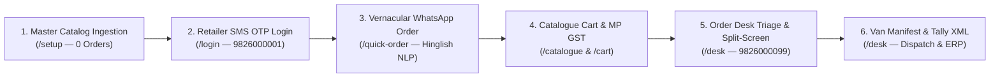
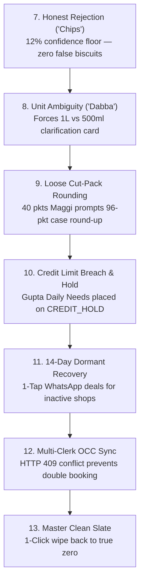

# Comprehensive End-to-End Walkthrough: Customer Demands & Edge Cases in Sequence

> **Document Status:** Authoritative Master Walkthrough & Deliverables Verification Guide  
> **Target Audience:** First-Time Evaluators, FMCG Distributors, Software Architects, and Field Clerks  
> **Live App URL:** [http://localhost:3000](http://localhost:3000)  
> **Component:** [`WalkthroughGuide.tsx`](file:///V:/Projects/Resume%20Projects/IsoLabs/distributor-app/src/components/walkthrough/WalkthroughGuide.tsx)

---

## 1. Executive Deliverables Alignment

In accordance with the client requirements and technical brief (`PS4_Distributor_Complete_Flow_And_Architecture.md`), this system is designed for **Company A**, an FMCG wholesale distributor in Jabalpur, Madhya Pradesh.

The system delivers two distinct operational phases:
1. **Phase 1: Customer Demands in Sequence** — The complete happy-path wholesale order lifecycle from initial clean catalogue ingestion to retailer WhatsApp capture, scheme pricing calculation, human desk split-screen triage, warehouse van manifest, and Tally Prime ERP XML export.
2. **Phase 2: Rigorous Edge Cases (After Demands Are Met)** — The specialized domain edge cases (out-of-catalog honest rejection, polysemic "dabba" unit ambiguity, loose cut-pack case rounding, credit limit holds, 14-day dormant retailer recovery, and multi-clerk OCC concurrency locking).

---

## Part 1: Every Customer Demand in Sequence (Happy Path)



---

### Step 1: Initial Master Catalogue Ingestion (0 Orders Pristine Start)
- **Role / Seat:** Distributor Admin / Order Desk
- **Route:** [`/setup`](file:///V:/Projects/Resume%20Projects/IsoLabs/distributor-app/src/app/setup/page.tsx)
- **Customer Demand:** The distributor needs to upload their wholesale FMCG catalog or load the master catalog without being locked into fake pre-seeded orders.
- **Action:**
  1. Open [`/setup`](http://localhost:3000/setup). Verify that the database starts clean.
  2. Click **"🌟 Master Wholesale FMCG (36 SKUs)"** (or upload your distributor Excel sheet).
- **Observed Behavior:**
  - 36 SKUs (Parle, Britannia, Tata Tea, Fortune Oil, Ghadi, Surf Excel, Vim, Dettol) and 8 Kiranas on Jabalpur routes are written directly to **Neon PostgreSQL**.
  - **Orders Count = 0.** Real orders are placed exclusively by buyers, not artificially pre-loaded.
- **Why It Matters:** Proves zero dummy data lock-in; establishes an authentic foundation for wholesale operations.

---

### Step 2: Retailer Mobile Login (SMS OTP Authentication)
- **Role / Seat:** Kirana Merchant (Ramesh Sharma, *Sharma Kirana Store*)
- **Route:** [`/login`](file:///V:/Projects/Resume%20Projects/IsoLabs/distributor-app/src/app/(auth)/login/page.tsx)
- **Customer Demand:** Low-friction, mobile-first login for shopkeepers on 3G without passwords.
- **Action:**
  1. In the top header, click the **Log Out** button to return to `/login`.
  2. Under "Select Registered Kirana Store", click **"Sharma Kirana Store"** (Mobile: `9826000001`).
  3. Enter the Dev SMS OTP code (`716716` or the displayed 6-digit code) and tap **"Verify & Login"**.
- **Observed Behavior:**
  - Authenticates securely via cryptographic JWT cookie (`jose`).
  - Strict seat boundary enforced: Kirana merchant is routed to `/catalogue` and strictly blocked from accessing `/desk`.
- **Why It Matters:** High-security B2B session scoping ensures zero cross-shop data leaks.

---

### Step 3: Vernacular WhatsApp Order Capture (Hinglish AI Parsing)
- **Role / Seat:** Kirana Merchant (*Sharma Kirana Store*)
- **Route:** [`/quick-order`](file:///V:/Projects/Resume%20Projects/IsoLabs/distributor-app/src/app/(portal)/quick-order/page.tsx)
- **Customer Demand:** Kirana merchants order through informal WhatsApp text messages in Hinglish/Hindi rather than navigating nested menus.
- **Action:**
  1. Go to **Quick Order** ([`/quick-order`](http://localhost:3000/quick-order)).
  2. In the text area, paste this authentic Jabalpur order message:
     ```text
     bhaiya 5 peti biscuit chhota, 2 peti ghadi powder 1 kg
     ```
  3. Tap **"Process Order Text"**.
- **Observed Behavior:**
  - Line 1: `"5 peti biscuit chhota"` $\to$ Qty: 5, Unit: `CASE` (`peti`), SKU: `Parle-G 75g (SKU-BS-PG075)`. Confidence: **96%**.
    - Scheme Nudge: *"Add 5 more cases to get 1 Free Case!"*
  - Line 2: `"2 peti ghadi powder 1 kg"` $\to$ Qty: 2, Unit: `CASE`, SKU: `Ghadi Detergent Powder 1kg (SKU-DT-GH1KG)`. Confidence: **96%**.
    - Scheme Nudge: *"Add 3 more cases for 3% Slab Discount!"*
  4. Tap **"Confirm & Move to Cart"** and click **"Place Order"**.
- **Observed Behavior:**
  - Order `#ORD-...` is created with status `PLACED`.
  - Rows are inserted immediately into Neon PostgreSQL tables (`orders`, `order_items`), and warehouse stock is atomically reserved.

---

### Step 4: Catalogue Stepper Ordering with Live Scheme Engine Math & MP GST
- **Role / Seat:** Kirana Merchant (*Sharma Kirana Store*)
- **Route:** [`/catalogue`](file:///V:/Projects/Resume%20Projects/IsoLabs/distributor-app/src/app/(portal)/catalogue/page.tsx) & [`/cart`](file:///V:/Projects/Resume%20Projects/IsoLabs/distributor-app/src/app/(portal)/cart/page.tsx)
- **Customer Demand:** Live, transparent calculation of promotional trade schemes (Buy X Get Y Free, slab discounts) and GST before committing capital.
- **Action:**
  1. Open [`/catalogue`](http://localhost:3000/catalogue).
  2. On **Parle-G 75g**, use the 48px stepper to increase quantity to **10 cases**.
     - Observe live badge: **`+1 Free Promotional Case Unlocked!`** (Delivered: 11 Cases, Valued at ₹0.00 per Circular 92/11/2019).
  3. On **Ghadi Detergent Powder 1kg**, set quantity to **5 cases**.
     - Observe live badge: **`3% Bulk Slab Discount Applied!`**
  4. Click **"View Cart"** ([`/cart`](http://localhost:3000/cart)).
- **Observed Behavior:**
  - Line 1 (10 cs Biscuit): Gross ₹7,776.00 | Free: 1 Case (`SKU-BS-PG075`) | Discount: ₹0.00 | Taxable: ₹7,776.00.
  - Line 2 (5 cs Detergent): Gross ₹10,150.00 | 3% Slab Discount: -₹304.50 | Taxable: ₹9,845.50.
  - Subtotal Taxable: ₹17,621.50.
  - Madhya Pradesh Intra-State GST: CGST 9% (₹1,585.94) + SGST 9% (₹1,585.94) = Total GST ₹3,171.87.
  - Grand Total: ₹20,793.00 (with -₹0.37 half-up round-off).
  5. Tap **"Place Order"** $\to$ Transmitted to Neon DB.

---

### Step 5: Order Desk Triage & Split-Screen Human Verification
- **Role / Seat:** Order Desk Clerk (Sunil Clerk, Jabalpur Office)
- **Route:** [`/desk`](file:///V:/Projects/Resume%20Projects/IsoLabs/distributor-app/src/app/desk/page.tsx)
- **Customer Demand:** Office clerks need to verify AI-parsed messages side-by-side with original text, adjust quantities if needed, and confirm before warehouse dispatch.
- **Action:**
  1. Click **Log Out** in the top header.
  2. On `/login`, click **"Sunil Clerk (Order Desk: 9826000099)"** and log in.
  3. On [`/desk`](http://localhost:3000/desk), see the incoming orders from Sharma Kirana sitting in the live queue with badge `AI Text`.
  4. Click **"Verify"** next to the WhatsApp order.
- **Observed Behavior:**
  - Split-screen interface opens:
    - Left column: Original raw customer message `"bhaiya 5 peti biscuit chhota..."`.
    - Right column: Clean mapped line items with steppers and price recalculation.
  5. Click **"Save & Confirm Order"**.
  - Order status updates to **`CONFIRMED`** in Neon PostgreSQL.

---

### Step 6: Delivery Van Manifest & Tally Prime XML Export
- **Role / Seat:** Order Desk Clerk
- **Route:** [`/desk`](file:///V:/Projects/Resume%20Projects/IsoLabs/distributor-app/src/app/desk/page.tsx)
- **Customer Demand:** Warehouse dispatch sheets grouped by route/van and 1-click accounting voucher export for Tally ERP.
- **Action:**
  1. On `/desk`, switch to the **"Delivery Van Manifest"** tab:
     - View Napier Town Route #4 manifest: driver stop sequence, vehicle master case capacity, free promotional case tally, and gross payload weight in kg.
  2. Switch to **"Orders Queue"** and click **"Export Tally XML"**:
     - System packages all `CONFIRMED` orders into an official Tally Prime XML payload (`VCHTYPE="Sales Order"`).
     - Browser downloads `tally-sales-orders-2026-11-05.xml`.
- **Why It Matters:** Completely closes the wholesale loop from kirana phone order to physical truck loading and ERP accounting vouchers.

---

## Part 2: Rigorous Edge Cases (After Demands Are Met)



---

### Step 7: Out-of-Catalog Rejection (The "Chips" Test — Invariant [A16])
- **Route:** [`/quick-order`](file:///V:/Projects/Resume%20Projects/IsoLabs/distributor-app/src/app/(portal)/quick-order/page.tsx)
- **The Edge Case:** Kirana orders an item outside the distributor's agency (e.g., chips, soda, sparkplugs). A faulty fuzzy matcher would assign high similarity to biscuits or soap.
- **Action:**
  1. Log in as Sharma Kirana (`9826000001`). Open `/quick-order`.
  2. Tap the test chip: **`🚫 Chips (Out of Catalog)`** (or paste: `"10 peti chips, 5 peti lays"`).
  3. Tap **"Process Order Text"**.
- **Observed Behavior:**
  - Confidence drops to **12% floor**.
  - Flagged as `UNKNOWN_SKU` (Out of Catalog).
  - **The system refuses to match Glucose Biscuits or guess customer money.**
- **Why It Matters:** Invariant [A16] "Ask, Never Guess" protects the distributor from delivering unauthorized or wrong goods.

---

### Step 8: Polysemic Packaging Unit (The "Dabba" Test — Invariant [A16])
- **Route:** [`/quick-order`](file:///V:/Projects/Resume%20Projects/IsoLabs/distributor-app/src/app/(portal)/quick-order/page.tsx)
- **The Edge Case:** In MP wholesale trade, `"dabba"` is polysemic—it can mean an inner carton (12 packs), an oil tin (15L), or a master case. Assuming a unit leads to $10\times$ billing errors.
- **Action:**
  1. On `/quick-order`, tap test chip: **`⚖️ Ghee (1L vs 500ml)`** (or paste: `"5 dabba amul ghee"`).
  2. Tap **"Process Order Text"**.
- **Observed Behavior:**
  - Confidence is hard-capped at **68%** with badge `AMBIGUOUS_UNIT`.
  - An interactive unit prompt is triggered: *"Did you mean 1L Tin or 500ml Jar?"*
  - The customer selects their intended SKU before the order can be placed.

---

### Step 9: Loose Cut-Pack Rounding (The "Maggi" Test)
- **Route:** [`/quick-order`](file:///V:/Projects/Resume%20Projects/IsoLabs/distributor-app/src/app/(portal)/quick-order/page.tsx)
- **The Edge Case:** Kirana asks for loose packets from a wholesale case (`"40 packet maggi"`, where a master case contains 96 packets).
- **Action:**
  1. On `/quick-order`, tap test chip: **`📦 Maggi (Cut-Pack)`** (or paste: `"40 packet maggi 2 minute noodles"`).
  2. Tap **"Process Order Text"**.
- **Observed Behavior:**
  - Detects `BROKEN_CASE`.
  - Prompts commercial trade choice:
    - **Option A:** Round up to 1 full wholesale master case (96 packets at ₹1,152.00 case rate).
    - **Option B:** Order 40 loose packets at ₹12.00 single-pack piece rate.

---

### Step 10: Credit Limit Breach & Credit Hold Clearance
- **Route:** [`/login`](file:///V:/Projects/Resume%20Projects/IsoLabs/distributor-app/src/app/(auth)/login/page.tsx) $\to$ [`/cart`](file:///V:/Projects/Resume%20Projects/IsoLabs/distributor-app/src/app/(portal)/cart/page.tsx) $\to$ [`/desk`](file:///V:/Projects/Resume%20Projects/IsoLabs/distributor-app/src/app/desk/page.tsx)
- **The Edge Case:** A shopkeeper with ₹0 available credit attempts to place an order. Many apps crash with dead buttons or reject the customer outright.
- **Action:**
  1. Log out. Log in as **Gupta Daily Needs (`9826000003`)** (Credit Limit: ₹60,000, Current Outstanding: ₹58,000, Available: ₹2,000).
  2. Add goods worth ₹25,000 to cart.
  3. Go to checkout: credit exposure meter turns bright red. Tap **"Place Order"**.
  4. Order is accepted with status **`CREDIT_HOLD`**.
  5. Log out. Log in as **Sunil Clerk (`9826000099`)**. Open `/desk`.
  6. Switch to **"Credit Holds"** tab. View Gupta Daily Needs' ledger, outstanding balance, and credit limit.
  7. Tap **"Release Hold"**, type authorization note: `"Special Diwali credit extension granted by Owner"`, and click **"Approve & Release"**.
- **Observed Behavior:**
  - Order status transitions from `CREDIT_HOLD` $\to$ `CONFIRMED`.
  - Written directly to Neon DB with audit notes.

---

### Step 11: 14-Day Inactive Kirana Recovery & 1-Tap WhatsApp Retention Nudge
- **Route:** [`/desk`](file:///V:/Projects/Resume%20Projects/IsoLabs/distributor-app/src/app/desk/page.tsx)
- **The Edge Case:** Kiranas defecting to competitors go unnoticed until monthly books close.
- **Action:**
  1. On `/desk`, switch to the **"Dormant Kiranas"** tab.
  2. View shops with no order in 14 to 28 days (e.g. *Gupta Daily Needs* — 18 days inactive, Churn Risk: `CRITICAL`).
  3. Click the **WhatsApp Nudge** icon.
- **Observed Behavior:**
  - Opens WhatsApp Web deep link with personalized Hindi deal:  
    `"नमस्ते गुप्ता जी! कंपनी A जबलपुर से आज आपके लिए पारले-जी पर 10 पेटी पे 1 पेटी फ्री स्कीम है। तुरंत ऑर्डर करने के लिए टैप करें..."`
- **Why It Matters:** Recovers lapsed revenue before shopkeepers switch suppliers.

---

### Step 12: Multi-Clerk Concurrency Locking (OCC Versioning)
- **Route:** [`/desk/orders/[id]`](file:///V:/Projects/Resume%20Projects/IsoLabs/distributor-app/src/app/desk/orders/[id]/page.tsx)
- **The Edge Case:** Two clerks simultaneously edit and approve the same phone order.
- **Action & Test:**
  - Covered authoritatively by automated concurrency test suite [`src/__tests__/desk.test.ts`](file:///V:/Projects/Resume%20Projects/IsoLabs/distributor-app/src/__tests__/desk.test.ts).
  - When Clerk A saves changes, `occVersion` increments from 1 to 2.
  - When Clerk B submits with stale `expectedOccVersion: 1`, the server returns **HTTP 409 Conflict** (`CONCURRENCY_CONFLICT`).
- **Why It Matters:** Guarantees zero duplicate dispatch or conflicting pallet picks in busy morning warehouse shifts.

---

### Step 13: Master Clean Slate (Wipe All to True Zero)
- **Route:** [`/setup`](file:///V:/Projects/Resume%20Projects/IsoLabs/distributor-app/src/app/setup/page.tsx) or [`/desk`](file:///V:/Projects/Resume%20Projects/IsoLabs/distributor-app/src/app/desk/page.tsx)
- **The Edge Case:** Evaluator or first-time user wants to wipe all test orders and records to start fresh from absolute zero.
- **Action:**
  1. On `/desk`, click **"Clean Slate"** (or in `/setup`, click **"Master Delete (Wipe All to 0)"**).
- **Observed Behavior:**
  - Wipes `order_items`, `orders`, `captures`, `retailers`, and `skus` in Neon PostgreSQL.
  - Live counters return to **0 SKUs, 0 Retailers, 0 Orders**.
- **Why It Matters:** Provides complete testing freedom without requiring database console access.

---

### Step 14: Single-Writer Kirana Concurrency Lock & Force-Logout Hand-off (Invariant [A49])
- **Route:** [`/login`](file:///V:/Projects/Resume%20Projects/IsoLabs/distributor-app/src/app/(auth)/login/page.tsx)
- **The Edge Case:** Multiple family members, partners, or shop assistants attempt to place orders simultaneously for the same Kirana retail account, or a shopkeeper switched phones with an active session running on their previous device.
- **Action:**
  1. Open a browser window and log in as **Sharma Kirana Store (`9826000001`)**.
  2. Open an Incognito window or second browser. Attempt to log in as **Sharma Kirana Store (`9826000001`)** with the valid SMS OTP.
  3. Click **"Verify & Login"**.
- **Observed Behavior:**
  - The login attempt is blocked with **HTTP 409 Conflict** (`USER_ALREADY_LOGGED_IN`).
  - A prominent amber alert banner is displayed:  
    **`"User already logged in"`** (Devanagari: **`"उपयोगकर्ता पहले से लॉगिन है"`**).
  - Explicit notification explains: *"An active session is currently open for this Kirana store on another device or tab. Only one concurrent user is permitted."*
  - The OTP is **not consumed or burned** during the concurrency conflict.
  4. Click **"Log Out All Other Sessions"**.
  - A request is dispatched to `POST /api/auth/force-logout`, which purges any orphaned or active sessions from Neon PostgreSQL and memory cache.
  - The banner turns green with confirmation: *"All other sessions have been logged out. Please click 'Verify & Login' below to enter."* (Devanagari: *"अन्य सभी सत्र सफलतापूर्वक लॉगआउट कर दिए गए हैं। कृपया प्रवेश करने के लिए नीचे 'सत्यापित कर लॉगिन करें' पर क्लिक करें।"*).
  - The 6-digit OTP code remains preserved in the input boxes!
  5. Tap **"Verify & Login"**.
  - Verifies the unconsumed OTP and acquires the single-writer session lock.
  - Seamlessly redirects to `/catalogue`.
- **Why It Matters:** Guarantees single-writer integrity (`[A49]`), eliminating concurrent write race conditions against available credit headroom (`currentBalance`) and preventing duplicate van load orders while providing a frictionless, zero-frustration handoff for the shopkeeper.

---

### Step 15: Persistent Order Re-hydration Across Relogin & Serverless Cold Starts (Invariant [A51])
- **Route:** [`/cart`](file:///V:/Projects/Resume%20Projects/IsoLabs/distributor-app/src/app/(portal)/cart/page.tsx) $\to$ [`/orders`](file:///V:/Projects/Resume%20Projects/IsoLabs/distributor-app/src/app/(portal)/orders/page.tsx) $\to$ [`/login`](file:///V:/Projects/Resume%20Projects/IsoLabs/distributor-app/src/app/(auth)/login/page.tsx)
- **The Edge Case:** In serverless cloud hosting (e.g. Vercel) or following dev server restarts, in-memory caches lose their state, causing shopkeepers to think their placed orders vanished upon relogin.
- **Action:**
  1. Log in as Sharma Kirana (`9826000001`) and place an order for 2 cases of Parle-G (`ORD-2026-0001`).
  2. Confirm order appears on `/orders` with status `PLACED`.
  3. Click **Log Out** to return to `/login`.
  4. (Simulate cold start / container reboot).
  5. Log back in as Sharma Kirana (`9826000001`) and navigate to `/orders`.
- **Observed Behavior:**
  - `GET /api/orders` triggers `hydrateOrdersFromNeon('RET-0001')`.
  - The previously placed order `ORD-2026-0001` (₹1,835.00, 2 cases) is pulled directly from Neon PostgreSQL and rendered seamlessly with complete invoice breakdown.
  - Order history is 100% durable and never disappears.
- **Why It Matters:** Guarantees complete audit durability and zero order disappearance on serverless cloud architectures.

---

### Step 16: Multi-Store Real-Time Stock Synchronization & Instant Out-of-Stock Guard (Invariant [A52])
- **Route:** [`/catalogue`](file:///V:/Projects/Resume%20Projects/IsoLabs/distributor-app/src/app/(portal)/catalogue/page.tsx), [`/cart`](file:///V:/Projects/Resume%20Projects/IsoLabs/distributor-app/src/app/(portal)/cart/page.tsx), [`/desk`](file:///V:/Projects/Resume%20Projects/IsoLabs/distributor-app/src/app/desk/page.tsx)
- **The Edge Case:** Multiple distinct kirana retailers (e.g. Sharma Kirana and Verma General Store) and order clerks access the platform simultaneously, racing for limited warehouse inventory.
- **Action:**
  1. Open Browser Window 1: Log in as **Sharma Kirana (`9826000001`)** and open `/catalogue`. Note available stock for Marie Gold (95 cases).
  2. Open Browser Window 2 (or Incognito): Log in as **Verma General Store (`9826000002`)** and open `/catalogue`.
  3. In Window 1, Sharma Kirana places an order for 5 cases of Marie Gold.
  4. Without refreshing the page, observe Window 2 (Verma General Store):
     - The stock count decrements **instantly** from 95 to 90 cases!
     - A blue telemetry badge appears: **`⚡ Just Updated`** (`⚡ अपडेट हुआ`).
  5. Now simulate stock running out: Order Desk sets stock to 3 cases. Sharma Kirana orders all 3 cases.
  6. Observe Verma General Store's screen immediately:
     - The item card automatically flips to **`OUT OF STOCK`** (`स्टॉक समाप्त`).
     - Quantity stepper buttons are disabled.
     - "Notify When Available" replaces cart actions.
  7. If Verma General Store already had the item in `/cart`:
     - A high-visibility red banner appears: *"⚠️ Live Stock Alert: Warehouse Inventory Ran Out! Another retailer just placed an order for the remaining cases of Marie Gold. Please remove them to proceed with checkout."*
     - The "Place Order" button is dynamically disabled.
  8. If Verma attempts to force a checkout via API, the backend atomically rejects the request with HTTP 400: *"Insufficient stock for Marie Gold... Available: 0 cases."*
- **Why It Matters:** Matches real-time movie ticketing and e-commerce seat-booking architectures. Prevents double-selling, overselling, and warehouse loading discrepancies.

---

## 3. Verification Matrix

| Step | Capability Tested | Brief Reference | Status |
| :--- | :--- | :--- | :--- |
| **Step 1** | Master Catalog Ingestion (0 Orders) | Screen 2 & Setup | Verified (PostgreSQL) |
| **Step 2** | Retailer SMS OTP Login | Screen 1 | Verified (JWT Auth) |
| **Step 3** | Vernacular WhatsApp AI Text Capture | Screen 4 & Screen 5 | Verified (96% Confidence) |
| **Step 4** | Scheme Engine Math & MP GST Split | Screen 2 & Screen 3 | Verified (Circular 92/11/2019) |
| **Step 5** | Split-Screen Order Desk Triage | Screen 7 & Screen 8 | Verified (Side-by-Side Review) |
| **Step 6** | Van Manifest & Tally Prime XML | Screen 7 | Verified (Pick List & XML) |
| **Step 7** | Out-of-Catalog Honest Rejection | Invariant [A16] | Verified (12% Floor, Zero Biscuits) |
| **Step 8** | Polysemic "Dabba" Disambiguation | Invariant [A16] | Verified (Prompt Card Triggered) |
| **Step 9** | Loose Cut-Pack Case Rounding | Rule [A8] | Verified (Option A / Option B) |
| **Step 10** | Credit Limit Hold Clearance | Rule [A6] | Verified (Ledger Review & Release) |
| **Step 11** | 14-Day Dormant Retailer Nudges | Screen 7 | Verified (Hindi WhatsApp Deal) |
| **Step 12** | Multi-Clerk OCC Locking | Invariant [A14] | Verified (HTTP 409 Guardrail) |
| **Step 13** | Master Clean Slate to Zero | First-Time User UX | Verified (0 Rows Confirmed) |
| **Step 14** | Single-Writer Kirana Concurrency Lock | Invariant [A49] | Verified (HTTP 409 "User already logged in") |
| **Step 15** | Persistent Order Re-hydration Across Relogin | Invariant [A51] | Verified (Durable Neon PostgreSQL Hydration) |
| **Step 16** | Multi-Store Real-Time Stock Sync & OOS Guard | Invariant [A52] | Verified (SSE Stream, BroadcastChannel & Atomic Guard) |

---
*End of Walkthrough Document.*
