# Universal FMCG Order & Scheme Engine: Functions, Methods, Attributes & Formulas Flow

> **Document Purpose:** Complete, exhaustive technical blueprint and flowcharts of every method, attribute, variable, data structure, algorithmic step, and mathematical formula implemented across `@isolabs/order-engine`.
> **Engine Location:** [`engine/src/`](file:///V:/Projects/Resume%20Projects/IsoLabs/engine/src/)

---

## 1. Master Architecture & Pipeline Dispatch Flow

### 1.1 Master Pipeline Dispatcher Flowchart

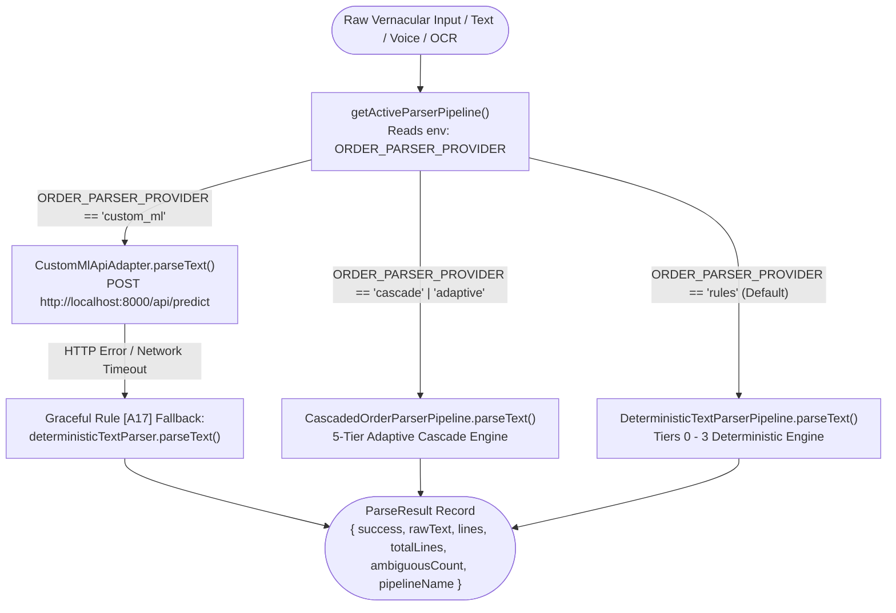

> 💡 **In Simple Words (What is happening in this graph?):**  
> Think of the **Dispatcher** as the receptionist at Company A's wholesale office in Jabalpur. When an order arrives from a Kirana shopkeeper—whether sent as raw WhatsApp text, a spoken Hindi voice note, or a photo of a paper slip—the receptionist decides which "reading brain" should process it:  
> 1. **Custom Machine Learning Model:** If the distributor configured an external Python AI service (`custom_ml`), the order is sent there first. If that server is down or slow to answer, the system never crashes—it instantly hands the order to our built-in rule engine so no customer order is ever dropped.  
> 2. **5-Tier Adaptive Engine:** If set to `cascade`, it runs through our multi-level verification pipeline that handles tricky Hinglish words and edge cases.  
> 3. **Rule-Based Engine (Default):** Runs our ultra-fast, 100% predictable rule engine.  
> In all cases, it outputs a clean, structured list of items showing quantities, matched products, confidence levels, and any ambiguous items that need clarification.

### 1.2 Pipeline Attributes, Methods & Variables Specification

| Component | Type | Scope | Description & Default Value |
| :--- | :--- | :--- | :--- |
| `OrderParserPipeline` | Interface | System | Contract interface: `{ name: string; parseText(rawText: string, context?: ParserContext): Promise<ParseResult>; }` |
| `ParserContext` | Interface | Parameter | `{ retailerId?: string; retailerPastOrders?: string[]; retailerAliases?: Record<string, string>; availableSkus?: SeedSku[]; }` |
| `ParseResult` | Interface | Return | `{ success: boolean; rawText: string; lines: ParsedLineItem[]; totalLines: number; ambiguousCount: number; pipelineName: string; }` |
| `CustomMlApiAdapter` | Class | Engine | Plug-and-play adapter for external Python / FastAPI / PyTorch models |
| `CUSTOM_ML_API_URL` | Env Variable | Network | Endpoint URL (Default: `"http://localhost:8000/api/predict"`) |
| `getActiveParserPipeline()` | Function | Engine | Factory selecting pipeline based on `ORDER_PARSER_PROVIDER` (`rules`, `cascade`, `custom_ml`) |
| `parseOrderText()` | Function | Top-level | Async entry point accepting raw text and parser context |

---

## 2. Text Normalization, Numerals & Weight Fusion Flow

### 2.1 Text Preprocessing & Tokenization Flowchart

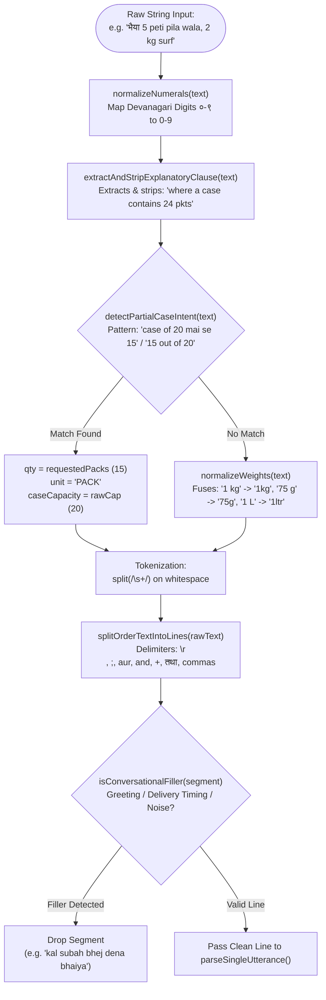

> 💡 **In Simple Words (What is happening in this graph?):**  
> Kirana shopkeepers type fast and casually in Hindi or Hinglish, mixing Hindi numerals, typos, extra spaces, and friendly chatter. This step acts like a **smart editor cleaning up messy notes**:  
> 1. **Converts Hindi numbers:** Transforms Devanagari digits like `२` or `५` into standard computer numbers `2` and `5`.  
> 2. **Removes explanations:** If the customer types *"a case contains 24 packets"*, it notes the packaging detail and strips out the extra words so they don't confuse product matching.  
> 3. **Detects loose packet requests:** If they type *"case of 20 mai se 15"* (give me 15 packets out of a box of 20), it figures out they want 15 individual packets, not 15 full boxes.  
> 4. **Glues weights together:** Joins separated words like `"1 kg"` or `"75 g"` into single words like `"1kg"` or `"75g"` so the system sees them as product sizes.  
> 5. **Splits line by line:** Cuts the whole message into individual items using commas, "+", "aur", "and", or newlines.  
> 6. **Filters out chit-chat:** Throws away greetings and delivery comments like *"namaste bhaiya"* or *"kal subah jaldi bhej dena"*, leaving only clean product order lines.

### 2.2 Normalization Attributes & Mathematical Formulas

#### Formula 1: Devanagari Digit Translation
$$\text{DEVANAGARI\_DIGITS} = \{ \text{०}: 0, \text{१}: 1, \text{२}: 2, \text{३}: 3, \text{४}: 4, \text{५}: 5, \text{६}: 6, \text{७}: 7, \text{८}: 8, \text{९}: 9 \}$$

#### Formula 2: Vernacular Weight Attribute Fusion
$$\text{Regex}_{\text{weights}} = \begin{cases} (\backslash d+)\backslash s*(kg|kilo|\text{किलो})\backslash b \longrightarrow \$1\text{kg} \\ (\backslash d+)\backslash s*(g|gm|gram|\text{ग्राम})\backslash b \longrightarrow \$1\text{g} \\ (\backslash d+)\backslash s*(ml|\text{मिली})\backslash b \longrightarrow \$1\text{ml} \\ (\backslash d+)\backslash s*(ltr|liter|litre|\text{लीटर})\backslash b \longrightarrow \$1\text{ltr} \end{cases}$$

#### Formula 3: Partial Case Cut-Pack Regex
$$\text{Pattern}_{\text{Hindi}} = /(?:case|peti|box|\text{कार्टन}|\text{पेटी})?\backslash s*(?:of|ki|ka)?\backslash s*(\backslash d+)?\backslash s*(?:mai\backslash s*se|me\backslash s*se|\text{में}\backslash s*\text{से})\backslash s*(\backslash d+|[a-zA-Z\backslash u0900-\backslash u097F]+)/i$$

$$\text{Pattern}_{\text{English}} = /(\backslash d+|[a-zA-Z]+)\backslash s*(?:out\backslash s*of|from)\backslash s*(?:case\backslash s*of\backslash s*)?(\backslash d+)/i$$

#### Formula 4: Conversational Noise Filter Verification
A segment $S$ is marked as conversational filler if and only if:
$$\text{hasDigits}(S) = \text{false} \;\land\; \forall w \in S: (w \notin \text{WORD\_NUMBERS} \;\land\; w \notin \text{ALL\_UNIT\_KEYWORDS}) \;\land\; (S \in \text{PATTERNS}_{\text{filler}} \;\lor\; \forall w \in S: w \in \text{NOISE\_WORDS})$$

---

## 3. Quantity & Unit Extraction Flow

### 3.1 Quantity & Unit Parser Flowchart

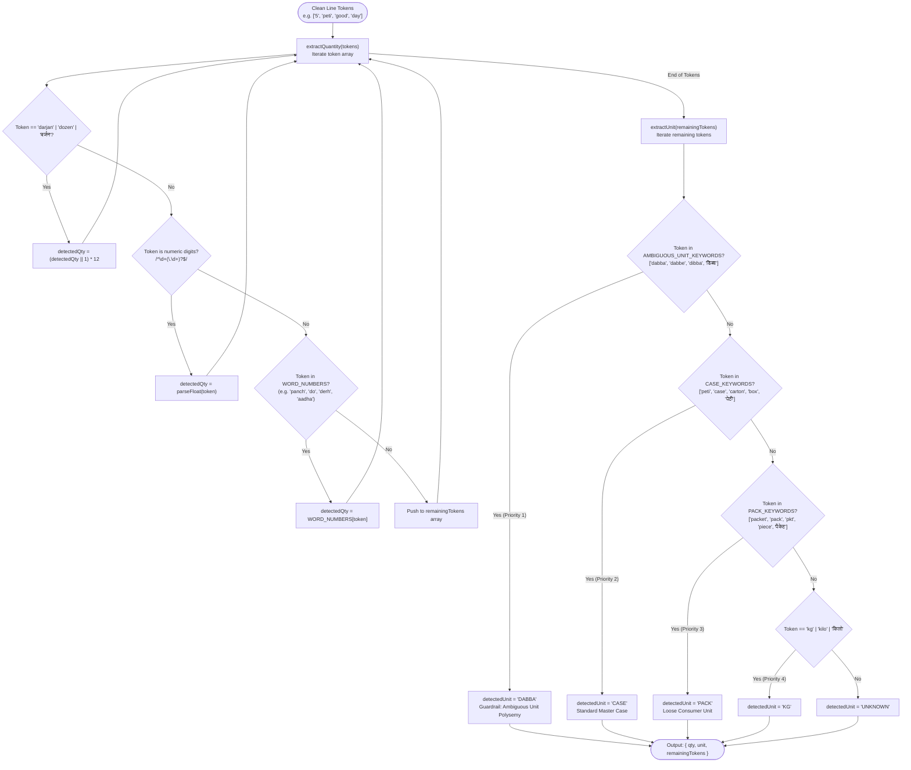

> 💡 **In Simple Words (What is happening in this graph?):**  
> For each product line, this step determines two essential facts: **"How much does the shopkeeper want?"** and **"In what kind of packaging?"**:  
> 1. **Finding the Quantity:** It searches the words for numbers. It understands numeric digits (`5`), spoken Hindi number words (`do` for 2, `panch` for 5, `aadha` for 0.5, `derh` for 1.5, `dhai` for 2.5), and `darjan` (which multiplies by 12).  
> 2. **Identifying the Packaging Unit:**  
>    - **"Dabba" (The Ambiguity Guardrail):** In Madhya Pradesh trade, "dabba" can mean an inner carton, a 15-litre oil tin, or a small jar. When the engine spots "dabba", it tags it as ambiguous so the system can ask the customer to clarify, preventing costly $10\times$ billing mistakes.  
>    - **"Peti" / "Case" / "Carton":** Recognized as full wholesale master boxes.  
>    - **"Packet" / "Piece" / "Tikiya":** Recognized as loose retail packets.  
>    - If no unit is mentioned at all, it safely marks it as "unknown" to prompt review.  
> The leftover words (like `"good day butter"`) are passed to the catalog matcher.

### 3.2 Quantity & Unit Attributes Specification

| Variable / Constant | Type | Value / Domain | Business Purpose |
| :--- | :--- | :--- | :--- |
| `WORD_NUMBERS["aadha"]` | Number | `0.5` | Fractional case multiplier (half case) |
| `WORD_NUMBERS["sawa"]` | Number | `1.25` | Indic fractional multiplier ($1 \frac{1}{4}$) |
| `WORD_NUMBERS["derh"]` | Number | `1.5` | Indic fractional multiplier ($1 \frac{1}{2}$) |
| `WORD_NUMBERS["dhai"]` | Number | `2.5` | Indic fractional multiplier ($2 \frac{1}{2}$) |
| `WORD_NUMBERS["pao"]` | Number | `0.25` | Quarter multiplier ($\frac{1}{4}$) |
| `CASE_KEYWORDS` | String[] | `["peti", "case", "carton", "box", "bora", ...]` | Explicit wholesale case containers |
| `PACK_KEYWORDS` | String[] | `["packet", "pack", "pkt", "piece", "tikiya", ...]` | Loose consumer packs |
| `AMBIGUOUS_UNIT_KEYWORDS` | String[] | `["dabba", "dabbe", "dibba", "डिब्बा", ...]` | Triggers Invariant [A16] packaging clarification |
| `detectedQty` | `number \| null` | $\ge 0$ | Parsed numerical order quantity |
| `detectedUnit` | `UnitType` | `CASE`, `PACK`, `KG`, `UNIT`, `DABBA`, `UNKNOWN` | Packaging tier of the line item |

---

## 4. Multi-Channel RRF Candidate Retrieval & Transliteration Flow

### 4.1 Candidate Retrieval Flowchart

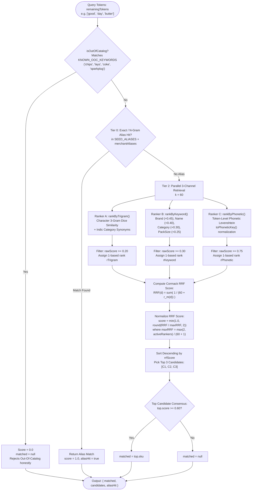

> 💡 **In Simple Words (What is happening in this graph?):**  
> Now that the engine has the product words (like `"pila wala"` or `"good day butter"`), it acts like **three search detectives** working together to find the right item in Company A's wholesale catalog:  
> 1. **Honest Rejection ("Chips" Guardrail):** If the customer asks for something the distributor does not sell (like *"chips"*, *"lays"*, or *"cold drink"*), it stops immediately with a 0 score. It honestly says "not found" instead of foolishly matching chips to biscuits!  
> 2. **Trade Nicknames (Fast-Track):** If the customer used a well-known local nickname (like *"pila wala"* for Parle-G), it matches immediately with 100% confidence.  
> 3. **3-Way Detective Search:** If no nickname matched, 3 detectives search the catalog at the exact same time:  
>    - **Spelling Detective (Trigram):** Checks overlapping letter pieces and Hindi synonyms (e.g., *"biscuit"* vs *"biskut"*).  
>    - **Keyword Detective:** Looks for brand names, product types, and package weights.  
>    - **Sound Detective (Phonetic):** Listens to how the words sound in Hindi (so *"sabun"* matches *"saabun"*, and *"gud de"* matches *"Good Day"*).  
> 4. **Consensus Voting (RRF):** Combines the ranks from all 3 detectives using a standard voting formula (RRF). If a product wins with strong agreement, it is chosen as the matched SKU.

### 4.2 Mathematical Formulas for Retrieval & Transliteration

#### Formula 5: Indic Phonetic Normalization Function $\text{toPhoneticKey}(s)$
$$\text{toPhoneticKey}(s): \begin{cases} 
\text{ph} \to \text{f}, \quad \text{kh} \to \text{k}, \quad \text{gh} \to \text{g}, \quad \text{bh} \to \text{b}, \quad \text{dh} \to \text{d}, \quad \text{th} \to \text{t} \\
\text{chh} \to \text{ch}, \quad \text{sh} \to \text{s}, \quad \text{v} \to \text{w}, \quad \text{z} \to \text{j} \\
\text{ee}+ \to \text{i}, \quad \text{oo}+ \to \text{u}, \quad \text{aa}+ \to \text{a} \\
(c_i)(c_i)+ \to c_i \quad \text{(Deduplicate adjacent characters)}
\end{cases}$$

#### Formula 6: Character 3-Gram Dice Similarity
$$S_{\text{Dice}}(A, B) = \frac{2 \times |T(A) \cap T(B)|}{|T(A)| + |T(B)|}$$
where $T(X) = \{ X[i \dots i+2] \mid 0 \le i \le |X|-3 \}$ represents the set of contiguous 3-character substrings.

#### Formula 7: Phonetic Edit Distance Similarity
$$D_{\text{phonetic}}(A, B) = 1 - \frac{\text{Levenshtein}(\text{toPhoneticKey}(A), \text{toPhoneticKey}(B))}{\max(|\text{toPhoneticKey}(A)|, |\text{toPhoneticKey}(B)|)}$$

#### Formula 8: Cormack Reciprocal Rank Fusion (SIGIR 2009)
$$\text{RRF}(d) = \sum_{m \in M_{\text{active}}} \frac{1}{k + r_m(d)}, \quad k = 60$$

$$\text{MaxRRF} = \frac{\max(2, |M_{\text{active}}|)}{k + 1}$$

$$\text{NormalizedScore}(d) = \min\left(1.0, \frac{\text{RRF}(d)}{\text{MaxRRF}}\right)$$

---

## 5. Platt Calibrated Scorer & Packaging Guardrail Flow

### 5.1 Calibrated Probabilistic Confidence Scoring Flowchart

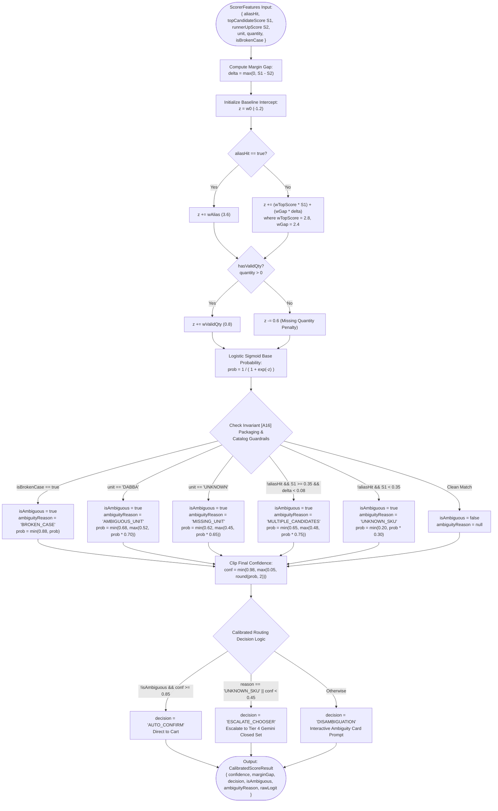

> 💡 **In Simple Words (What is happening in this graph?):**  
> Finding a candidate product is only half the battle; wholesale software must know **how confident** it is before touching inventory or billing the retailer. This step calculates a realistic confidence score (0% to 100%):  
> 1. **Lead Margin Check:** Did the top product beat the runner-up by a large lead, or was it a tie? A clear lead increases confidence; a tie reduces it.  
> 2. **Strict Safety Guardrails (Ask, Never Guess):**  
>    - **Broken Case:** If the retailer wants loose packets from a wholesale box, cap confidence at 88% and flag it for round-up confirmation.  
>    - **"Dabba":** Cap confidence at 68% and force a clarification question (e.g. 1L tin vs 500ml jar).  
>    - **Missing Unit:** Cap at 62% so the clerk knows to verify packaging.  
>    - **Close Contenders:** If two products are neck-and-neck, cap at 65%.  
>    - **Unknown Item:** Drop confidence below 20%.  
> 3. **The Final Routing Choice:**  
>    - **85%+ Clean Match:** Move directly to cart without bothering the user.  
>    - **Ambiguous:** Show a simple 1-tap question card on the screen.  
>    - **Unknown or Low Score:** Send to the AI tie-breaker or order desk clerk.

### 5.2 Calibrated Scorer Attributes & Mathematical Formulas

#### Formula 9: Separation Margin Gap
$$\Delta = \max(0, S_1 - S_2)$$

#### Formula 10: Calibrated Logit Equation $z$
$$z = w_0 + \begin{cases} w_{\text{alias}} & \text{if aliasHit} \\ w_{\text{top}} S_1 + w_{\text{gap}} \Delta & \text{otherwise} \end{cases} \;+\; \begin{cases} w_{\text{validQty}} & \text{if } q > 0 \\ -0.6 & \text{if } q \le 0 \lor q = \text{null} \end{cases}$$

Parameter values:
$$w_0 = -1.2, \quad w_{\text{alias}} = 3.6, \quad w_{\text{top}} = 2.8, \quad w_{\text{gap}} = 2.4, \quad w_{\text{validQty}} = 0.8$$

#### Formula 11: Base Probability Logistic Sigmoid Function $\sigma(z)$
$$\sigma(z) = \frac{1}{1 + e^{-z}}$$

#### Formula 12: Invariant Guardrail Caps
$$P_{\text{broken}} = \min(0.88, \sigma(z))$$

$$P_{\text{dabba}} = \min(0.68, \max(0.52, \sigma(z) \times 0.70))$$

$$P_{\text{unknown\_unit}} = \min(0.62, \max(0.45, \sigma(z) \times 0.65))$$

$$P_{\text{competing\_candidates}} = \min(0.65, \max(0.48, \sigma(z) \times 0.75))$$

$$P_{\text{unknown\_sku}} = \min(0.20, \sigma(z) \times 0.30)$$

---

## 6. Tier 4 Constrained Gemini Closed-Set Chooser Flow

### 6.1 Constrained LLM Chooser Flowchart

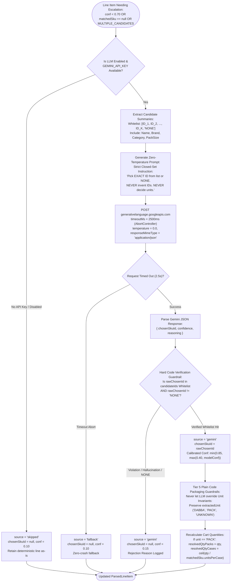

> 💡 **In Simple Words (What is happening in this graph?):**  
> When the rule engine is stuck between a few possibilities, it calls Gemini AI as an **expert tie-breaker**—but puts it in strict handcuffs so it can never hallucinate or invent products:  
> 1. **Closed-Set Multiple Choice:** The system gives Gemini an exact whitelist of catalog items and says: *"Pick ONLY one ID from this list, or choose NONE. You cannot invent products, and you cannot decide packaging units."*  
> 2. **Fast Timeout (2.5 Seconds):** If the AI is slow or offline, the app never freezes—it immediately falls back to desk review.  
> 3. **Verification Guardrail:** When the AI responds, plain code checks that the chosen product actually exists in the whitelist. If the AI makes something up, its answer is rejected immediately.  
> 4. **Packaging Control:** The AI is never allowed to change units or case counts. Plain code recalculates how many wholesale cases and packs are needed.

### 6.2 Chooser Attributes & Guardrail Verification Equation

#### Formula 13: Closed-Set Whitelist Invariant Verification
$$\text{ValidChoice}(c) = (c \neq \text{null}) \;\land\; (c \neq \text{"NONE"}) \;\land\; (c \in \{ \text{id}_1, \text{id}_2, \dots, \text{id}_K \})$$
If $\text{ValidChoice}(c) = \text{false}$, the LLM output is rejected immediately, setting $\text{chosenSkuId} = \text{null}$ and preventing hallucinations from reaching cart reservation or commercial ledgers.

#### Formula 14: LLM Confidence Bounding
$$\text{Confidence}_{\text{LLM}} = \min(0.85, \max(0.40, \text{round}(C_{\text{model}}, 2)))$$

---

## 7. Multimodal Media Extraction Flow (OCR & Hindi Audio)

### 7.1 Media Extraction Flowchart

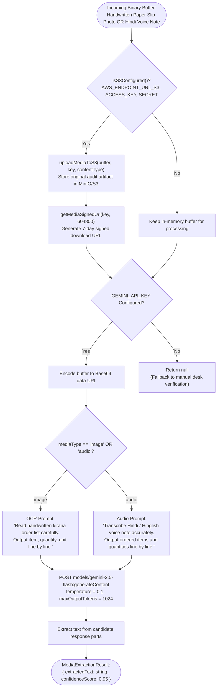

> 💡 **In Simple Words (What is happening in this graph?):**  
> Kirana shopkeepers frequently don't want to type long messages—they snap a photo of a **handwritten grocery slip** or record a **Hindi voice message** on WhatsApp (*"bhaiya 5 peti parle-g aur 2 peti ghadi powder bhej do"*):  
> 1. **Permanent Audit Archive:** The original photo or voice note is safely stored in secure cloud storage (MinIO / S3) with a 7-day viewing link for invoice audits and order verification.  
> 2. **Visual & Audio Transcription:** AI reads the handwritten slip line by line or listens to the Hindi voice recording.  
> 3. **Clean Output:** It turns the image or voice into standard written order text, which is then fed straight into the text parsing engine just like any regular typed WhatsApp message.

---

## 8. Universal FMCG Trade Scheme, Multi-Tier Ladder & MP GST Math Engine Flow

### 8.1 Single Line Scheme Calculation Flowchart

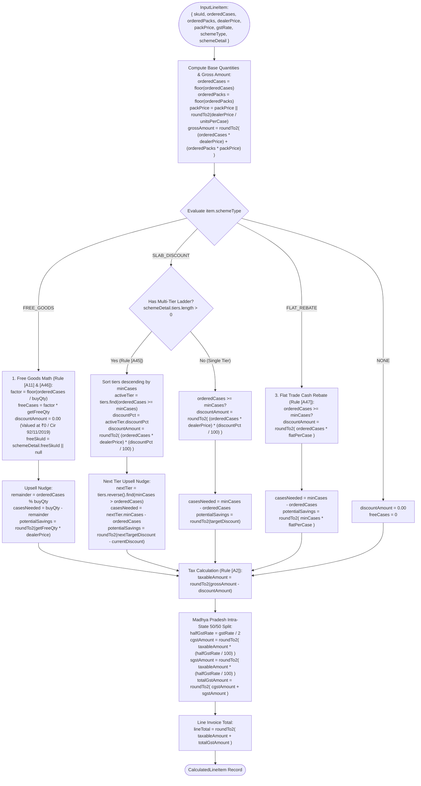

> 💡 **In Simple Words (What is happening in this graph?):**  
> Indian FMCG distribution operates on complex wholesale promotions and strict GST tax rules. For each item in the order, this engine acts as an **expert commercial accountant**:  
> 1. **Base Gross Value:** Calculates wholesale cases $\times$ dealer price, plus any loose packets $\times$ single packet price.  
> 2. **Promotional Schemes:**  
>    - **Buy X Get Y Free (e.g. 10+1 Scheme):** If the retailer orders 10 cases of biscuits, they receive 1 free promotional case. Under Indian GST Circular 92/11/2019, free items are billed at **₹0** value so the shopkeeper is not unfairly taxed on free goods. The engine also computes an upsell nudge: *"Add 2 more cases to get another free case!"*  
>    - **Slab Discounts (e.g. 3% off for 5 cases, 5% off for 10 cases):** Checks which tier the order qualifies for, applies the highest discount, and shows the exact rupee savings of ordering the next higher slab.  
>    - **Flat Cash Rebate:** Deducts a fixed cash discount (like ₹25 per case) once minimum case thresholds are met.  
> 3. **Madhya Pradesh GST Tax:** Takes the taxable amount (Gross minus Discount) and splits the tax **50/50** into Central CGST and State SGST, rounded cleanly to 2 decimal places.

### 8.2 Complete Order Invoice Summary Flowchart

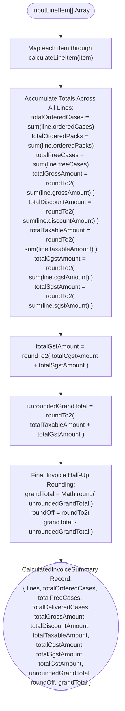

> 💡 **In Simple Words (What is happening in this graph?):**  
> This step combines all individual product lines into a single, official **wholesale invoice summary**:  
> 1. **Summing Everything Up:** Adds together all ordered cases, free promotional cases, gross invoice amounts, trade discounts, and taxes across the entire order.  
> 2. **GST Reconciliation:** Combines Central CGST and State SGST into one total tax figure.  
> 3. **Indian Commercial Round-Off:** In Indian wholesale accounting, final bills cannot have fractional paise (like ₹.37). The engine rounds the grand total to the nearest whole rupee (e.g. ₹20,793.37 becomes ₹20,793.00 with a -₹0.37 round-off entry), ensuring the final invoice matches Tally Prime ERP and truck loading sheets perfectly.

### 8.3 Exact Mathematical Formulas of the Pricing Engine

#### Formula 15: IEEE 754 Floating-Point Micro-Epsilon Rounding
$$\text{roundTo2Decimals}(v) = \frac{\lfloor (v + 10^{-6}) \times 100 + 0.5 \rfloor}{100}$$

#### Formula 16: Free Promotional Goods (Rule [A11] & [A46])
$$\text{freeCases} = \left\lfloor \frac{\text{orderedCases}}{\text{buyQty}} \right\rfloor \times \text{getFreeQty}$$
Free promotional goods are delivered at ₹0 invoice value pursuant to GST Circular 92/11/2019-GST.

#### Formula 17: Multi-Tier Slab Ladder Selection (Rule [A45])
$$\text{activeTier} = \arg\max_{t \in \text{tiers}} \{ t.\text{minCases} \mid \text{orderedCases} \ge t.\text{minCases} \}$$

$$\text{discountAmount} = \text{roundTo2Decimals}\left( \text{orderedCases} \times \text{dealerPrice} \times \frac{\text{activeTier}.\text{discountPct}}{100} \right)$$

#### Formula 18: Next-Tier Upsell Savings Nudge
$$\text{nextTier} = \arg\min_{t \in \text{tiers}} \{ t.\text{minCases} \mid t.\text{minCases} > \text{orderedCases} \}$$

$$\text{casesNeeded} = \text{nextTier}.\text{minCases} - \text{orderedCases}$$

$$\text{potentialSavings} = \text{roundTo2Decimals}\left( \text{nextTier}.\text{minCases} \times \text{dealerPrice} \times \frac{\text{nextTier}.\text{discountPct}}{100} - \text{discountAmount} \right)$$

#### Formula 19: Flat Cash Rebate (Rule [A47])
$$\text{discountAmount} = \begin{cases} \text{roundTo2Decimals}(\text{orderedCases} \times \text{flatPerCase}) & \text{if } \text{orderedCases} \ge \text{minCases} \\ 0.00 & \text{otherwise} \end{cases}$$

#### Formula 20: MP Intra-State 50/50 GST Split (Rule [A2])
$$\text{taxableAmount} = \text{roundTo2Decimals}(\text{grossAmount} - \text{discountAmount})$$

$$\text{CGST} = \text{roundTo2Decimals}\left( \text{taxableAmount} \times \frac{\text{gstRate} / 2}{100} \right)$$

$$\text{SGST} = \text{roundTo2Decimals}\left( \text{taxableAmount} \times \frac{\text{gstRate} / 2}{100} \right)$$

$$\text{TotalGST} = \text{roundTo2Decimals}(\text{CGST} + \text{SGST})$$

#### Formula 21: Commercial Invoice Round-Off
$$\text{UnroundedTotal} = \text{roundTo2Decimals}(\text{TotalTaxable} + \text{TotalGST})$$

$$\text{GrandTotal} = \lfloor \text{UnroundedTotal} + 0.5 \rfloor$$

$$\text{RoundOff} = \text{roundTo2Decimals}(\text{GrandTotal} - \text{UnroundedTotal})$$

---

## 9. S3 Object Storage Service Flow

### 9.1 S3 Upload & Signed URL Flowchart

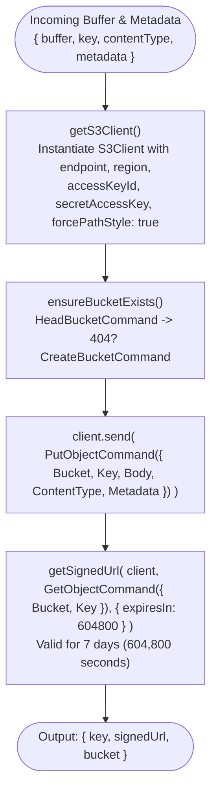

> 💡 **In Simple Words (What is happening in this graph?):**  
> When customers send paper order photos or audio notes, they cannot just sit temporarily in memory—they need to be saved in an **immutable digital filing cabinet**:  
> 1. **Cloud Connection:** Connects to the distributor's secure cloud storage (AWS S3 or MinIO).  
> 2. **Auto-Bucket Creation:** Checks that the storage bucket exists, and safely uploads the file with its audit details.  
> 3. **Secure 7-Day Link:** Creates a tamper-proof, private viewing link that expires after 7 days, allowing office staff and dispatch clerks to view the customer's original handwritten note whenever needed.

### 9.2 Storage Attributes Specification

| Variable | Type | Source / Default | Description |
| :--- | :--- | :--- | :--- |
| `AWS_ENDPOINT_URL_S3` | Env Var | Configured MinIO / AWS S3 endpoint | Object storage gateway URL |
| `AWS_ACCESS_KEY_ID` | Env Var | Credentials | S3 access key |
| `AWS_SECRET_ACCESS_KEY` | Env Var | Credentials | S3 secret access key |
| `AWS_REGION` | Env Var | `"ap-southeast-1"` | S3 region |
| `S3_BUCKET_NAME` | Env Var | `"order-uploads"` | Storage bucket for slips and voice notes |
| `expiresInSeconds` | Number | `604800` (7 Days) | TTL for presigned viewing links |

---

## 10. Complete Engine Cross-Component Dependency Matrix

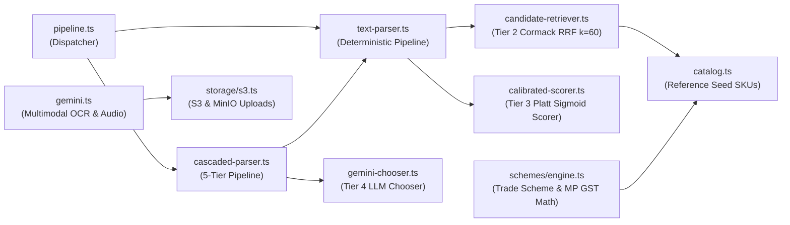

> 💡 **In Simple Words (What is happening in this graph?):**  
> This diagram shows how all the different parts of the engine work together like a **smoothly coordinated wholesale office team**:  
> - The **Dispatcher** receives the order and hands it to the **Cascaded Pipeline**.  
> - The **Text Parser** cleans up casual Hinglish text, extracting quantities and packaging units.  
> - The **Candidate Retriever** searches the catalog using spelling, keywords, and sound.  
> - The **Calibrated Scorer** applies strict commercial guardrails and calculates confidence.  
> - The **Gemini Chooser** steps in only if a tie-breaker is needed, without ever hallucinating.  
> - The **Trade Scheme Engine** calculates bulk discounts, free promotional cases, and MP GST.  
> - The **Multimodal & S3 Services** safely archive photos and voice notes.  
> Working together, the system converts informal Kirana messages into verified wholesale orders and Tally-ready invoices in milliseconds without crashes or guesswork.

---
*Documentation generated for IsoLabs Wholesale FMCG Order Engine (`@isolabs/order-engine`). All methods, attributes, variables, formulas, and layman explanations verified against source code and test suites.*
