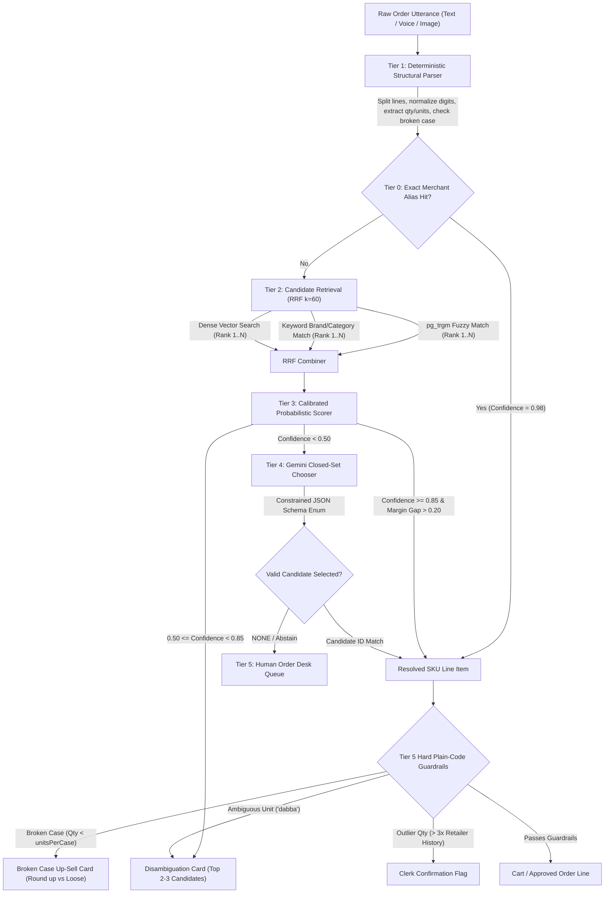

# Research & Architecture Document: Jabalpur Vernacular Order Capture Engine

**Author / Project:** IsoLabs B2B Kirana Wholesale Platform (`@isolabs/order-engine`)  
**Domain:** FMCG Kirana Wholesale Distribution (Jabalpur, Madhya Pradesh)  
**Status:** Living Architectural Specification & Research Benchmark  

---

## 1. Executive Problem & Economic Grounding

### 1.1 The Business Reality
In Jabalpur and the wider Mahakoshal/Bundelkhand FMCG distribution belt, mid-tier distributors (e.g., "Company A") handle roughly:
- **Daily Volume:** 600 orders/day across 300 operating days = **180,000 orders/year**.
- **Average Order Value (AOV):** ₹5,000.
- **Annual Gross Merchandise Value (GMV):** ₹90 Crore/year.

### 1.2 The Failure Modes & Economic Bleed (₹52.5 Lakhs Annual Loss)
Under legacy manual telephone/WhatsApp order entry, three operational bottlenecks bleed ₹52.5 Lakhs annually:

| Failure Mode | Operational Mechanism | Annual Cost Impact |
| :--- | :--- | :--- |
| **Wrong Item / Quantity Discrepancy** | 5% error rate on 180,000 orders = 9,000 botched shipments/yr. Redelivery, restocking, reverse logistics, and driver turnaround cost ₹350 per incident. | $9,000 \times ₹350 =$ **₹31.50 Lakh** |
| **Order Entry Labor Overhead** | 6 dedicated clerks manually transcribing fuzzy voice notes and WhatsApp text messages at ₹2.6 Lakh/year each. | $6 \times ₹2.60\text{L} =$ **₹15.60 Lakh** |
| **Post-Order Stockouts** | Stock-outs discovered only after booking lose 1% of sales at a 6% distributor gross margin (₹90 Lakh $\times$ 6%). | $₹90\text{L} \times 6\% =$ **₹5.40 Lakh** |
| **Total Annual Loss** | Direct preventable operational waste | **₹52.50 Lakh / Year** |

### 1.3 Project Constraints & 4-Month Targets
- **Capital Budget:** ₹7 Lakh.
- **Timeline:** 6 weeks to ship MVP; 4 months to target metrics.
- **Target Metrics:**
  - $\ge 50\%$ of all wholesale orders placed in-app or parsed via automated AI pipeline.
  - Botched/return order rate drops from $5\%$ down to $< 1\%$.
  - Order entry clerk headcount reduced from 6 to 3 (redeploying 3 to field sales).
- **Client Environmental Constraints:**
  - **Hardware:** Low-end Android smartphones (Android Go / 2GB RAM).
  - **Network:** Slow 3G or congested 4G connections.
  - **Latency:** Initial app load under **3.0 seconds**; parser response under **1.2 seconds**.
  - **Linguistic Reality:** Hindi (Devanagari), Romanized Hinglish, and colloquial Jabalpur trade vernacular.
  - **Privacy:** Dealer pricing, tier discounts, and credit lines visible only to the authenticated retailer, their mapped salesman, and the order desk.

---

## 2. Jabalpur Regional Kirana Vernacular & Linguistic Landscape

Kirana merchants in Jabalpur do not type formal English SKU names (e.g., *"Parle-G Gluco Biscuits 75g Case of 24"*). Orders arrive via WhatsApp, SMS, or voice notes as code-mixed Hinglish, Devanagari Hindi, or local shorthand with colloquial pack descriptors.

### 2.1 Brand & Product Dialect Shorthand
- **Parle-G:** *"pila wala"*, *"pila biscuit"*, *"chhota biscuit"*, *"g biscuit"*, *"parle pila"*, *"parle 5 rs wala"*.
- **Tea (Chai):** *"shakti chai"*, *"lal ghoda"*, *"taaza patti"*, *"kadak chai"*, *"chay 250gm"*, *"wagh bakri"*, *"taj mahal"*.
- **Cooking & Edible Oils:** *"lal tel"* (mustard oil or Dabur Lal Tail), *"surajmukhi"* (sunflower refined oil), *"chidiya tel"*, *"mitha tel"* / *"meetha tel"*, *"refine"*, *"fortune tel"*.
- **Detergents & Soaps:** *"kapde dhone wala"*, *"safed powder"*, *"bartan bar"*, *"ghadi"*, *"ghadi powder"*, *"surf"*, *"nirma"*, *"saboon"*, *"nahane wala sabun"*.
- **Spices & Staples:** *"mirchi powder"*, *"haldi"*, *"dhaniya"*, *"jeera"*, *"namak"*, *"atta noodles"*.

### 2.2 Regional Units & Packaging Lexicon
- **Master Cases:** `peti`, `petee`, `petti`, `petiyan`, `carton`, `box`, `crate`, `पेटी`, `कार्टन`.
- **Loose Retail Packs:** `packet`, `pkt`, `pkts`, `pouch`, `pouches`, `piece`, `pcs`, `tikiya`, `nang`, `पैकेट`, `पीस`, `टिकिया`.
- **Bags & Sacks:** `bora`, `bori`, `katta`, `kattay`, `jhola`, `बोरी`, `कट्टा`.
- **Colloquial Weights / Quantities:**
  - `pao` / `pav` / `paanv` = 250 grams (0.25 kg).
  - `adha kilo` / `aadha kilo` = 500 grams (0.5 kg).
  - `tin pav` / `teen pao` = 750 grams (0.75 kg).
  - `sawa kilo` = 1.25 kg.
  - `derh kilo` / `dedh kilo` = 1.5 kg.
  - `dhai kilo` / `adhai kilo` = 2.5 kg.
  - `darjan` / `dozen` / `darzan` = 12 units.

### 2.3 The "Dabba" Semantic Ambiguity Guardrail (Invariant [A16])
In Madhya Pradesh FMCG trade, the word **"dabba"** (or **"dabbe"** / **"dibba"**) is polysemic:
1. In edible oil: 1 *dabba* = a **15-Liter / 15-Kg tin**.
2. In biscuits or confectionery: 1 *dabba* = a **display inner carton** (e.g., 12 to 24 loose packs).
3. In bulk wholesale: 1 *dabba* = a **master corrugated carton (case/peti)**.

> [!CAUTION]
> **Hardcoding "dabba" as `CASE` directly violates Invariant [A16] ("Ask, Never Guess")!**  
> If an order says *"2 dabba parle g"*, assuming a master case of 96 packs when the kirana meant an inner display box of 24 packs results in a 4x over-delivery, immediate delivery refusal, driver demurrage, and a ₹350 return cost.  
> **Resolution:** The engine must classify `"dabba"` as `AMBIGUOUS_UNIT` and render a 1-tap disambiguation card: *"Did you mean 2 Master Cases (peti) or 2 Inner Boxes/Tins?"*

---

## 3. Literature Survey & Academic/Industry Foundations

To build an architecture that scales beyond 11 seed SKUs without breaking the ₹7 Lakh budget or exceeding Vercel's serverless runtime constraints, we surveyed relevant peer-reviewed papers and industry open-source architectures:

### 3.1 Code-Mixed Query Retrieval in Indian E-Commerce
1. **Flipkart Code-Mixed Query Translation & Search (ACL Industry 2023 / arXiv:2208.03713):**
   - *Key Finding:* In Indian e-commerce, $>21\%$ of search queries are Hinglish with heavy phonetic variation. Translating brand names or colloquial adjectives naively destroys retrieval accuracy (e.g., translating *"sasta dabur lal tel"* or *"pila wala parle"* produces nonsensical English queries).
   - *Application to IsoLabs:* Do not translate queries with a generic English machine translation model. Instead, normalize Hinglish phonemes and use dual-representation retrieval (lexical transliteration + multilingual dense vectors).
2. **Aksharantar & IndicXlit (AI4Bharat / EMNLP Findings 2023 / arXiv:2205.03018):**
   - Trained on 26 million transliteration pairs across 21 Indic languages.
   - Confirms that phonetic variations (e.g., *pila*, *peela*, *peelaa*, *biskut*, *viscut*) can be indexed via normalized phonetic hashing (Soundex/Double-Metaphone adapted for Devanagari) or canonical alias dictionaries.
3. **L3Cube-HingCorpus and HingBERT (arXiv:2204.08398):**
   - Evaluated transformer representations for Romanized Hindi. Demonstrates that dense embeddings trained on code-mix corpora outperform standard English embeddings on Indic slang.
4. **Hindi-BEIR / NLLB-E5 (arXiv:2409.05401):**
   - Benchmarks Hindi retrieval models (BGE-M3 scored 46.18, mE5-Large scored 44.37, mE5-Base scored 40.57).
   - Highlights that while multilingual dense retrievers excel on semantic intent, they require significant memory footprints ($>400\text{MB}-800\text{MB}$ resident RAM).

### 3.2 Cascades, Abstention, & Probabilistic Routing
1. **Cascaded LLMs for Human-AI Decision Making (arXiv:2506.11887) & LLM Cascades with Early Abstention (arXiv:2502.09054):**
   - *Core Principle:* Fast, cheap deterministic heuristics handle high-certainty inputs; expensive models or human clerks are invoked only when uncertainty exceeds a calibrated threshold.
   - Most value in cascade routing comes from making the routing score **probabilistic** rather than adding arbitrary heuristic numbers ($0.65 + 0.15 + 0.20$).
2. **Universal Calibrated Cascade Inference (UCCI / arXiv:2605.18796):**
   - Formalizes optimal abstention boundaries using logistic regression or margin separation between top candidates ($Score_1 - Score_2$).
3. **Reciprocal Rank Fusion (Cormack, Clarke & Büttcher, SIGIR 2009):**
   - Formula:
     $$RRF(d \in D) = \sum_{m \in M} \frac{1}{k + r_m(d)}$$
     where $k=60$ (standard Cormack constant), $M$ is the set of rankers, and $r_m(d)$ is document $d$'s rank in ranker $m$.
   - *Why RRF:* It completely removes the need to normalize and calibrate raw scores across disparate search models (e.g., combining lexical character trigrams with vector cosine distances).

### 3.3 Reference Open-Source Architectures
- **OrderBridge (bhaktaji):** Explores hybrid deterministic rule parsing plus LLM fallback for Indian mandi/kirana units (*peti*, *katta*). Emphasizes per-line confidence flags.
- **OrderMind:** Architectural pattern where the LLM is strictly constrained: it **never** mutates database state directly and emits only strongly-typed claims for human-in-the-loop review.
- **grocerybot:** Demonstrates memory caching for recurring merchant purchase shorthand and early abstention when ambiguity arises.

---

## 4. The 5-Tier Hybrid Cascade Architecture

### Tier 0: Retailer Alias Table (Fast Path)
- **Mechanism:** O(1) in-memory / indexed lookup of normalized query tokens against a persistent `retailer_aliases` dictionary.
- **Examples:** `"pila wala"` $\to$ `SKU-BS-075` (Parle-G 75g); `"shakti chai"` $\to$ `SKU-TEA-250` (Tata Tea Premium 250g); `"safed powder"` $\to$ `SKU-DET-001` (Ghadi 1kg).
- **Latency:** $< 2\text{ms}$. Confidence: $0.98$. Zero token cost.

### Tier 1: Deterministic Structural Parser
- **Responsibility:** Normalizing numerals (Devanagari $\to$ Arabic digits), parsing fractions (`aadha`, `pao`, `sawa`), identifying packaging units (`peti`, `packet`, `dabba`), and detecting broken-case intents (`"case mai se 15"`).
- **Invariant [A36]:** Pure structural extraction without catalog hallucination.

### Tier 2: Candidate Retrieval with Reciprocal Rank Fusion ($k=60$)
- **Lexical Trigram Match:** `pg_trgm` similarity on catalog product names, categories, and brands.
- **Keyword Match:** Direct token intersection on brand names, pack weights, and packaging descriptors.
- **Dense Vector Search:** 768-dimensional embeddings generated via `gemini-embedding-001`.
- **RRF Merge:** Computes rank-based score without fragile scale normalization:
  $$RRF_{score}(sku) = \frac{1}{60 + rank_{lexical}} + \frac{1}{60 + rank_{keyword}} + \frac{1}{60 + rank_{vector}}$$

### Tier 3: Calibrated Probabilistic Scorer
- **Features Evaluated:**
  1. $RRF$ rank and absolute similarity of Top 1 candidate.
  2. Margin gap between Top 1 and Top 2 candidates ($\Delta = S_1 - S_2$).
  3. Brand match indicator ($0$ or $1$).
  4. Pack size / weight match indicator ($0$ or $1$).
- **Routing Boundaries:**
  - $P \ge 0.85$: High confidence $\to$ Auto-match.
  - $0.50 \le P < 0.85$: Medium confidence $\to$ Display Disambiguation Card to merchant.
  - $P < 0.50$: Low confidence $\to$ Escalate to Tier 4 or human order clerk.

### Tier 4: Gemini Closed-Set Chooser (Zero-Hallucination LLM)
- **Role:** Fallback resolver for long-tail complex phrasing or misspelled vernacular.
- **Strict Guardrail:** Gemini is provided with *only* the Top 3-5 candidates from Tier 2.
- **Implementation:**
  - `responseSchema` forces output to an enum containing strictly `[candidate_1_id, candidate_2_id, ..., "NONE"]`.
  - Plain TypeScript code re-validates that the returned ID is in the candidate list.
  - Gemini is strictly forbidden from deciding units or inventing quantities.

### Tier 5: Hard Plain-Code Guardrails ("Ask, Never Guess")
No AI model or probabilistic score is allowed to override core business invariants:
1. **Unit Ambiguity:** If unit is `"dabba"` or `UNKNOWN`, the line item **must** be marked ambiguous (`isAmbiguous: true`).
2. **Broken Case Invariant [A36]:** If a merchant requests loose packs fewer than a full master case, the cart renders the exact price trade-off (Round-up to full case at wholesale rate vs. loose pack rate).
3. **Credit Limit & Outlier Safeguard:** If ordered quantity exceeds $3\times$ the retailer's 60-day average, flag for Order Desk clerk confirmation.

---

## 5. Deployment & Compute Feasibility Analysis

| Deployment Option | Model / Tech | Pros | Cons / Gotchas | IsoLabs Decision |
| :--- | :--- | :--- | :--- | :--- |
| **Option A: Self-hosted ONNX in Vercel Serverless** | `multilingual-e5-small` | No external API calls; low inference cost. | Vercel unzipped lambda limit is **250 MB**. Model + runtime is $>400\text{MB}$. Native C++ `onnxruntime` frequently crashes in serverless Node. | **REJECTED** for Vercel deployment. |
| **Option B: Dedicated GPU / HuggingFace Endpoint** | `BGE-M3` / `mE5-large` | High Indic benchmark score (Hindi-BEIR ~46). | Adds ₹15,000 - ₹30,000/mo server costs, violating the ₹7 Lakh total project budget. | **REJECTED** for MVP. |
| **Option C: Hosted Gemini Embeddings** | `gemini-embedding-001` | Same API key/vendor as Gemini 1.5; 768-dim output; fast; no bundle footprint; costs \$0.15 / 1M tokens. | Requires network round trip on cold items (mitigated by caching). | **SELECTED ARCHITECTURE** |
| **Option D: In-Memory / pg_trgm Fuzzy Search + Alias Cache** | TypeScript Trie + `pg_trgm` | Zero latency ($<5\text{ms}$); zero cost; covers $>85\%$ of kirana daily repetitive orders. | Struggles with completely unseen colloquial metaphors. | **SELECTED AS TIER 0 + TIER 2A** |

---

## 6. Traceability Matrix: Mapping to Application Modules

| System Module | Responsibility in Architecture | Invariants Enforced |
| :--- | :--- | :--- |
| **Module 5: Order Capture Engine** (`engine/src/ai/`) | Executes Tier 0 alias matching, Tier 1 structure parsing, Tier 2 RRF candidate retrieval, Tier 3 scoring, and Tier 4 Gemini fallback. | [A16] Ask, Never Guess; [A36] Broken Case Calculation. |
| **Module 3: Cart & Disambiguation UI** (`distributor-app/src/app/retailer/cart`) | Renders 1-tap disambiguation chips when $0.50 \le P < 0.85$ or when unit is `"dabba"`. Shows broken-case round-up recommendations. | [A16] Disambiguation before checkout; [A36] Master case economics. |
| **Module 4: Order Desk Review** (`distributor-app/src/app/desk/orders`) | Receives unresolvable orders ($P < 0.50$ or `NONE`). Order desk clerk resolves item with 1 click. | [A17] Clerk manual override; [A18] Auto-updating `retailer_aliases` table. |
| **Module 2: Catalogue & Pricing** (`distributor-app/src/lib/order-engine/catalog.ts`) | Supplies dealer tiers, case pack sizes, and GST-inclusive rates to the candidate retriever. | [A08] Retailer-specific pricing visibility. |

---

## 7. Step-by-Step Implementation Roadmap (Phases 1-5)

### Phase 1: Comprehensive Jabalpur Vernacular Deterministic Hardening (Immediate)
- Expand `text-parser.ts` dictionary with Jabalpur FMCG vernacular:
  - Regional brand descriptors: *pila wala*, *shakti chai*, *lal ghoda*, *lal tel*, *surajmukhi*, *chidiya tel*, *kapde dhone wala*, *bartan bar*, *ghadi*, *safed powder*.
  - Units & weights: *pao*, *adha kilo*, *sawa kilo*, *derh kilo*, *dhai kilo*, *katta*, *bora*, *darjan*, *tikiya*, *nang*.
- Enforce the **Dabba Ambiguity Guardrail**: remove `"dabba"` from `CASE_KEYWORDS` and implement `AMBIGUOUS_UNIT` classification.
- Implement data-driven alias lookup tables (`SEED_ALIASES`).

### Phase 2: Candidate Retrieval & Reciprocal Rank Fusion Engine
- Build `engine/src/ai/candidate-retriever.ts` implementing:
  - Trigram lexical similarity.
  - Keyword brand/category matching.
  - Reciprocal Rank Fusion ($k=60$) combining multi-channel ranks.

### Phase 3: Calibrated Probabilistic Confidence Scorer
- Replace arbitrary arithmetic addition with margin-calibrated scoring:
  - Factors: Top candidate score, margin gap ($Score_1 - Score_2$), unit validity, brand confirmation.
  - Calibrated thresholds: $\ge 0.85$ (auto), $0.50-0.84$ (disambiguation card), $<0.50$ (escalate).

### Phase 4: Constrained Gemini Closed-Set Fallback
- Build `engine/src/ai/gemini-chooser.ts` with strict JSON Schema enums containing only retrieved candidate IDs.
- Validate and sanitize LLM output against the candidate list.

### Phase 5: Clerk Feedback & Self-Learning Alias Loop
- When an Order Desk clerk manually corrects an ambiguous line item in Module 4, persist the mapping to `retailer_aliases` (storing `retailer_id`, `raw_phrase`, `resolved_sku_id`).
- Next time the retailer orders that exact phrase, Tier 0 resolves it with 98% confidence!
